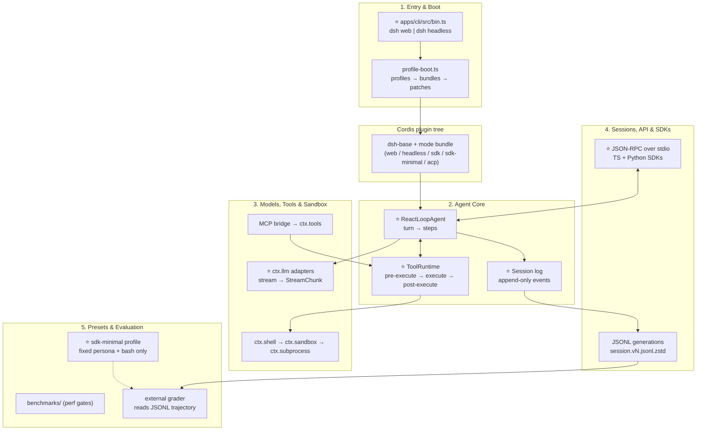
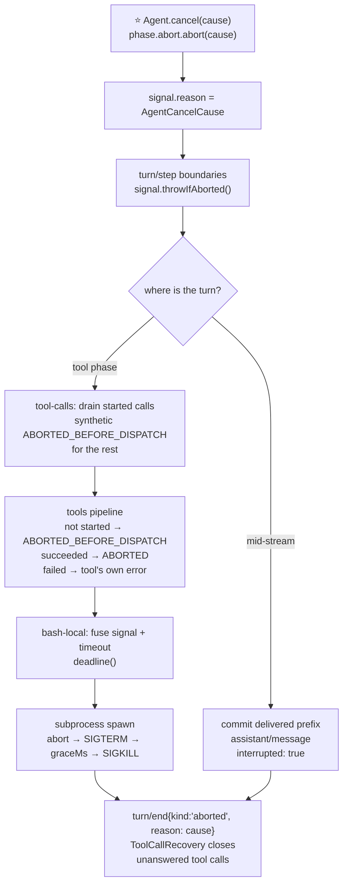
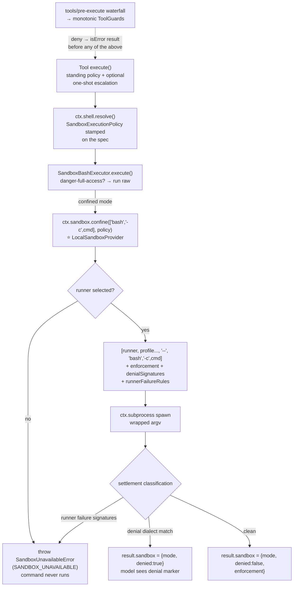
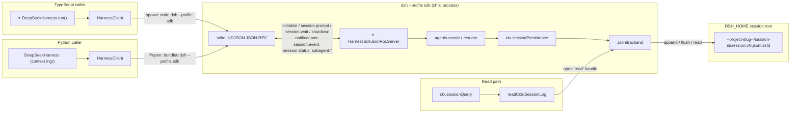
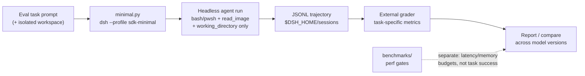
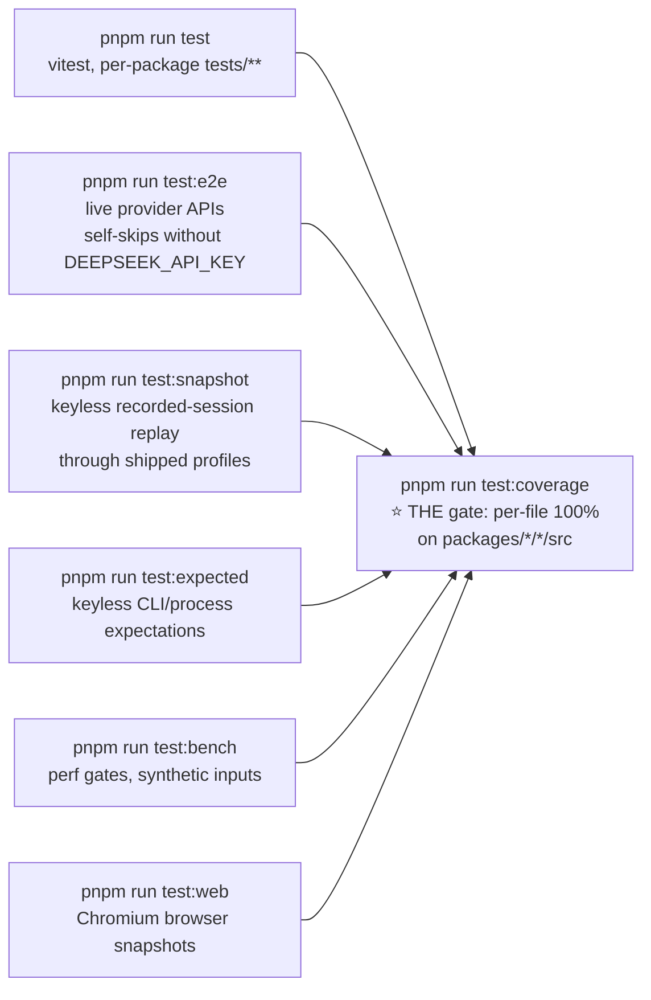
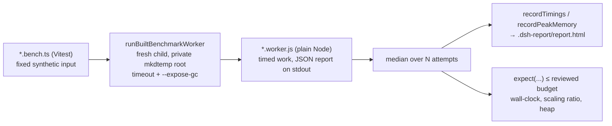

# DeepSeek Harness — Step-by-Step Study Guide

> **Repo:** [deepseek-ai/deepseek-harness](https://github.com/deepseek-ai/deepseek-harness) (`master` branch)
> **What it is:** An open-source agent harness ("everything is a plugin") built on [Cordis](https://github.com/cordiverse/cordis). It is also the evaluation rig DeepSeek uses internally for its own models.
> **Stack:** TypeScript monorepo (pnpm workspaces), Cordis plugin framework, with a Python SDK.
> **License:** MIT

## How to use this guide

Read top to bottom: it follows the real execution path — from the `dsh` command you type, through boot and plugin composition, into the agent loop, out to models and tools, down to the session log on disk, and finally to the SDK and evaluation pipeline. Each section is self-contained enough to study alone, but the order is deliberate.

- ⭐ marks **critical entry points** — start reading code here.
- Every code snippet has inline comments explaining each important line.
- Every file reference links directly to the upstream repo.
- Tick the `- [ ]` boxes as you complete each milestone.

**Suggested path:** start with the Cordis prerequisite (nothing else makes sense without it), skim the five subsystem overviews (30 min), then go deep in order, running the milestone exercises as you go.

## The big picture



**The one-sentence mental model:** `dsh` composes a Cordis plugin tree from YAML layers → the agent loop turns inbox messages into model requests → tools execute through guarded, sandboxable providers → every model-visible fact lands in an append-only session log → SDKs drive the whole thing over JSON-RPC, and the minimal profile doubles as a reproducible eval rig.

---
## Prerequisite: Cordis Core Framework Fundamentals

Before Chapter 1 makes sense, you need the framework the whole harness is built on. DeepSeek Harness is not a program with plugins — it **is** a Cordis plugin tree. The `dsh` launcher (Chapter 1) assembles the tree, but every behavior you will study — the agent loop, tools, sandbox, sessions — is just plugins registering services, listeners, and tools on a shared **Context**. The design principle: **composition is explicit and disposable** — every registration is tied to a plugin fiber's lifecycle, so unloading a plugin unwinds exactly what it contributed, and nothing leaks. Read this chapter once, carefully; everything after it assumes you know what `ctx`, `inject`, `effect`, and `waterfall` mean.

**Key files**
- ⭐ https://github.com/deepseek-ai/deepseek-harness/blob/master/vendor/cordis/src/context.ts — the `Context` class: service registry, `plugin()`, `effect()`, `extend()`
- ⭐ https://github.com/deepseek-ai/deepseek-harness/blob/master/vendor/cordis/src/service.ts — the `Service` base class: `super(ctx, name)` registers, fiber disposal unregisters
- ⭐ https://github.com/deepseek-ai/deepseek-harness/blob/master/vendor/cordis/src/events.ts — `waterfall()` implementation and the five dispatch modes (`emit`, `parallel`, `serial`, `bail`, `waterfall`)
- ⭐ https://github.com/deepseek-ai/deepseek-harness/blob/master/vendor/cordis/src/fiber.ts — plugin fiber lifecycle: `inject` resolution, activation, disposal
- https://github.com/deepseek-ai/deepseek-harness/blob/master/docs/cordis-primer.md — the canonical waterfall semantics and Loader configuration rules
- https://github.com/deepseek-ai/deepseek-harness/blob/master/packages/core/scope/src/index.ts — `createScope()`: the real-world example of fiber-scoped contexts
- https://github.com/deepseek-ai/deepseek-harness/blob/master/packages/ssh/sandbox-ssh/src/index.ts — `static inject = ['ssh']`: dependency injection in one line
- https://github.com/deepseek-ai/deepseek-harness/blob/master/packages/preset/persona/src/index.ts — `ctx.effect()` as the registration primitive
- https://github.com/deepseek-ai/deepseek-harness/blob/master/packages/shell/shell/src/index.ts — the canonical capability seam (Service Definition)

### The mental model: Context, services, fibers

A Cordis `Context` is a **service registry with a lifecycle**. Plugins don't call each other — they register named services on the context and consume them through it. When a plugin (a "fiber") unloads, everything it registered is removed. Three roles, never confused:

```ts
// vendor/cordis/src/service.ts — the Service base class.
// A service registers itself on construction and unregisters on fiber disposal.
export abstract class Service<out T = never> {
  constructor(protected ctx: Context, name: string) {
    name ??= this.constructor['provide'] as string   // name defaults to the static `provide` field
    // ...
    self.ctx.reflect.provide(name, self, this[symbols.check])  // ⭐ registered NOW,
    return self                                         // unregistered when the owning fiber unloads
  }
}
```

- **Service Definition** — the abstract class naming the capability (`ShellExecutor`, `SandboxProvider`, `LlmAdapter`). It declares the contract and nothing else.
- **Provider** — the concrete implementation that mounts under that name (`bash-local`, `sandbox-ssh`, `DeepSeekAdapter`). Exactly one provider per name per composition (a second throws — see Chapter 1's service-driven activation).
- **Consumer** — any plugin that *uses* the service through `ctx` (`tool-bash` calls `ctx.shell`, the loop calls `ctx.llm`). Consumers never name a provider, only the definition — that is why swapping `sandbox-local` for `sandbox-ssh` moves execution to a remote host with zero consumer changes (Chapter 3).

### The fiber lifecycle: registrations live and die with the plugin

The harness's hardest rule: **every contribution goes through `ctx.effect()` / `ctx.on()`**, and each returns a disposer tied to the current fiber. `createScope` (Chapter 2) is the clearest real example:

```ts
// packages/core/scope/src/index.ts — minting a per-agent registration world.
export function createScope(ctx: Context, key: ScopeKey, options?: CreateScopeOptions): Scope {
  if (options?.parent !== undefined) bindScopeParent(key, options.parent)  // one parent link, cycle-rejected
  const fiber = ctx.plugin(scope)                       // ⭐ a fiber: a live plugin instance
  const scoped: Context = fiber.ctx.extend({ [kScope]: key })  // child context, tagged with the scope key
  return {
    ctx: scoped,                                        // registrations through this ctx are agent-local
    rawDispose: fiber.dispose,                          // disposing the fiber unwinds EVERYTHING it registered
    dispose: () => (disposing ??= quiesceFiber(fiber)), // idempotent: racing disposals share one completion
  }
}
```

`ctx.effect(fn)` runs `fn` now and registers its return value as the teardown; `ctx.on(event, cb)` registers a listener and returns an unregister function. The persona plugin shows the minimal shape:

```ts
// packages/preset/persona/src/index.ts — a plugin's entire contribution is effects.
export function apply(ctx: Context, config: Config): void {
  ctx.effect(() => ctx.systemPrompt.section({          // register the prompt section…
    name: PERSONA_PREFIX_SECTION, text: config.prefix,
    ...(config.complete ? { complete: true } : {}),    // complete:true ⇒ this text IS the whole system prompt
  }), 'persona.section()')                             // …and the returned disposer removes it on unload
}
```

If you ever find yourself registering something without an effect, you have a leak: it will survive the plugin's unload.

### Dependency injection: the `inject` array

A plugin declares the services it needs; the fiber stays **pending** until they exist (this is the `pending` entry with named missing services you debug in Chapter 1). For class plugins it's a static field; for function plugins it's an exported `inject`:

```ts
// packages/ssh/sandbox-ssh/src/index.ts — one line declares the dependency.
export class SshSandboxProvider extends SandboxProvider {
  static inject = ['ssh']   // ⭐ do not construct until ctx.ssh exists; fail-loud if it never does
  override async confine(argv, policy, signal?): Promise<ConfinedArgv> {
    // this.ctx.ssh is now guaranteed present — no null checks, no lazy lookup
    const confined = await this.ctx.ssh.request('sandbox', { argv, policy }, factsSchema, signal)
    // ...
  }
}
```

Resolution order matters: injections activate **before** the plugin's config is interpolated and before `apply` runs, so `ctx.<service>` inside `apply` is safe. Reserve `ctx.<name>` for declared injections — for optional services use `ctx.get(name)`, which reads the global store instead of the topology-sensitive property proxy (repo rule, `packages/AGENTS.md`).

### The waterfall pattern: around-middleware you can veto

`ctx.waterfall` is how the harness stays extensible without editing core packages. The implementation is ten lines — read them once and the whole event system clicks:

```ts
// vendor/cordis/src/events.ts — the entire waterfall mechanic.
waterfall(...args: any[]) {
  const cbs = this.dispatch('waterfall', args)  // listeners, outermost-first
  const inner = args.pop()                      // the LAST arg is the built-in behavior ("next")
  const next = () => {
    const cb = cbs.shift() ?? inner             // each next() consumes the next listener…
    return cb(...args)                          // …until none remain, then the built-in runs
  }
  args.push(next)                               // every listener receives (...args, next)
  return next()
}
```

The contract (`docs/cordis-primer.md`): a listener receives `(...args, next)`; call `next()` to delegate (possibly with a wrapped result); **return without calling `next()` to short-circuit** — the rest of the chain, including the built-in behavior, never runs. Values propagate through `next()`'s return value, so a listener can also *replace* the result downstream listeners see.

A real listener, from the harness's own codebase:

```ts
// packages/experimental/auto-review/src/index.ts — a tools/pre-execute policy listener.
const stopListener = ctx.on('tools/pre-execute', async (exec, next): Promise<PreToolDecision> => {
  const agent = exec.agent
  if (agent === undefined || (exec.parent === undefined && exec.name === RUN_CODE_NAME)) {
    return next()                        // not our case: delegate down the chain
  }
  if (permissionPresets.current(agent.session) !== AUTO_PRESET) {
    return next()                        // wrong mode: delegate
  }
  if (!accepting || lifecycle.signal.aborted) {
    return { kind: 'cancel' }             // ⭐ our decision: return WITHOUT next() → short-circuit
  }
  // ... falls through to next() for the allow path
})
```

The standard waterfall extension points you will meet in every chapter: `llm/stream` (observe/rewrite model chunks), `agent/pre-step` (reject a step or replace its messages), `agent/request` (replace the frozen call config), `agent/request-error` (return `{kind:'retry'}`), `tools/pre-execute` → `tools/execute` → `tools/post-execute` (the tool pipeline), `system-prompt/assemble` (transform prompt + tools as one unit). Listeners run in **registration order** (outermost-first); use `prepend: true` only when a listener must run before ordinary registrations.

### The capability seam, stated once

You saw the pieces; here is the pattern the repo's own glossary demands: **a capability seam is Definition + Provider + Consumer, complete, never one role alone.** The shell execution seam is the template:

```ts
// packages/shell/shell/src/index.ts — the Definition: what "execute a command" means.
export abstract class ShellExecutor extends Service {
  // Request/spec split (repo rule: "explicit > implicit at package boundaries"):
  // resolve() fills defaults OUTSIDE run(), never hidden inside.
  abstract resolve(request: ShellExecRequest): ShellExecSpec
  abstract execute(spec: ShellExecSpec): Promise<ShellExecution>
}
```

Provider: `bash-local` (or `bash-sandbox`, or the SSH variants) mounts *one* implementation. Consumer: `tool-bash` calls `ctx.shell.resolve()` / `ctx.shell.execute()` and never knows which provider is mounted. To change *where* or *how* a capability works, you swap the provider — if you find yourself branching on "local vs remote" inside a consumer, the seam is wrong.

### Where Cordis itself lives

Cordis is **vendored**, not an npm dependency: `vendor/cordis/` is a pinned source copy (`vendor/README.md` logs the upstream SHA and local modifications). Read order when you want the framework truth: `vendor/cordis/src/context.ts` (registry, `plugin`, `effect`, `extend`), `vendor/cordis/src/service.ts` (provide/inject), `vendor/cordis/src/fiber.ts` (lifecycle, dependency gating), `vendor/cordis/src/events.ts` (all five dispatch modes). The Loader that turns `cordis.yml` rows into fibers is `vendor/loader/`.

### How it fits together

```mermaid
flowchart TB
    subgraph CTX["Context (service registry)"]
        REG["reflect.provide(name, service)<br/>exactly one provider per name"]
    end
    subgraph FIBER["Plugin fiber (lifecycle)"]
        INJ["inject: ['ssh', ...]<br/>pending until deps exist"]
        EFF["ctx.effect / ctx.on<br/>returns disposers"]
        FIBER --> INJ --> EFF
    end
    subgraph ROLES["Capability seam"]
        DEF["Definition<br/>abstract Service"]
        PROV["Provider<br/>concrete, mounted"]
        CONS["Consumer<br/>uses ctx.&lt;name&gt;"]
        DEF --> PROV
        PROV -.->|"ctx.shell"| CONS
    end
    subgraph WF["Waterfall event"]
        L1["listener 1<br/>next()?"]
        L2["listener 2<br/>next()?"]
        IN["built-in behavior"]
        L1 --> L2 --> IN
    end
    FIBER -->|"registers on"| CTX
    CTX --> ROLES
    CONS -->|"extends via"| WF
```

### Learning milestones

- [ ] Read `vendor/cordis/src/events.ts` `waterfall()` (10 lines) and explain in your own words what happens when a listener returns without calling `next()`
- [ ] Find three `static inject` declarations in `packages/` and for each, name what breaks (which `pending` entry appears) if the injected service never mounts
- [ ] Write a throwaway plugin that registers a `tools/pre-execute` listener which logs every tool name and always calls `next()`; confirm the agent still works unchanged
- [ ] Modify it to *deny* one tool by name (return a denial without `next()`); observe the denial surface as an `isError` tool result
- [ ] Call `ctx.plugin()` twice with the same function plugin and dispose one fiber; verify the other's registrations survive
- [ ] Explain the difference between `ctx.emit`, `ctx.serial`, and `ctx.waterfall` — when would you choose each for a new event?
- [ ] Trace how `scopeTarget()` in `packages/core/scope/src/index.ts` filters event delivery using the `[CordisContext.filter]` symbol

### Pitfalls & design decisions

1. **Unregistered work is a leak.** Every listener, service, tool, and prompt section must be created inside `ctx.effect()`/`ctx.on()` (or a Service constructor). Anything else survives fiber disposal and corrupts the next mount — the HMR-safety test exists specifically to catch this.
2. **Short-circuit is a decision, not an optimization.** In a waterfall, returning without `next()` *vetoes* the built-in behavior. Only do it when your listener owns the decision (policy, rejection); observers and annotators must always delegate.
3. **`inject` is fail-loud by design.** A missing dependency shows as a `pending` fiber with the missing service named — read that name first when debugging a hung boot (Chapter 1). Never work around it with `ctx.get` + null checks for a service your plugin cannot function without.
4. **One provider per service name.** Mounting a second provider for the same name throws. Capability *choice* happens at composition time (which provider row is in the profile), never at runtime branching in consumers.
5. **Listener order is registration order.** `prepend: true` is for must-run-first policy; reaching for it to fix an ordering bug usually means the event's contract is wrong — reconsider the design before prepending.

---
## 1. Entry Points, Boot & Plugin Composition

This subsystem turns a shell command (`dsh web`, `dsh --profile headless "task"`) into a running Cordis application. The design principle is **composition as data**: a profile is not code but an ordered stack of YAML patch layers — bundle patches (from npm packages declaring `dsh.bundle.patch`), the profile's own `cordis.patch.yml`, the machine-wide `$DSH_HOME/cordis.patch.yml`, and `--patch` CLI overlays — flattened over an empty `cordis.yml` root and mounted by the Cordis Loader. The launcher (`apps/cli`) owns almost nothing: it resolves the profile name, assembles the patch stack, and hands everything else to the booted tree. Understanding this layering is what lets you add a new surface (e.g. a new profile), change what a profile mounts, or debug why a plugin row is missing at runtime.

### Key files

- ⭐ `apps/cli/src/bin.ts` — https://github.com/deepseek-ai/deepseek-harness/blob/master/apps/cli/src/bin.ts — the `dsh` process entry; dispatches to profile/plugin/dump modes.
- `apps/cli/src/args.ts` — https://github.com/deepseek-ai/deepseek-harness/blob/master/apps/cli/src/args.ts — commander adapter; launcher parses only its own flags.
- ⭐ `apps/cli/src/profile-boot.ts` — https://github.com/deepseek-ai/deepseek-harness/blob/master/apps/cli/src/profile-boot.ts — profile resolution, patch-stack composition, shutdown wiring.
- ⭐ `packages/boot/app-boot/src/index.ts` — https://github.com/deepseek-ai/deepseek-harness/blob/master/packages/boot/app-boot/src/index.ts — `boot()`, `mountRootInclude()`, patch loading, fail-loud guards, hot recomposition.
- `packages/boot/app-boot/src/profile.ts` — https://github.com/deepseek-ai/deepseek-harness/blob/master/packages/boot/app-boot/src/profile.ts — `PROFILE_TEMPLATES`, `loadProfile`, `initProfile`, profile-dir layout.
- `packages/boot/app-boot/src/profile-context.ts` — https://github.com/deepseek-ai/deepseek-harness/blob/master/packages/boot/app-boot/src/profile-context.ts — `readProfilePatches()`: the exact layer-application order.
- `packages/boot/cmdline/src/index.ts` — https://github.com/deepseek-ai/deepseek-harness/blob/master/packages/boot/cmdline/src/index.ts — `cmdlineArgs`/`appExit` services; how apps own their flags.
- `packages/boot/plugin-manager/src/index.ts` — https://github.com/deepseek-ai/deepseek-harness/blob/master/packages/boot/plugin-manager/src/index.ts — (auxiliary) `dsh plugin` operations on the current profile.
- `packages/boot/hmr/src/index.ts` — https://github.com/deepseek-ai/deepseek-harness/blob/master/packages/boot/hmr/src/index.ts — (auxiliary) coordinates config/module reloads.
- ⭐ `packages/bundle/base/cordis.patch.yml` — https://github.com/deepseek-ai/deepseek-harness/blob/master/packages/bundle/base/cordis.patch.yml — the shared core layer every base-backed profile patches over.
- `packages/bundle/headless/cordis.patch.yml` — https://github.com/deepseek-ai/deepseek-harness/blob/master/packages/bundle/headless/cordis.patch.yml — one-shot task layer over base.
- `packages/bundle/web-app/cordis.patch.yml` — https://github.com/deepseek-ai/deepseek-harness/blob/master/packages/bundle/web-app/cordis.patch.yml — browser-app layer over base.
- `packages/bundle/sdk-app/cordis.patch.yml` — https://github.com/deepseek-ai/deepseek-harness/blob/master/packages/bundle/sdk-app/cordis.patch.yml — SDK JSON-RPC stdio layer over base.
- `packages/bundle/sdk-minimal/cordis.patch.yml` — https://github.com/deepseek-ai/deepseek-harness/blob/master/packages/bundle/sdk-minimal/cordis.patch.yml — standalone tree (the only profile not built on base).
- `packages/bundle/acp-app/cordis.patch.yml` — https://github.com/deepseek-ai/deepseek-harness/blob/master/packages/bundle/acp-app/cordis.patch.yml — automation-only ACP stdio layer over base.
- `apps/cli/composition.md` — https://github.com/deepseek-ai/deepseek-harness/blob/master/apps/cli/composition.md — generated graph of the exact composition each shipped profile uses.

### `apps/cli/src/bin.ts` — process entry and mode dispatch (CORE ⭐)

```ts
export async function runCli(options: RunCliOptions = {}): Promise<void> {
  const version = getDshRuntimeVersion()                       // version string for --version
  const { manageDesktopProfile, ...profileOptions } = options  // split launcher-owned option out
  const invocation = parseDshArgs(process.argv.slice(2), version, manageDesktopProfile)
  // parseDshArgs returns a discriminated union: mode is 'profile' | 'plugin' | 'dump-config' | 'dump-config-schema'

  switch (invocation.mode) {
    case 'profile': {
      const { runProfile } = await import('./profile-boot.ts') // lazy: only loaded for the hot path
      try {
        await runProfile({
          environment: loadLayeredEnv('dsh'),                  // frozen .env snapshot (project layer, then home layer)
          profile: invocation.profile,                        // e.g. "web"
          fromDefaultProfile: invocation.fromDefaultProfile,   // optional template reset
          patchFiles: invocation.patches,                      // --patch overlays, argv order
          args: invocation.args,                               // inner app args, verbatim
          ...profileOptions,
        })
      } catch (error) {
        if (!(error instanceof StartupError)) throw error      // only StartupError gets the friendly report
        await reportStartupFailure(error, { home: resolveDshHome(), version, profile: invocation.profile })
        process.exit(1)
      }
      break
    }
    // 'plugin' forwards to pnpm; 'dump-config*' print the composed tree without booting
```

### `apps/cli/src/profile-boot.ts` — patch-stack composition (CORE ⭐)

The empty root every profile tree patches over — the whole composition is layers; there is no base config content:

```ts
/** The empty root entry list every profile tree patches over. */
const PROFILE_ROOT_CONFIG = `# dsh profile root — an empty entry list. The tree is composed as patches:
# each bundle in package.json's dsh.profile.bundles, then cordis.patch.yml, then any
# --patch overlays. Edit cordis.patch.yml, not this file.
[]
`
```

`prepareProfile` rewrites that root on **every** boot — deliberately, because the Loader's tree write-back can bake composed rows into the file and duplicate every bundle insert on the next boot:

```ts
export function prepareProfile(name: string, userLayer = true, fromDefaultProfile?: string): Profile {
  if (fromDefaultProfile !== undefined) initializeProfileFromDefault(name, fromDefaultProfile)
  const profile = loadProfile(NAME, name, INSTALL_ANCHOR, undefined, { userLayer })
  reportSkippedBundles(NAME, profile)                       // warn about bundles the install no longer ships
  writeFileSync(join(profile.dir, PROFILE_ROOT_FILENAME), PROFILE_ROOT_CONFIG) // always reset to []
  return profile
}
```

### `packages/boot/app-boot/src/profile-context.ts` — the layer order (CORE)

The single source of truth for "what wins over what". Later layers win per row:

```ts
export function readProfilePatches(binName: string, context: ProfileContext, initialProfile?: Profile): PatchOptions[] {
  const patches = structuredClone([
    ...readBundlePatches(binName, context, initialProfile),   // 1. bundles in dsh.profile.bundles order
    ...(initialProfile?.patches ?? loadOptionalPatches(binName, context.patchPath) ?? []), // 2. profile's cordis.patch.yml
    ...(loadOptionalPatches(binName, join(context.home, PROFILE_PATCH_FILENAME)) ?? []),   // 3. $DSH_HOME/cordis.patch.yml (all profiles)
    ...context.overlays,                                     // 4. --patch overlays, argv order
  ])
  const telemetryPatch = resolveTelemetryPatch(context.telemetryDisabledEnv, /* ... */)
  if (telemetryPatch !== undefined) patches.push(telemetryPatch) // 5. telemetry switch, always last
  return patches
}
```

A patch **replaces** the targeted row's whole `config` instead of merging — so a row that differs by mode does not live in base; each mode bundle restates its complete configuration.

### `packages/boot/app-boot/src/profile.ts` — shipped templates (CORE)

```ts
export const PROFILE_TEMPLATES: Record<string, ProfileTemplate> = {
  acp:    { bundles: ['@deepseek-ai/dsh-base', '@deepseek-ai/dsh-acp-app'] },
  web:    { bundles: ['@deepseek-ai/dsh-base', '@deepseek-ai/dsh-web-app'] },
  headless:{ bundles: ['@deepseek-ai/dsh-base', '@deepseek-ai/dsh-headless'] },
  sdk:    { bundles: ['@deepseek-ai/dsh-base', '@deepseek-ai/dsh-sdk-app'] },
  'sdk-minimal': { bundles: ['@deepseek-ai/dsh-sdk-minimal'] }, // standalone: no base layer
}
```

### Boot sequence

```mermaid
flowchart TD
    A["`dsh web` / `dsh --profile headless 'task'`"] --> B["bin.ts runCli()\nloadLayeredEnv → parseDshArgs\n'web' expands to --profile web"]
    B --> C{"invocation.mode"}
    C -->|profile| D["profile-boot.ts runProfile()\nproxy env, fail-loud guards,\nSIGTERM/SIGINT handlers"]
    C -->|plugin| P["plugin.ts → pnpm in profile dir"]
    C -->|dump-config| Q["print composed tree, no boot"]
    D --> E["prepareProfile()\nloadProfile / initProfile\nfrom PROFILE_TEMPLATES\nrewrite cordis.yml root to []"]
    E --> F["readProfilePatches()\nlayer order: bundles → profile\ncordis.patch.yml → $DSH_HOME/cordis.patch.yml\n→ --patch overlays → telemetry"]
    F --> G["boot(): new Cordis Context\nmountRootInclude pinned id='include'\nprovide profileContext, launch env"]
    G --> H["Loader mounts tree\nservice-driven activation\njudged by requiredStartupEntryIds"]
    H -->|all required ACTIVE| I["appReady.commit()\nheadless-runner adopts Agent,\nprints result, bounded shutdown"]
    H -->|failure| J["StartupError →\nreportStartupFailure → exit 1"]
```

### Presets vs profiles (read this once)

`packages/preset/` is an **orthogonal axis**: profiles decide *which plugins mount* (composition), presets declare *what an Agent can do* (tools, prompts, skills per Agent revision). You add a surface by editing bundles/profiles; you change agent behavior by editing presets. Don't mix the two.

### Learning milestones

- [ ] Run `dsh --profile web --dump-config` and `dsh --profile headless --dump-config`; diff the outputs and identify which rows come from `dsh-base` vs the mode bundle
- [ ] Trace `dsh headless "hi"` end to end: confirm the task text flows from inner argv into the headless runner
- [ ] Create a custom profile and add one row override in its `cordis.patch.yml`
- [ ] Add a `--patch` overlay that disables one base row and verify with `--dump-config` before booting
- [ ] Read `mountRootInclude` and explain why the root Include id is pinned to `'include'`
- [ ] Trigger a `StartupError` (e.g. point a row at a nonexistent module) and read the per-entry diagnostics

### Pitfalls and design decisions

1. **A patch replaces the whole row `config`; it never deep-merges.** Override a row and you must restate every key you still want.
2. **The root `cordis.yml` is rewritten to `[]` on every boot.** Never hand-edit it; edit `cordis.patch.yml` layers instead.
3. **Launcher flags must come first.** `dsh web --resume abc` works; `dsh --resume abc --profile web` fails — the first unrecognized token ends launcher parsing.
4. **Activation is service-driven, not order-driven.** A missing provider surfaces as a `pending` entry with named missing services — read those names first when debugging a hung boot.
5. **Core vs auxiliary:** core = `bin.ts`, `args.ts`, `profile-boot.ts`, `app-boot` (boot, patches, profiles), `dsh-cmdline`. Auxiliary = `plugin-manager`, `hmr`, `config-editor`, `dump-config`. Touch core to change *what boots*; auxiliary to change *how it's managed*.

---
### Source Code Reading Roadmap

Read the codebase in this order. Each stage builds on the previous one; the "focus" line tells you what to extract before moving on.

**Stage 1 — The shape of the thing (30 min, no code execution)**
1. `README.md` — https://github.com/deepseek-ai/deepseek-harness/blob/master/README.md — what the project claims to be
2. `docs/architecture.md` — https://github.com/deepseek-ai/deepseek-harness/blob/master/docs/architecture.md — the official mental model; read before touching `packages/`
3. `docs/glossary.md` — https://github.com/deepseek-ai/deepseek-harness/blob/master/docs/glossary.md — terms like "capability seam", "surface", "profile"
4. `apps/cli/composition.md` — https://github.com/deepseek-ai/deepseek-harness/blob/master/apps/cli/composition.md — the generated graph of what each profile actually mounts

*Focus: be able to draw the profile → bundles → patches → Cordis tree pipeline from memory.*

**Stage 2 — The loop (the 20% of code that explains 80% of behavior)**
5. ⭐ `packages/core/agent-loop/src/agent.ts` — https://github.com/deepseek-ai/deepseek-harness/blob/master/packages/core/agent-loop/src/agent.ts — `turn()` and `step()`; read slowly
6. `packages/core/session/src/index.ts` — https://github.com/deepseek-ai/deepseek-harness/blob/master/packages/core/session/src/index.ts — `Session.append()`; the commit point of all durable truth
7. ⭐ `packages/core/tools/src/index.ts` — https://github.com/deepseek-ai/deepseek-harness/blob/master/packages/core/tools/src/index.ts — the four-stage tool pipeline
8. `packages/core/agent/src/runtime-types.ts` — https://github.com/deepseek-ai/deepseek-harness/blob/master/packages/core/agent/src/runtime-types.ts — the `Agent` contract and `agent/*` events

*Focus: trace one `followup()` → `turn/start` → `step/start` → `assistant/message` → `turn/end` in your head.*

**Stage 3 — Voice and hands**
9. `packages/llm/llm/src/types.ts` + `packages/llm/llm/src/index.ts` — https://github.com/deepseek-ai/deepseek-harness/blob/master/packages/llm/llm/src/types.ts — `StreamChunk` protocol and the adapter seam
10. `packages/shell/tool-bash/src/index.ts` — https://github.com/deepseek-ai/deepseek-harness/blob/master/packages/shell/tool-bash/src/index.ts — the canonical guarded tool
11. `packages/sandbox/sandbox/src/index.ts` — https://github.com/deepseek-ai/deepseek-harness/blob/master/packages/sandbox/sandbox/src/index.ts — the confinement seam

*Focus: how a tool call becomes a spawned process, and where each seam lets you swap the implementation.*

**Stage 4 — Durability and remote control**
12. `packages/sdk/client/src/client.ts` + `packages/sdk/server/src/server.ts` — the JSON-RPC bridge
13. `packages/session/session-persistence-jsonl/src/storage.ts` — the append path
14. `packages/bundle/sdk-minimal/cordis.patch.yml` — https://github.com/deepseek-ai/deepseek-harness/blob/master/packages/bundle/sdk-minimal/cordis.patch.yml — the eval rig as pure data

*Focus: how an out-of-process caller drives the loop, and where every event lands on disk.*

**Stage 5 — Everything else (on demand)**
- `packages/subagent/` — only when you need delegation
- `packages/mcp/`, `packages/skill/` — only when you need external tools
- `packages/web/`, `packages/client/`, `packages/host/` — only when you need the GUI
- `packages/experimental/` — explicitly no product-support commitment; read last

**Core vs auxiliary (first-pass skip list):** core = `boot/`, `core/`, `llm/`, `shell/`, `subprocess/`, `sandbox/`, `session/`, `sdk/`, `bundle/`, `preset/`, `subagent/`. Auxiliary on first pass = `web/`, `client/`, `host/`, `computer-use/`, `browser-use/`, `lsp/`, `terminal/`, `compaction/`, `deliverables/`, `spill/`, `feedback/`, `identity/`, `schedule/`, `workflow/`, `todo/`, `plan/`, `goal/`, `experimental/`. The full group map lives in the repo `AGENTS.md`.

**Tracing `dsh headless "hello"` end to end:**
```text
apps/cli/src/bin.ts            runCli() → mode 'profile'
apps/cli/src/profile-boot.ts   runProfile() → prepareProfile('headless')
packages/boot/app-boot/src/profile-context.ts
                               readProfilePatches(): dsh-base + dsh-headless
                               + $DSH_HOME/cordis.patch.yml + --patch overlays
packages/boot/app-boot/src/index.ts
                               boot() → Cordis Context → Loader mounts tree
packages/bundle/headless/...  headless-runner plugin adopts the Agent
packages/core/agent-loop/src/agent.ts
                               followup("hello") → inbox → wakeDriver → turn()
                                 → preStep → system-prompt assemble
                                 → agent/request waterfall → ctx.llm.stream()
                                 → assistant/message committed
                                 → executeToolCalls (if any) → turn/end
packages/session/...           every append() above → JSONL under $DSH_HOME/sessions
```

### Learning milestones

- [ ] Without opening the repo, list the five patch layers in order and what each one is for
- [ ] Read `agent.ts` `turn()` once and explain when a turn ends vs when a step ends
- [ ] Name three files you can skip on first pass and say why
- [ ] Trace `dsh headless "hello"` through the file list above, naming the function that owns each handoff

### Pitfalls & design decisions

1. **Don't read alphabetically.** `packages/` is grouped by domain, not by importance — the roadmap order above follows the execution path, which is the only order that compounds.
2. **Docs are generated from code, not the reverse.** `docs/subsystems/*.md` and `apps/cli/composition.md` are generated artifacts; when they disagree with `src/`, trust `src/`.
3. **Skim `vendor/` once, then stop.** It's pinned Cordis source — you need its concepts (Context, Service, waterfall), not its internals, until you're debugging the framework itself.

### Local Development Environment & Debugging Guide

**Setup — from zero to a running local `dsh`:**

```sh
# 1. Prerequisites: Node ^22.19 or >=24, and pnpm
node --version   # must satisfy the engines range in package.json
corepack enable  # pnpm ships via corepack; or: npm i -g pnpm

# 2. Clone and install (pnpm workspaces; this takes a while)
git clone https://github.com/deepseek-ai/deepseek-harness.git
cd deepseek-harness
pnpm install

# 3. Build once (tsc emits lib/, tsdown bundles runtime)
pnpm run build

# 4. Run one headless task from source (needs DEEPSEEK_API_KEY)
export DEEPSEEK_API_KEY=...            # real-API calls; never commit this
pnpm dsh --profile headless "say hi"   # = node --import tsx/esm apps/cli/src/bin.ts
```

The `dsh` script runs the **TypeScript source directly** through tsx's ESM-only hook — modules it reaches must stay ESM (no CJS-only exports). You are debugging the real code, not a stale build. Use `pnpm run dev:web` / `dev:desktop` for the GUI surfaces (builds, then launches with rebuild on edit).

**Inspecting what actually booted:**

```sh
# Print the fully composed plugin tree for a profile and exit (no boot)
pnpm dsh --profile headless --dump-config
# Same, but only the profile's own patch (no bundles, no user layer)
pnpm dsh --profile headless --dump-config --dump-default-config
# JSON Schema for profile entries and patches (what keys each row accepts)
pnpm dsh --profile headless --dump-config-schema
```

`--dump-config` is the single most useful debugging flag: if a plugin row is missing at runtime, diff this output against your patch file before anything else.

**Diagnosing boot failures:**

1. A boot that hangs is usually a **service-driven activation stall**: some entry stays `pending` because a required service never mounted. The `StartupError` report names the missing services per entry — read those names first; they tell you exactly which provider row is absent or misconfigured.
2. A row pointing at a nonexistent module fails **loud at load** (`misconfiguration fails loud`) — check the per-entry diagnostics in the startup report.
3. If bundles behave unexpectedly, remember `prepareProfile` rewrites the root `cordis.yml` to `[]` on every boot — never hand-edit it; your change belongs in a `cordis.patch.yml` layer or a `--patch` overlay.
4. User-layer surprises: `$DSH_HOME/cordis.patch.yml` applies to **every** profile. When debugging, move it aside temporarily to get a clean tree.

**Attaching a debugger:**

```sh
# Node inspector on the CLI entry; attach Chrome DevTools or VS Code to the port
node --import tsx/esm --inspect-brk apps/cli/src/bin.ts --profile headless "say hi"
```

Because `pnpm dsh` is just `node --import tsx/esm apps/cli/src/bin.ts`, any Node inspector flag works. Set breakpoints in `packages/core/agent-loop/src/agent.ts` (`turn()`, `step()`) or `packages/core/session/src/index.ts` (`append()`) to watch a turn unfold. Source maps come from tsx; stepping lands in the `.ts` files you read.

**Useful gates before pushing** (from the repo `AGENTS.md`):

```sh
pnpm run typecheck   # strict: true, noImplicitAny — must be clean
pnpm run lint        # lint the change
pnpm run test        # unit tests for touched packages (CI owns the full matrix)
```

### Learning milestones

- [ ] From a clean clone, get `pnpm dsh --profile headless "say hi"` running against source (with a real or stubbed key path)
- [ ] Use `--dump-config` to find which bundle provides the `bash` tool row, and which layer could override it
- [ ] Deliberately break a patch row (bad module path) and read the resulting `StartupError` diagnostics
- [ ] Attach the inspector and break inside `Session.append()` during a headless run

### Pitfalls & design decisions

1. **Source launch ≠ built launch.** Tests and config subprocesses run built `lib/` under plain Node; the `dsh` CLI runs source via tsx. A bug that reproduces under one may not reproduce under the other — know which one you're debugging.
2. **Never `pnpm run test` the whole suite locally by default.** CI owns exhaustive coverage; run focused package tests for your change (`test:coverage` is the CI gate, per-file 100% on `packages/*/*/src`).
3. **Real-API tests self-skip without `DEEPSEEK_API_KEY`.** A green `test:e2e` with no key tested nothing — check for the skip notice.

---
## 2. Agent Core: Loop, Tools & Session Log

This subsystem is the beating heart of the harness: `dsh-agent` defines the public `Agent` handle and `agent/*` event vocabulary, `dsh-agent-loop` provides the one concrete driver (`ReactLoopAgent`) that turns inbox input into model requests → streamed responses → tool calls → logged results, `dsh-system-prompt` assembles what the model is told, `dsh-tools` runs the guarded tool pipeline, `dsh-session` records every model-visible fact in an append-only event log, and `dsh-scope` gives each agent an isolated registration world. The governing invariant: **model-visible ⟺ logged** — anything reaching a model request must be reconstructable from the session log. To modify loop behavior, you almost never edit `agent-loop`; you attach to its documented waterfall extension points (`agent/pre-step`, `agent/request`, `tools/pre-execute`, …).

### Key files

- ⭐ `packages/core/agent-loop/src/agent.ts` — https://github.com/deepseek-ai/deepseek-harness/blob/master/packages/core/agent-loop/src/agent.ts — the `ReactLoopAgent` driver: turn/step machine, prompt admission, request dispatch, cancellation
- `packages/core/agent-loop/src/tool-calls.ts` — https://github.com/deepseek-ai/deepseek-harness/blob/master/packages/core/agent-loop/src/tool-calls.ts — per-step tool scheduling: exclusive barriers + bounded parallel pool
- `packages/core/agent-loop/src/inbox.ts` — https://github.com/deepseek-ai/deepseek-harness/blob/master/packages/core/agent-loop/src/inbox.ts — durable inbox (`next-turn` / `next-step` pending lists, claim semantics)
- `packages/core/agent/src/runtime-types.ts` — https://github.com/deepseek-ai/deepseek-harness/blob/master/packages/core/agent/src/runtime-types.ts — the public `Agent` interface + full `agent/*` event declarations
- `packages/core/agent/src/index.ts` — https://github.com/deepseek-ai/deepseek-harness/blob/master/packages/core/agent/src/index.ts — `AgentRegistry`, factory slot, initiator scope
- `packages/core/system-prompt/src/index.ts` — https://github.com/deepseek-ai/deepseek-harness/blob/master/packages/core/system-prompt/src/index.ts — `SystemPrompt.assemble()`: sections, variables, tool schemas, waterfall
- ⭐ `packages/core/tools/src/index.ts` — https://github.com/deepseek-ai/deepseek-harness/blob/master/packages/core/tools/src/index.ts — `ToolRuntime`: registry + the `tools/pre-execute → execute → post-execute → result` pipeline
- `packages/core/tools/src/types.ts` — https://github.com/deepseek-ai/deepseek-harness/blob/master/packages/core/tools/src/types.ts — `ToolDefinition`, execution/result/guard types
- ⭐ `packages/core/session/src/index.ts` — https://github.com/deepseek-ai/deepseek-harness/blob/master/packages/core/session/src/index.ts — `Session.append()`: validation, freezing, commit, fan-out
- `packages/core/session/src/types.ts` — https://github.com/deepseek-ai/deepseek-harness/blob/master/packages/core/session/src/types.ts — `SessionEventMap` (turn/step/tool/assistant events), `TurnEndReason`
- `packages/core/scope/src/index.ts` — https://github.com/deepseek-ai/deepseek-harness/blob/master/packages/core/scope/src/index.ts — `createScope`, scope-targeted event routing
- `docs/subsystems/core.md` — https://github.com/deepseek-ai/deepseek-harness/blob/master/docs/subsystems/core.md — generated loop map + service API reference

### 2.1 The `Agent` contract — `packages/core/agent/src/runtime-types.ts` (core)

The public surface. Note the driver lives elsewhere (`dsh-agent-loop` registers as the factory); consumers depend on this package only.

```ts
// Four ways to feed one agent. The target selects the inbox boundary;
// wakeup decides whether the driver starts. ⭐ entry points for all input.
send(message: UserMessage, target: InboxTarget, wakeup: boolean): void
followup(message: UserMessage): void  // next-turn prompt + wake driver (ordinary user turn)
steer(message: UserMessage): void     // next-step input; consumed at nearest step boundary
inject(message: UserMessage): void    // model-facing context, does NOT wake the driver

// Cooperative cancellation: aborts the active turn; keepInbox preserves queued work.
cancel(cause: AgentCancelCause, options?: CancelOptions): void
// Resolves when the whole agent reaches quiescence (no driver/maintenance left).
whenIdle(): Promise<void>
```

`agent/*` events (scope-filtered per agent): `agent/pre-step` (waterfall — reject a step or replace its messages), `agent/request` (waterfall — replace frozen call config), `agent/request-error` (waterfall — return `{kind:'retry'}` to retry), `agent/turn-stopping` (serial — steer to keep the turn open), `agent/assistant-stream` (emit — transient UI frames), `agent/status|created|disposed`, `agent/inbox/*`.

### 2.2 The loop driver — `packages/core/agent-loop/src/agent.ts` (core ⭐)

`ReactLoopAgent` owns one session for its lifetime. `wakeDriver()` latches a `running` phase and runs `kick()` → `turn()` until the inbox drains. Each turn: `turn/start` → steps → `turn/end`.

```ts
private async turn(): Promise<boolean> {
  // ... every turn opens a durable boundary FIRST, before any model work
  this.session.append('turn/start', { turn })
  let target: InboxTarget = 'next-turn'   // first step consumes one queued turn + next-step input
  try {
    while (true) {
      signal.throwIfAborted()             // cancellation is cooperative: checked at boundaries
      const decision = await this.preStep(target, { turn, step })  // claim inbox + assemble prompt + agent/pre-step waterfall
      if (decision.kind === 'reject') { turnEnds = { kind: 'blocked' }; return false }
      // ...
      this.session.append('step/start', { turn, step })  // durable step boundary
      const stepEnd = await this.step(decision)          // ⭐ one model request + tool execution
      // ... on step failure: ToolCallRecovery appends recovery results for
      //     unanswered calls so later requests replay paired history
      this.session.append('step/end', { turn, step })
      signal.throwIfAborted()
      if (turnEnds && this.inbox.nextStep.length === 0) break  // turn ends only when model stops AND inbox drains
      target = 'next-step'                // later steps in the same turn take step-scoped input only
    }
  } finally {
    this.session.append('turn/end', { turn, reason: turnEnds! })  // completed | max-tokens | blocked | aborted | error
  }
}
```

Inside `step()`: prompt admission commits `system/message` + `user/message` events, `buildRequest()` logs `request/header` and freezes `deriveMessages()`, then the stream runs — and a **cancelled stream commits the delivered prefix** so replay matches what the user saw:

```ts
const stream = preparedCall?.stream(request) ?? this.loopCtx.llm.stream(request)
live.start()                              // process-local frames only; durable commit happens at settle
for await (const chunk of stream) {
  signal.throwIfAborted()                 // abort mid-stream → catch below commits delivered text
  live.push(chunk)
}
// No tool calls in the message → step returns { kind: 'completed' }; otherwise:
const { concluded } = await executeToolCalls(this.loopCtx, turn, step, toolCalls, signal,
  context => this.inbox.splice('next-step', this.inbox.nextStep.length, 0, [context]))
```

Tool scheduling (`tool-calls.ts`) — exclusive calls are ordering barriers; parallel-safe calls share a bounded rolling pool; **results commit in model order** even though dispatch overlaps:

```ts
while (next < planned.length) {
  const first = planned[next]!
  const mode = ctx.tools.executionMode(first.exec).kind  // re-read per group: registry changes can create barriers
  const group = mode === 'parallel' ? planned.slice(next) : [first]  // exclusive ⇒ barrier of one
  const outcome = await runGroup(ctx, turn, step, group, mode, signal, acceptContext)
  next += outcome.consumed
  if (outcome.aborted) {
    // every skipped call gets a synthetic ABORTED_BEFORE_DISPATCH error result: replay stays valid
    for (const call of planned.slice(next)) appendSkippedToolCall(session, turn, step, call.block)
    return { concluded }
  }
}
```

Auxiliary in this package: `assistant-stream.ts` (transient UI frames — never the replay source), `inbox.ts` (durable claim semantics), `runtime-context.ts` (runtime-fact projection).

### 2.3 Prompt assembly — `packages/core/system-prompt/src/index.ts` (core)

One `assemble()` merges the global layer with the agent's scope layer (scoped contributions shadow globals), canonicalizes tool order, then runs the scope-filtered `system-prompt/assemble` waterfall:

```ts
async assemble(context: AssembleContext = {}): Promise<PromptAssembly> {
  const scopeLayers = this.layers.chainLayers(scope)       // nearest scope wins
  const sectionByName = this.layers.merge(scope, layer => layer.sections)  // scoped shadows global, by name
  // ... tool schemas collected per assembly from registered providers (ToolRuntime self-registers)
  const assembly: PromptAssembly = {
    sections,                                              // ordered prompt sections; ONE complete:true section ⇒ exact prompt
    contexts: [...],                                       // dynamic runtime facts → user-role snapshots in history
    tools: orderTools(collected, this.toolOrder, knownNames),  // model-facing tool order is deterministic
    variables,                                             // {{name}} interpolation at renderPrompt()
  }
  // ⭐ the extension point: listeners may transform the final assembly (prompt + tools as one unit)
  const transformed = await this.ctx.waterfall(
    scopeTarget(this, scope), 'system-prompt/assemble', assembly, context,
    () => Promise.resolve(assembly),
  )
}
```

### 2.4 Tool execution pipeline — `packages/core/tools/src/index.ts` (core ⭐)

Every call runs one fixed pipeline. Waterfall stages delegate via `next()`; the monotonic guard stage after `tools/pre-execute` can only deny, never re-allow:

```ts
// Stage 1 — policy: extensible allow/deny/ask, then registered monotonic guards
const gate = await this.ctx.waterfall(
  carrier, 'tools/pre-execute', exec,
  () => Promise.resolve<PreToolDecision>({ kind: 'allow' }),  // default allow; a listener that skips next() short-circuits
)
const askResolution = gate.kind === 'ask' ? await this.serviceAsk(exec, gate) : { decision: gate, ... }
const denialReason = decision.kind === 'allow' ? this.guardReason(exec) : decision.reason
// → denial becomes a normal isError result; the turn does NOT end

// Stage 2 — around-dispatch wrappers (timeouts, retries live here)
const result = await this.ctx.waterfall(
  carrier, 'tools/execute', mutableExec,
  () => this.dispatchToolBody(mutableExec),  // resolves tool, validates args, runs body with fused abort signal
)

// Stage 3 — post-execute: inspect/replace result; block turns it into an isError with corrective feedback
// Stage 4 — finalizeContent (tool-owned last transform), materialize, then observe-only tools/result
```

Cancellation semantics (memorize these): abort **before** body invocation → `ABORTED_BEFORE_DISPATCH`; abort **after** → only a successful outcome is replaced with `ABORTED` (a failure stays the more specific error). Unknown tools and throwing bodies become structured error results — the turn continues; only loop-machinery failures close the turn.

### 2.5 AbortSignal & Cooperative Cancellation Deep Dive

Every cancellation in the harness is one `AbortSignal` flowing downhill: `Agent.cancel()` aborts the driver's phase controller, and each layer — turn loop, LLM stream, tool scheduler, tool pipeline, shell executor, subprocess — reacts to that same signal cooperatively. Nothing is ever force-killed in-process; the signal is *observed* at boundaries, and every in-flight unit of work settles into a durable, replayable log state before the turn closes. The whole chain is `AbortSignal`-typed end to end, so a custom tool, a wrapper, or a subprocess provider plugs into cancellation by honoring one interface.

### Key files

- ⭐ `packages/core/agent/src/runtime-types.ts` — https://github.com/deepseek-ai/deepseek-harness/blob/master/packages/core/agent/src/runtime-types.ts — `Agent.cancel(cause, options)`: the public entry; first cause wins, no-op when idle
- ⭐ `packages/core/agent-loop/src/agent.ts` — https://github.com/deepseek-ai/deepseek-harness/blob/master/packages/core/agent-loop/src/agent.ts — the phase-owned `AbortController`; `throwIfAborted()` at every boundary; mid-stream `interrupted: true` commit
- `packages/core/agent-loop/src/tool-calls.ts` — https://github.com/deepseek-ai/deepseek-harness/blob/master/packages/core/agent-loop/src/tool-calls.ts — synthetic `ABORTED_BEFORE_DISPATCH` results for undispatched calls
- ⭐ `packages/core/tools/src/index.ts` — https://github.com/deepseek-ai/deepseek-harness/blob/master/packages/core/tools/src/index.ts — abort-before-dispatch vs abort-after-dispatch; caller/wrapper signal fusion; the tool-author cancellation contract
- `packages/shell/bash-local/src/index.ts` — https://github.com/deepseek-ai/deepseek-harness/blob/master/packages/shell/bash-local/src/index.ts — fuses `exec.signal` with the command timeout into one spawn signal
- `packages/subprocess/subprocess-local/src/spawn.ts` — https://github.com/deepseek-ai/deepseek-harness/blob/master/packages/subprocess/subprocess-local/src/spawn.ts — abort → `SIGTERM` → `graceMs` → `SIGKILL`
- `packages/core/session/src/repair.ts` — https://github.com/deepseek-ai/deepseek-harness/blob/master/packages/core/session/src/repair.ts — `ToolCallRecovery`: synthetic closers for interrupted/crashed logs

### The entry: `Agent.cancel()` (core ⭐)

```ts
// packages/core/agent/src/runtime-types.ts
cancel(cause: AgentCancelCause, options?: CancelOptions): void
// cause: the stable caller intent, carried as the abort REASON on the signal
// options.keepInbox: preserve queued/steering work; the active turn still aborts
// With no active activity, cancellation is a no-op and does not arm later work.
```

The driver's implementation (`packages/core/agent-loop/src/agent.ts`) is three lines:

```ts
cancel(cause: AgentCancelCause, options: CancelOptions = {}): void {
  if (!options.keepInbox) {
    this.inbox.clear()                                   // discard queued + steering input (durably)
    if (this.phase.kind !== 'idle') this.phase.wakeRequested = false  // drop any latched wake
  }
  if (this.phase.kind !== 'idle') this.phase.abort.abort(cause)  // ⭐ the ONLY abort site: one controller per activity
}
```

Each driver phase (`running` turn, `maintenance` task) owns one `AbortController`. `abort(cause)` sets `signal.reason` to the `AgentCancelCause`, which `abortedCancelCause()` later reads back to stamp `turn/end{kind:'aborted', reason: cause}` — the cause survives the whole chain as signal metadata, never as a side channel. Waking input submitted *after* cancellation is deliberately routed to `next-turn`: it cannot join the aborted activity, it starts the next one.

### Boundaries: `throwIfAborted()` in the turn loop (core ⭐)

The turn loop never polls; it *throws* at deterministic checkpoints — before prompt assembly, after the `agent/pre-step` waterfall, around `step/start`, inside the stream chunk loop, before/after tool dispatch:

```ts
// packages/core/agent-loop/src/agent.ts — turn()
signal.throwIfAborted()             // before inbox claim + prompt assembly
const decision = await this.preStep(target, { turn, step })
signal.throwIfAborted()             // after the agent/pre-step waterfall
this.session.append('step/start', { turn, step })
const stepEnd = await this.step(decision)
```

When the throw escapes, the turn's `catch` classifies the failure from the signal itself:

```ts
} catch (error: unknown) {
  const cause = abortedCancelCause(signal)   // reads signal.reason; undefined if NOT a cancel
  if (cause !== undefined) {
    turnEnds = { kind: 'aborted', reason: cause }  // durable aborted ending, cause preserved
    throw error
  }
  turnEnds = { kind: 'error', ... }               // non-cancel failures take the error path
} finally {
  this.session.append('turn/end', { turn, reason: turnEnds! })  // ALWAYS committed, even on cancel
}
```

Design consequence: a cancelled turn is *fully logged* — `turn/start`, partial steps, `turn/end{aborted}`. There is no "vanished turn".

### Mid-stream: the delivered prefix is committed (core ⭐)

Inside `step()`, the chunk loop checks the signal on every chunk. On abort, the catch block inspects whether any content was actually delivered to the user, and commits exactly that:

```ts
for await (const chunk of stream) {
  signal.throwIfAborted()             // abort here → throw → catch below
  live.push(chunk)                    // transient UI frames only; nothing durable yet
}
// ... in catch:
if (signal.aborted) {
  const content = live.interruptedBlocks()   // what the user actually SAW
  if (content.length > 0) {
    live.settle('assistant/message', () => this.session.append('assistant/message', {
      turn, step,
      message: createAssistantMessage({ content, source: { provider, model, ... } }),
      interrupted: true,             // ⭐ replay/resume marker: this message was cut off
      ...usage ..., stream: live.stream,
    }, { surfaceOp: 'append' }).seq)
  } else {
    live.settle('assistant/attempt', () => this.session.append('assistant/attempt', { turn, step, stream: live.stream }).seq)
  }
}
```

`interrupted: true` is the replay-correctness linchpin: resume and `deriveMessages()` replay *exactly the delivered prefix*, so the model never sees a "complete" message the user didn't see, and never loses text the user did see. A stream that delivered nothing commits a log-only `assistant/attempt` (no model-visible surface).

### Tool scheduler: in-flight calls settle, the rest get synthetic results (core)

`executeToolCalls` in `tool-calls.ts` runs a bounded rolling pool. When the signal fires mid-group:

```ts
// packages/core/agent-loop/src/tool-calls.ts — runGroup()
let aborted: boolean = signal.aborted
// ... fillPool() starts calls while (!aborted && ...); each await re-checks:
if (signal.aborted) aborted = true   // abort may arrive while pre-execute or a commit awaits
// ...
if (aborted) {
  // Started calls and accepted context settle first; every remaining model
  // call then receives an ordered synthetic result before the turn aborts.
  for (const call of group.slice(started)) appendSkippedToolCall(session, turn, step, call.block)
  return { consumed: group.length, aborted: true, concluded }
}
```

`appendSkippedToolCall` writes a real `tool/call` + `tool/result` pair with `code: TOOL_ABORTED_BEFORE_DISPATCH` — the log stays paired (every call has a result), so later requests replay valid history. Started calls are *not* abandoned: the pool drains them to quiescence first.

### Tool pipeline: abort-before-dispatch vs abort-after-dispatch (core ⭐)

The registry (`packages/core/tools/src/index.ts`) decides the canonical outcome by whether the body started, using per-execution cancellation state (`callerSignal`, `bodyInvoked`):

```ts
// packages/core/tools/src/index.ts — dispatchToolBody()
const fused = fuseToolSignals(state.callerSignal, wrapperSignal)  // around-wrappers may replace exec.signal;
const signal = fused.signal                                        // the registry fuses the caller signal back in
if (isAborted(signal)) {
  fused.dispose()
  return toolAbortedBeforeDispatchResult()   // ⭐ ABORTED_BEFORE_DISPATCH: body never ran
}
exec.signal = signal                         // tool body observes THIS fused signal
try {
  state.bodyInvoked = true
  const returned = await tool.execute(exec.arguments, exec)  // body runs to quiescence — never abandoned
  const result = this.createSuccessResult(exec, tool, returned)
  return isAborted(signal)
    ? toolAbortedResult(result)              // ⭐ ABORTED: success replaced; outcome was superseded
    : result
} catch (error: unknown) {
  return toolErrorResult(error)              // ⭐ a FAILURE keeps its specific error — abort does NOT mask it
} finally {
  fused.dispose()                            // dispatch-scoped relay listeners are removed
  exec.signal = wrapperSignal                // wrapper's signal restored
}
```

Memorize the three outcomes: **not started → `ABORTED_BEFORE_DISPATCH`**; **started and succeeded but signal fired → `ABORTED`** (success discarded, because the caller will never act on it); **started and failed → the tool's own error** (more specific, and the model can react to it). A wrapper that replaces `exec.signal` cannot detach caller cancellation — the fusion guarantees it.

The same check exists one stage earlier: if the caller signal is already aborted when a scheduled execution reaches dispatch, `prepareExecution` short-circuits to the `ABORTED_BEFORE_DISPATCH` post-result path without invoking the body at all.

### Down to the metal: abort kills the child process

The bash tool passes `exec.signal` into `ctx.shell.resolve()`; `bash-local` fuses it with the command timeout into one deadline (`deadline(spec.signal, spec.timeoutMs, 'BASH_TIMEOUT')`) and hands the fused signal to `ctx.subprocess.spawn()`. The local subprocess provider (`packages/subprocess/subprocess-local/src/spawn.ts`) wires it directly to termination:

```ts
// packages/subprocess/subprocess-local/src/spawn.ts
const terminateWithReason = (cancellationReason: unknown): void => {
  if (rangeExitObserved || terminationStarted) return
  terminationStarted = true
  void observeRangeExit().catch(() => {})
  kill('SIGTERM', cancellationReason)        // first: polite termination with the abort reason
  graceTimer = setTimeout(() => {
    graceTimer = undefined
    kill('SIGKILL')                          // then: unconditional kill after the grace period
  }, spec.graceMs)
}
const onAbort = (): void => { terminateWithReason(spec.signal?.reason) }
spec.signal?.addEventListener('abort', onAbort, { once: true })  // abort IS terminate at this seam
```

`graceMs` is the only tuning knob: `SIGTERM` first (lets the child flush/cleanup), `SIGKILL` after the grace expires. The `done` promise then settles with the killed outcome, which the shell executor classifies as `aborted: true` (not `timedOut`) — that classification is what the bash tool turns into `toolAborted()`.

### Recovery: interrupted logs are repaired, never rewritten

Two mechanisms keep cancelled/crashed logs replayable:

1. **Live step failure** — the turn loop wraps each `step()` with a `ToolCallRecovery` observer. If the step throws (cancel included), every `tool-call` block without a committed `tool/result` gets a synthetic error result appended *before* `step/end`:
   - call was recorded started → `TOOL_OUTCOME_UNKNOWN` ("interrupted after it was recorded… outcome is unknown… do not retry blindly")
   - call never started → `TOOL_NOT_STARTED` ("interrupted before the Harness recorded it as started… retry it if still needed")
   
   This is why providers never see dangling assistant tool calls on resume.
2. **Cold crash recovery** — `interruptedTurnClosers()` in `repair.ts` scans a persisted log whose tail turn never closed (process died mid-turn) and synthesizes the same closers in memory for readers, without writing them back.

### The full signal chain



### Learning milestones

- [ ] Call `agent.cancel()` mid-stream on a live agent and confirm the committed `assistant/message` carries `interrupted: true` with exactly the delivered text
- [ ] Cancel during a parallel tool group and identify the synthetic `ABORTED_BEFORE_DISPATCH` results in the session log; verify every `tool/call` still has a paired `tool/result`
- [ ] Write a tool whose body ignores `exec.signal` (sleeps 30s); cancel mid-call and observe that the pipeline waits for quiescence before the turn closes — then fix it to observe the signal
- [ ] Write a `tools/execute` wrapper that replaces `exec.signal`; verify the caller's abort still reaches the body (signal fusion)
- [ ] Run a long `bash` command, cancel it, and confirm the child process actually dies (check `aborted: true` vs `timedOut` in the result)
- [ ] Trigger `TOOL_OUTCOME_UNKNOWN` recovery: kill the process mid-tool-call, then cold-read the session and find the synthetic closer
- [ ] Explain why `turn/end{kind:'aborted'}` is committed in a `finally` — what breaks if a cancelled turn vanished from the log?

### Pitfalls & design decisions

1. **Cooperative, never a thread kill.** The signal is observed at boundaries; in-flight work always settles to quiescence first. A tool body that ignores `exec.signal` doesn't break cancellation — it *delays* it, holding the turn open until it returns. The registry "cannot hard-kill same-process code" (JSDoc on `ToolDefinition.execute`).
2. **Abort never masks a real failure.** If the body threw, the structured error result survives even when the signal also fired — the model gets the specific error, not a generic abort. Only *successful* outcomes are replaced with `ABORTED`.
3. **`interrupted: true` is a replay invariant, not a UI hint.** Resume, fork, and `deriveMessages()` all depend on the log containing exactly what the user saw. Committing the delivered prefix (rather than dropping it) is what makes cancel-then-resume correct.
4. **First cause wins.** Concurrent `cancel()` calls don't race: the first cause is the signal's reason for the whole activity. Design multi-source cancellation (user stop + timeout + guard) knowing only one cause is recorded.
5. **Signal fusion is a security property.** Around-dispatch wrappers may *replace* `exec.signal` (e.g. to add a timeout), but `fuseToolSignals` guarantees the caller's abort still fires the body-visible signal. A wrapper that could detach cancellation would be a hang vector.
6. **`graceMs` is the only kill tuning.** `SIGTERM`-then-`SIGKILL` is fixed; if a child ignores `SIGTERM`, it still dies after the grace. Don't add custom kill logic in tools — set the timeout/grace at the executor config level.
7. **Recovery results are conservative by design.** `TOOL_OUTCOME_UNKNOWN` tells the model to verify external state before retrying side-effecting operations — blind retry of an interrupted `bash rm -rf` is a data-loss vector the closer text explicitly warns against.

### 2.6 Waterfall Extension System Deep Dive

If the Cordis plugin tree is the harness's skeleton, waterfalls are its nervous system. Every behavioral interception point in the agent core is a **waterfall event**: `ctx.waterfall` dispatches listeners in registration order as around-middleware — each listener receives `(...args, next)`, calls `next()` to delegate (optionally wrapping the result), or returns without `next()` to short-circuit the chain ([docs/cordis-primer.md](https://github.com/deepseek-ai/deepseek-harness/blob/master/docs/cordis-primer.md)). The loop, the tool pipeline, prompt assembly, and model streaming are all built this way, which is why the repo rule is *"plugins, not loop changes"*: you extend behavior by registering listeners, never by editing `agent-loop`.

### Registration and ordering

A listener registers with `ctx.on()` inside a plugin's `apply()` — the registration is an effect, so it unwinds automatically when the plugin's fiber disposes:

```ts
// Registration order = dispatch order. The last arg is the terminal default:
// it runs only if every listener delegates.
const gate = await this.ctx.waterfall(
  carrier, 'tools/pre-execute', exec,          // carrier: scope-filtered dispatch target
  () => Promise.resolve<PreToolDecision>({ kind: 'allow' }),  // default when nobody short-circuits
)
```

Two ordering rules from the primer:

```ts
// Ordinary registration: runs after previously registered listeners.
ctx.on('agent/pre-step', (payload, next) => { /* ... */ return next() })

// prepend: true — runs BEFORE ordinary registrations. Use only when the
// listener must run first (e.g. a gate that rejects before others observe).
ctx.on('agent/pre-step', async (payload, next) => { /* ... */ }, { prepend: true })
```

Cooperative listeners mutate a shared decision object (or the `exec`) and delegate; a listener may also replace the result entirely — downstream listeners then see only the replaced value. For single-decision events (policy gates), **short-circuiting is the design**: a policy listener returns without `next()` when it owns the decision, while a listener that only annotates or observes must delegate.

### Short-circuit logic: where it is load-bearing

Returning without calling `next()` terminates the chain: downstream listeners never run, and your return value becomes the waterfall's result. Three places where this is the mechanism, not a trick:

1. **`agent/pre-step` rejection.** Return `{ kind: 'reject' }` without `next()` and the loop ends the turn as `blocked` — no `step/start`, no model request. This is how `archived-session-gate` freezes archived sessions:
   ```ts
   // packages/api/session-controller/src/archived-session-gate.ts
   ctx.on('agent/pre-step', (payload, next) =>
     underArchivedSession(ctx, payload.agent)
       ? Promise.resolve({ kind: 'reject' as const })  // short-circuit: own the decision
       : next())                                       // otherwise delegate down the chain
   ```
2. **`agent/request-error` retry.** Return `{ kind: 'retry' }` without `next()` and the listener *owns recovery* — the loop retries the request instead of closing the step. The default (`undefined`) leaves the failure terminal.
3. **Policy denial in `tools/pre-execute`.** Return `{ kind: 'deny', reason }` without `next()` and the call never dispatches — it materializes as an `isError` tool result and the turn continues.

### Every standard waterfall extension point

| Event | Payload | Listener returns | What you can do |
|---|---|---|---|
| `agent/pre-step` ⭐ | `{ agent, messages, turn, step, signal }` | `PreStepDecision` (`{kind:'reject'}` \| `{kind:'enter', messages}`) | Reject the step, or replace the messages entering it. Runs after inbox claim, before `step/start`. |
| `agent/request` | `{ agent, turn, step, signal }` | `LlmCallConfig` | Replace the frozen call config (`await next()` yields what the machine would use). Cannot mutate messages — model-visible content must use logged channels. |
| `agent/request-error` | `{ agent, turn, step, provider, failure, retryPolicy, signal }` | `RequestErrorAction` (`{kind:'retry'}` \| `undefined`) | Own recovery by returning `{kind:'retry'}` without `next()`; delegate to leave the failure terminal. |
| `tools/pre-execute` ⭐ | `exec: ToolExecution` | `PreToolDecision` (`allow` \| `deny` \| `cancel` \| `ask`) | Policy gate: allow, deny (with model-facing `reason`), cancel, or ask for approval. Default is `allow`. |
| `tools/execute` | `exec: ToolDispatchExecution` | `ToolExecutionResult` | Around-dispatch wrappers: timeouts, retries, metrics. May replace only `exec.signal`; call identity is immutable, and the registry re-fuses the caller signal so a replacement can't detach caller cancellation. |
| `tools/post-execute` | `(exec, result)` | `PostToolDecision` (`accept` \| `block`) | Accept, replace content, attach `additionalContexts` for the next request, or `block` with corrective feedback (becomes an `isError` result). |
| `system-prompt/assemble` | `(assembly, context)` | `PromptAssembly` | Transform the final prompt + tool schemas as one unit, after scope layers merge. |
| `llm/stream` | `options: GenerateOptions` | `AsyncIterable<StreamChunk>` | Observe/rewrite chunks around every streaming model call; yield your own chunks to short-circuit the adapter. Loop-built requests arrive deep-frozen — read, never rewrite. |

Declarations: `agent/*` in [packages/core/agent/src/runtime-types.ts](https://github.com/deepseek-ai/deepseek-harness/blob/master/packages/core/agent/src/runtime-types.ts); `tools/*` in ⭐ [packages/core/tools/src/index.ts](https://github.com/deepseek-ai/deepseek-harness/blob/master/packages/core/tools/src/index.ts); `system-prompt/assemble` in [packages/core/system-prompt/src/index.ts](https://github.com/deepseek-ai/deepseek-harness/blob/master/packages/core/system-prompt/src/index.ts); `llm/stream` in [packages/llm/llm/src/index.ts](https://github.com/deepseek-ai/deepseek-harness/blob/master/packages/llm/llm/src/index.ts).

All `agent/*` and `tools/*` waterfalls are **scope-filtered**: a listener registered on `agent.ctx` receives only that agent's events; on the plain context it receives every agent's. And note the signature asymmetry: `agent/*` listeners take `(payload, next)` with a payload object, while `tools/*` and `system-prompt/assemble` take their subjects positionally (`(exec, next)`, `(assembly, context, next)`).

### The monotonic guard rule in `tools/pre-execute`

After the `tools/pre-execute` waterfall settles, one more stage runs — and it can only tighten, never loosen:

```ts
// packages/core/tools/src/index.ts — prepareExecution()
const gate = await this.ctx.waterfall(
  carrier, 'tools/pre-execute', exec,
  () => Promise.resolve<PreToolDecision>({ kind: 'allow' }),
)
// ... 'ask' resolved through the approval seam ...
const denialReason = decision.kind === 'allow' ? this.guardReason(exec) : decision.reason
//                    ^^^^^^^^^^^^^^^^^^^^^^^^   ^^^^^^^^^^^^^^^^^^^^^
//  waterfall allowed → guards get the final say | waterfall denied → guards can't re-allow
```

Guards register via `ctx.tools.guard()` — a **synchronous** check where returning a string denies:

```ts
ctx.tools.guard((exec) => {
  // Any matching guard may deny by returning a reason;
  // NO guard can force-allow a call another guard (or the waterfall) denied.
  if (exec.name === 'bash' && isRisky(exec.arguments)) return 'bash call blocked by workspace policy'
  return undefined  // no opinion: keep evaluating
})
```

The waterfall decides policy (allow/deny/ask/cancel, possibly async, possibly interactive); the monotonic guards are the non-bypassable floor underneath it. If you need approval UX, use the waterfall (`ask`); if you need an invariant no plugin can lift, use `guard()`.

### Practical example 1: `agent/pre-step` rejection listener

A complete plugin that caps steps per turn — modeled on the real `archived-session-gate`:

```ts
import type { Context, Plugin } from '@deepseek-ai/cordis'

const MAX_STEPS_PER_TURN = 25

export const StepBudgetGate: Plugin.Object<void> = {
  name: 'step-budget-gate',
  inject: ['agents'],                    // declare the dependency: mount only after ctx.agents exists,
                                         // so load order follows service requirements, not file order
  apply(ctx: Context): void {
    // Registered on the plain context: sees every agent's steps.
    // (Register on agent.ctx instead to gate one agent only.)
    ctx.on('agent/pre-step', (payload, next) => {
      // payload = { agent, messages, turn, step, signal } — the proposed step,
      // claimed from the inbox but not yet committed as step/start.
      if (payload.step >= MAX_STEPS_PER_TURN) {
        // SHORT-CIRCUIT: return the decision WITHOUT calling next().
        // Downstream listeners never run; the loop sees { kind: 'reject' }
        // and closes the turn with turn/end{kind:'blocked'}. The claimed
        // inbox message is neither discarded nor logged as user/message.
        return Promise.resolve({ kind: 'reject' } as const)
      }
      return next()                      // delegate: downstream listeners + the default 'enter' still run
    })
    // No manual cleanup: ctx.on inside apply() is an effect tied to this
    // plugin's fiber — it unregisters automatically on dispose/HMR reload.
  },
}
```

### Practical example 2: `tools/pre-execute` deny guard

A complete plugin that blocks `bash` commands matching a dangerous pattern — the decision shape is `PreToolDecision` from [packages/core/tools/src/index.ts](https://github.com/deepseek-ai/deepseek-harness/blob/master/packages/core/tools/src/index.ts):

```ts
import type { Context, Plugin } from '@deepseek-ai/cordis'

const DANGEROUS = /(^|[;&|]\s*)(rm\s+-rf\s+\/|mkfs(\.\w+)?\s|:\(\)\s*\{\s*:\|:\s*&\s*\}\s*;)/

export const DangerousCommandGuard: Plugin.Object<void> = {
  name: 'dangerous-command-guard',
  apply(ctx: Context): void {
    ctx.on('tools/pre-execute', async (exec, next) => {
      // exec: ToolExecution — { name, arguments (parsed + frozen JSON), agent, signal, callId, ... }.
      // NOTE: positional (exec, next), not a payload object like agent/* events.
      if (exec.name === 'bash') {
        const command = (exec.arguments as { command?: unknown }).command
        if (typeof command === 'string' && DANGEROUS.test(command)) {
          // SHORT-CIRCUIT with a denial — no next() call.
          // The registry converts this to an isError tool result whose text is
          // `Error: <reason>`; the MODEL sees it and the turn continues.
          // Input rewriting is deliberately excluded: arguments are already
          // logged and presented, so policy can only allow/deny, never edit.
          return { kind: 'deny', reason: `blocked dangerous command: ${command.slice(0, 80)}` }
        }
      }
      return next()   // not our concern: delegate (terminal default is { kind: 'allow' })
    })
  },
}
```

Prefer the waterfall form above when the policy is async or might ask the user (`ask`); prefer `ctx.tools.guard()` when the check is synchronous and must be unbypassable:

```ts
// Same policy as a monotonic guard: runs AFTER the waterfall, can only deny.
ctx.tools.guard((exec) => {
  if (exec.name !== 'bash') return undefined
  const command = (exec.arguments as { command?: unknown }).command
  return typeof command === 'string' && DANGEROUS.test(command)
    ? `blocked dangerous command: ${command.slice(0, 80)}`
    : undefined
})
```

### Learning milestones

- [ ] Register a logging-only listener on each of the 8 waterfall events and run one headless task; record the exact firing order in a single turn
- [ ] Write the `agent/pre-step` budget gate above, trigger the `blocked` turn ending, and find the turn boundary in the session log
- [ ] Write an `agent/pre-step` listener that *replaces* `messages` (post-`next()` transform, like `session-reference` does) instead of rejecting
- [ ] Write an `agent/request-error` listener returning `{ kind: 'retry' }` and observe a retried request in the log
- [ ] Implement the `tools/pre-execute` deny guard; verify the denial appears as an `isError` `tool/result` and the turn continues
- [ ] Convert the deny guard to `ctx.tools.guard()` and prove a second plugin's waterfall `allow` cannot override it
- [ ] Add a `tools/post-execute` listener that `block`s a result with corrective feedback; compare its log shape to a `pre-execute` denial
- [ ] Write an `llm/stream` listener that counts `tool-call-delta` chunks without altering the stream

### Pitfalls & design decisions

1. **Short-circuit is a feature, not a bug — but only for single-decision events.** On `agent/pre-step` or `tools/pre-execute`, returning without `next()` is how policy works. On multi-listener observation points, forgetting `next()` silently starves downstream listeners — the classic waterfall bug. When in doubt, delegate.
2. **Monotonic means one-way.** After `tools/pre-execute`, guards can deny an allowed call but can never re-allow a denied one (`decision.kind === 'allow' ? guardReason(exec) : decision.reason`). Don't try to build an "allowlist override" as a guard — it can't work by construction.
3. **The waterfall can't fix the log.** `agent/request` explicitly cannot mutate messages; `tools/pre-execute` cannot rewrite arguments — both are already committed or about to be. Policy sees the exact values the model will see; there is no "sanitized copy" path.
4. **`prepend: true` is for gates, not for convenience.** Registration order is the dispatch order, so a normal `ctx.on` usually suffices. Reach for `prepend` only when your listener must run before ordinary registrations (e.g. a reject gate that should fire before observers log the step).
5. **Scope-filtering cuts both ways.** A listener on the plain context sees every agent's traffic — fine for global policy, wrong for per-agent customization. Register on `agent.ctx` when the behavior belongs to one agent; the loop mints that scope per agent and disposal unwinds it.

### 2.7 Session: the append-only log — `packages/core/session/src/index.ts` (core ⭐)

`Session.append()` is the single commit point for every durable fact:

```ts
append<T extends SessionEventType>(type: T, data: SessionEventMap[T], ...opts): SessionEvent<T> {
  const dataSnapshot = snapshotJsonValue(data)   // ONE iterative pass: validate + copy (defeats stateful getters)
  if (dataSnapshot === undefined) throw new Error(...)  // bad event fails HERE, never later at backend flush
  const event = deepFreeze({                       // frozen: the log is immutable history
    type,
    seq: SessionSeq(this.log.length),              // sequence number assigned at commit
    time: Date.now(),
    data: dataSnapshot,
    ...surfaceMetadata,                            // surfaceOp / sourceEventSeqs for surface events
  })
  validateSessionEventData(event, ...)             // typed payload validation
  this.commit(event, entry)                        // surface-manager validation + session/event fan-out
  return event
}
```

`deriveMessages()` projects the log into the `Message[]` the model sees (cached, deep-frozen); `request/header` snapshots the non-history envelope so **every request is a pure function of the log** — resume, fork, and replay all work from events alone.

### 2.8 Scopes: per-agent isolation — `packages/core/scope/src/index.ts` (auxiliary, load-bearing)

```ts
export function createScope(ctx: Context, key: ScopeKey, options?: CreateScopeOptions): Scope {
  if (options?.parent !== undefined) bindScopeParent(key, options.parent)  // one parent link, cycle-rejected
  const fiber = ctx.plugin(scope)                                          // registrations live AND die with this fiber
  const scoped: Context = fiber.ctx.extend({ [kScope]: key })              // visibility tag on the context
  return { ctx: scoped, rawDispose: fiber.dispose, dispose: () => ... }    // dispose unwinds everything registered
}
```

Registration views inherit **down** the chain (child sees ancestors); event admission extends **up**. The loop mints one scope per agent: tools, prompt sections, and listeners registered there are agent-local and unwind on disposal. **Not a sandbox or authority boundary** — it routes trusted same-process plugins.

### Full-turn flow

```mermaid
sequenceDiagram
    participant U as User / Plugin
    participant A as ReactLoopAgent
    participant S as Session log
    participant P as system-prompt
    participant M as LLM adapter
    participant T as tools pipeline
    U->>A: followup() / steer() / inject()
    A->>S: append agent/inbox/spliced (durable)
    A->>A: wakeDriver → kick → turn()
    A->>S: append turn/start
    A->>A: preStep: inbox.claim + P.assemble
    A->>A: agent/pre-step waterfall (reject?)
    A->>S: append step/start
    A->>A: agent/request waterfall → prepareCall()
    A->>S: append system/message + user/message (admission)
    A->>S: append request/header (+ request/context on change)
    A->>M: stream(request) — derived messages + tool schemas
    M-->>A: chunks (agent/assistant-stream: transient UI frames)
    A->>S: append assistant/message (or assistant/attempt on failure/cancel)
    alt tool calls present
        A->>T: executeToolCalls (exclusive barriers / parallel pool)
        T->>T: tools/pre-execute → guards → tools/execute → tools/post-execute
        T->>A: tools/result (observe-only)
        A->>S: append tool/call + tool/result per call (model order)
    end
    A->>A: agent/turn-stopping (serial; steer to continue)
    A->>S: append step/end … loop or append turn/end
```

### Pitfalls & design decisions

1. **Cooperative cancellation, durable replay.** Abort is a signal checked at boundaries, never a thread kill. A cancelled stream commits the *delivered* text with `interrupted: true`; undispatched calls get synthetic results. The log always contains exactly what the user saw.
2. **Waterfalls short-circuit.** A listener that returns without calling `next()` ends the chain — this is how `agent/pre-step` rejects and `agent/request-error` retries. `tools/pre-execute` guards are *monotonic*: a denial can never be re-allowed downstream.
3. **Tool errors ≠ turn errors.** A throwing tool body becomes a structured error *result* and the turn continues (the model sees it and can recover). Only loop-machinery failures close the turn. Design tools to fail as results.
4. **KV-cache awareness is first-class.** Prompt consolidation at node 0 vs `in-history` append is chosen per step based on route capability — gratuitous prompt edits silently multiply token cost. Keep dynamic facts in runtime *context*, not rewritten system sections.
5. **Scope ≠ sandbox.** `dsh-scope` isolates visibility/lifetime for trusted plugins; it confers no authority boundary. Never rely on it for security isolation.

### Learning milestones

- [ ] Trace one `followup()` call end-to-end: inbox splice → `turn/start` → `step/start` → `assistant/message` → `turn/end` in a real session log
- [ ] Explain the difference between `steer()` and `inject()` — when does each one's message reach the model?
- [ ] Write an `agent/pre-step` waterfall listener that rejects a step under a custom condition; observe the `blocked` turn ending
- [ ] Register a tool with `defineTool`, call it from a step, and follow its `tool/call` → `tool/result` pair in the log
- [ ] Add a `tools/pre-execute` listener that denies a call; verify the denial surfaces as an `isError` result and the turn continues
- [ ] Cancel a mid-stream turn and confirm the committed `assistant/message` carries `interrupted: true` with the delivered prefix
- [ ] Assemble a prompt with an agent-scoped section shadowing a global one; verify via the logged `system/message`

---
## 3. Models, Tools, Sandbox & Execution

This subsystem is the harness's "voice and hands." `ctx.llm` streams model calls through provider-neutral **adapters** (`LlmAdapter`); the loop assembles `GenerateOptions` (messages + `ToolSchema`s) and consumes a `StreamChunk` protocol both adapters and the session log share. Model-facing **tools** (`bash`, MCP-bridged tools, the `skill` loader) register on `ctx.tools` via `defineTool` + `ctx.tools.register`. Execution flows down a guarded pipeline — `ctx.shell.resolve()` (request→spec) → `ctx.shell.execute()` → `ctx.sandbox.confine()` (argv wrapping) → `ctx.subprocess` spawn — and because every stage is a Cordis **capability seam** (Service Definition / Provider / Consumer), pointing the sandbox or subprocess provider at SSH transparently moves execution to a remote host with zero consumer changes.

### Key files

- ⭐ `packages/llm/llm/src/types.ts` — https://github.com/deepseek-ai/deepseek-harness/blob/master/packages/llm/llm/src/types.ts — the canonical message/block/chunk vocabulary every adapter, the loop, and the session log share
- ⭐ `packages/llm/llm/src/index.ts` — https://github.com/deepseek-ai/deepseek-harness/blob/master/packages/llm/llm/src/index.ts — `LlmRuntime` (`ctx.llm`): the adapter registry plus the interceptable streaming API
- `packages/llm/llm-deepseek/src/adapter.ts` — https://github.com/deepseek-ai/deepseek-harness/blob/master/packages/llm/llm-deepseek/src/adapter.ts — concrete adapter: the template to copy for a new provider
- ⭐ `packages/shell/shell/src/index.ts` — https://github.com/deepseek-ai/deepseek-harness/blob/master/packages/shell/shell/src/index.ts — `ShellExecutor` (`ctx.shell`): the Service Definition half of the execution seam
- `packages/shell/shell/src/types.ts` — https://github.com/deepseek-ai/deepseek-harness/blob/master/packages/shell/shell/src/types.ts — request/spec/result vocabulary
- ⭐ `packages/shell/tool-bash/src/index.ts` — https://github.com/deepseek-ai/deepseek-harness/blob/master/packages/shell/tool-bash/src/index.ts — the model-facing `bash` tool: the guarded execution pipeline every tool should imitate
- ⭐ `packages/sandbox/sandbox/src/index.ts` — https://github.com/deepseek-ai/deepseek-harness/blob/master/packages/sandbox/sandbox/src/index.ts — `SandboxProvider` (`ctx.sandbox`): the confinement seam (modes: `read-only` | `workspace-write` | `danger-full-access`)
- `packages/subprocess/subprocess/src/types.ts` — https://github.com/deepseek-ai/deepseek-harness/blob/master/packages/subprocess/subprocess/src/types.ts — the lowest spawn vocabulary; every bash command goes through `ctx.subprocess`
- `packages/mcp/mcp-client/src/tools.ts` — https://github.com/deepseek-ai/deepseek-harness/blob/master/packages/mcp/mcp-client/src/tools.ts — bridges external MCP servers into `ctx.tools`
- `packages/skill/skill/src/index.ts` — https://github.com/deepseek-ai/deepseek-harness/blob/master/packages/skill/skill/src/index.ts — `SkillRegistry` (`ctx.skills`)
- `packages/skill/tool-skill/src/index.ts` — https://github.com/deepseek-ai/deepseek-harness/blob/master/packages/skill/tool-skill/src/index.ts — the model-facing `skill` loader tool
- ⭐ `packages/ssh/sandbox-ssh/src/index.ts` — https://github.com/deepseek-ai/deepseek-harness/blob/master/packages/ssh/sandbox-ssh/src/index.ts — the remote-execution proof: same `SandboxProvider` seam, confinement resolved on the remote host

### `packages/llm/llm/src/types.ts` — the streaming vocabulary (core)

```ts
// ⭐ The raw streaming protocol every adapter MUST emit. Block indexes
// correlate interleaved deltas; 'block-end' carries the assembled block.
export type StreamChunk =
  | { type: 'block-start'; index: number; blockType: ContentBlockType }
  | { type: 'text-delta'; index: number; text: string }        // visible text pieces
  | { type: 'reasoning-delta'; index: number; text: string }   // thinking, kept separate
  | { type: 'tool-call-delta'; index: number; id: ToolCallId; name?: string; argumentsDelta: string }
  | { type: 'block-end'; index: number; block: ContentBlock }  // one finished ContentBlock
  | { type: 'usage'; usage: TokenUsage }                       // must come BEFORE finish
  | { type: 'finish'; reason: FinishReason; replayState?: ReplayEnvelope }
  // NOTE: tool arguments stay RAW JSON strings here; parsing is the consumer's job.
```

```ts
// Tool schemas live HERE, not in dsh-tools: they are part of GenerateOptions,
// so the llm package (not the tools package) owns them for prompt assembly.
export interface ToolSchema {
  deferLoading?: true           // Anthropic-style: load definition into context lazily
  name: string
  description: string
  parameters: Record<string, unknown>  // JSON Schema for the arguments
}
```

### `packages/llm/llm/src/index.ts` — the adapter seam (core ⭐)

```ts
// ⭐ THE provider seam. To add a model provider, subclass this and implement
// ONLY stream() — every other method has a working default.
export abstract class LlmAdapter {
  providerInfo(provider: string): LlmProviderInfo { /* display metadata */ }
  providerRetryPolicy(_provider: string) { return undefined }  // or your own policy
  async prepareCall(provider, model, signal): Promise<PreparedAdapterCall> {
    // Binds ONE adapter generation (endpoint + capabilities) to the dispatch,
    // so a settings change mid-flight can't mix generations. Override for
    // dynamic adapters; default just calls resolveModel + stream.
    return { model: await this.resolveModel(provider, model, signal),
             stream: options => this.stream(options) }
  }
  abstract stream(options: GenerateOptions): AsyncIterable<StreamChunk> // the only required method
}
```

```ts
// Registration: one adapter serves N provider routes; duplicates throw loudly.
// Returns a disposer tied to the plugin fiber's lifecycle.
registerAdapter(providers: string[], adapter: LlmAdapter): AdapterRegistrationHandle
// Every call runs through the 'llm/stream' waterfall FIRST, so plugins can
// observe/rewrite chunks; adapter failures normalize into a terminal
// 'error'|'aborted' finish chunk (never thrown).
```

### `packages/shell/tool-bash/src/index.ts` — the model-facing `bash` tool (core ⭐)

The guarded execution pipeline every tool should imitate:

```ts
return defineTool({
  name: 'bash',                       // model-visible name
  description: bashDescription(),      // written from the MODEL's perspective
  parameters: {                       // JSON schema -> joins prompt assembly
    description: { type: 'string', required: true, /* 5-10 word UI label */ },
    command: { type: 'string', required: true, description: 'The bash command to execute.' },
    timeoutMs: { type: 'number', /* executor defaults+caps it */ },
  },
  async execute(args: BashToolArgs, exec) {
    validateBashArgs(args, standingPolicy?.mode)          // 1. schema-level guard
    const approvedMode = /* 2. user-approved one-time escalation, or undefined */
    const spec = ctx.shell.resolve({ ...request, signal: exec.signal }) // 3. request -> spec
    const foreground = await ctx.shell.execute(spec)      // 4. spawn via mounted executor
    const result = await foreground.result()              // 5. await outcome
    if (result.aborted) throw toolAborted()
    return { kind: 'foreground', ...canonicalBashResult(result, spec.workdir) }
  },
})
ctx.tools.register(bashTool(jobCtx.jobs)) // registration is an effect; disposer unregisters
```

### `packages/sandbox/sandbox/src/index.ts` — the confinement seam (core ⭐)

```ts
export abstract class SandboxProvider extends Service {
  // Wrap argv so it runs confined under `policy`. The caller spawns the
  // RETURNED argv instead of its own. FAIL-CLOSED: return enforcing argv or
  // throw — silent unconfined passthrough is forbidden.
  abstract confine(
    argv: readonly string[],   // exact argv about to spawn, NOT a shell string
    policy: SandboxPolicy,     // per-call file-effect policy (mode + roots)
    signal?: AbortSignal,
  ): Promise<ConfinedArgv>     // wrapped argv + enforcement completeness
}
```

### `packages/ssh/sandbox-ssh/src/index.ts` — remote execution via seam swap (core ⭐)

The design payoff of capability seams, in one file:

```ts
export class SshSandboxProvider extends SandboxProvider {
  static inject = ['ssh']  // declares its dependency on the ssh service
  override async confine(argv, policy, signal?): Promise<ConfinedArgv> {
    // Instead of wrapping argv locally (bwrap/Landlock/Seatbelt), ask the
    // REMOTE host to confine it: execution moves with the provider swap.
    const confined = await this.ctx.ssh.request('sandbox', { argv, policy }, factsSchema, signal)
    return { ...confined, runnerFailureRules: confined.runnerFailureRules.map(...) }
  }
}
// Design payoff: tool-bash -> ctx.shell -> ctx.sandbox -> ctx.subprocess is
// unchanged; mounting sandbox-ssh (+ subprocess-ssh) instead of sandbox-local
// reroutes the whole pipeline to the SSH host. Consumers never branch.
```

### Security Model & Sandbox Implementation Details

This subsection goes inside Chapter 3, right after the `sandbox-ssh` seam-swap section. It answers: *what* the sandbox promises per mode, *where* each call's policy comes from, *how* `confine()` wraps argv on each platform, and *why* the design fails closed at every step. The security model has three layers that compose: the **policy** (`SandboxMode`, resolved per call), the **enforcement** (`SandboxProvider.confine` wrapping argv in a platform runner), and the **guards** (the `tools/pre-execute` waterfall + monotonic `ToolGuard`s). A fourth layer — **escalation** — lets the model request a strictly wider mode for one call, but only through an explicit user-approval channel.

Key files:

- ⭐ https://github.com/deepseek-ai/deepseek-harness/blob/master/packages/sandbox/sandbox/src/index.ts — `SandboxMode`, `SandboxPolicy`, `SandboxProvider`, `SandboxUnavailableError`, `ConfinedArgv` (the seam definition)
- https://github.com/deepseek-ai/deepseek-harness/blob/master/packages/sandbox/sandbox/src/roots.ts — `writableRoots()`: the one shared definition of what `workspace-write` means
- https://github.com/deepseek-ai/deepseek-harness/blob/master/packages/sandbox/sandbox/src/escalation.ts — `WIDER_MODES` ladder, `approveEscalation()`, model-facing denial markers
- https://github.com/deepseek-ai/deepseek-harness/blob/master/packages/sandbox/sandbox/src/diagnostics.ts — `classifyRunnerFailure`, `isRunnerSpawnFailure`, `matchesSignature`: runner failure vs denial vs tool failure
- ⭐ https://github.com/deepseek-ai/deepseek-harness/blob/master/packages/sandbox/sandbox-local/src/index.ts — `LocalSandboxProvider.confine()`: platform runner chain, probes, argv wrapping
- https://github.com/deepseek-ai/deepseek-harness/blob/master/packages/sandbox/sandbox-local/src/profiles.ts — per-backend profile builders (`bwrapProfileArgs`, `landlockProfileArgs`, `seatbeltProfileArgs`)
- https://github.com/deepseek-ai/deepseek-harness/blob/master/packages/sandbox/sandbox-policy/src/index.ts — `SandboxPolicyService.resolve()`: per-call policy resolution
- https://github.com/deepseek-ai/deepseek-harness/blob/master/packages/shell/bash-sandbox/src/index.ts — `SandboxBashExecutor`: confine → spawn → classify denials/runner failures
- https://github.com/deepseek-ai/deepseek-harness/blob/master/packages/shell/tool-bash/src/index.ts — per-call policy plumbing + one-time escalation (`validateBashArgs`, `approveBashEscalation`)
- https://github.com/deepseek-ai/deepseek-harness/blob/master/packages/ssh/sandbox-ssh/src/index.ts — `SshSandboxProvider`: confinement resolved on the remote host
- https://github.com/deepseek-ai/deepseek-harness/blob/master/packages/core/tools/src/index.ts — `ToolGuard` type, `tools.guard()` registration, monotonic guard evaluation

#### Policy levels: the exact vocabulary (core)

`packages/sandbox/sandbox/src/index.ts` — three modes, and note the deliberate type split: a *policy* can never carry `danger-full-access`, because that mode means "do not confine at all" and must bypass the provider, not flow through it:

```ts
/**
 * File-effect policy for confined processes. `read-only` permits only required
 * sinks such as `/dev/null`; `workspace-write` also permits the workspace and a
 * backend-defined temp area; `danger-full-access` bypasses confinement. Network
 * and process visibility are outside this vocabulary.
 */
export type SandboxMode = 'read-only' | 'workspace-write' | 'danger-full-access'

/** A confining (non-`danger-full-access`) mode — the modes a {@link SandboxPolicy} can carry. */
export type ConfinedSandboxMode = Exclude<SandboxMode, 'danger-full-access'>
```

The exact meaning of `workspace-write` lives in exactly one place — `packages/sandbox/sandbox/src/roots.ts` — so the Seatbelt profile and the in-process filesystem fence can never drift apart:

```ts
export function writableRoots(policy: SandboxExecutionPolicy): string[] {
  if (policy.mode !== 'workspace-write') return []   // read-only: NOTHING is writable
  // workspace-write: the workspace root + host /tmp + the per-user temp dir
  // (mkstemp-family tools need the real temp area; omitting it would deny
  // what the mode promises). All canonicalized (symlinks resolved) because
  // Seatbelt filters and the fs fence match resolved paths.
  return [...new Set([policy.workspaceRoot, '/tmp', tmpdir()].map(canonicalPath))]
}
```

How each backend expresses the modes (`packages/sandbox/sandbox-local/src/profiles.ts`):

```ts
export function bwrapProfileArgs(policy: SandboxPolicy): string[] {
  // Base: the ENTIRE filesystem read-only, a private /dev and /proc, a fresh
  // PID namespace, and die-with-parent so orphans can't outlive the harness.
  const args = ['--ro-bind', '/', '/', '--dev', '/dev', '--unshare-pid', '--proc', '/proc', '--die-with-parent']
  if (policy.mode === 'workspace-write') {
    args.push('--tmpfs', '/tmp')                          // ephemeral writable /tmp…
    args.push('--bind', policy.workspaceRoot, policy.workspaceRoot)  // …plus the workspace itself
  }
  return args                                             // read-only adds nothing: total lockdown
}
export function seatbeltProfileArgs(policy: SandboxPolicy): string[] {
  const forms = ['(version 1)', '(allow default)', '(deny file-write*)',
    `(allow file-write* (literal ${sbplString('/dev/null')}))`]  // read-only floor: only /dev/null
  const roots = writableRoots(policy)                     // shared with the fs fence — same roots, same spelling
  if (roots.length > 0) {
    forms.push(`(allow file-write* ${roots.map(root => `(subpath ${sbplString(root)})`).join(' ')})`)
  }
  return ['-p', forms.join(' ')]
}
```

#### Where a call's policy comes from (core)

Policy is resolved **per call**, never fixed on the provider — two consumers can confine under different policies at the same instant. `packages/sandbox/sandbox-policy/src/index.ts` defines the precedence:

```ts
resolve(request: SandboxPolicyRequest = {}): SandboxExecutionPolicy {
  const { session } = request
  return {
    // Precedence: approved one-shot escalation > the session's last
    // sandbox/mode event > the deployment default (fail-safe: read-only).
    mode: request.mode ?? (session === undefined ? undefined : this.overrideOf(session)) ?? this.defaultMode,
    // A session's immutable cwd IS its workspace-write boundary; agentless
    // calls fall back to the configured root (default: process.cwd()).
    workspaceRoot: resolveWorkspaceRoot(session?.header.cwd ?? this.workspaceRoot),
    ...session === undefined ? {} : { sessionId: session.id },
  }
}
```

The tool layer stamps it onto the request (`packages/shell/tool-bash/src/index.ts`): the standing policy comes from the calling session, and an approved escalation replaces only the mode for that one call:

```ts
const standingPolicy = resolveSandboxPolicy(exec)          // session policy via ctx.sandboxPolicy
validateBashArgs(args, standingPolicy?.mode)              // schema-level + escalation-pairing validation
const approvedMode = args.sandbox_permissions !== undefined && args.justification !== undefined
  ? await approveBashEscalation(args.sandbox_permissions, args.justification, exec, standingPolicy)
  : undefined                                             // no escalation args ⇒ no approval prompt
const policy = approvedMode === undefined
  ? standingPolicy                                        // ordinary call: the standing policy, untouched
  : { ...(standingPolicy as SandboxExecutionPolicy), mode: approvedMode }  // one-shot: wider mode, this call only
// …then: ...policy !== undefined ? { sandboxPolicy: policy } : {}  → rides ShellExecRequest into resolve()
```

And the executor resolves it into the spec (`packages/shell/bash-sandbox/src/index.ts`): tool calls carry their session's policy; lower-level callers fall back to deployment policy:

```ts
override resolve(request: ShellExecRequest): ShellExecSpec {
  return { ...super.resolve(request), sandboxPolicy: request.sandboxPolicy ?? this.ctx.sandboxPolicy.resolve() }
}
```

#### `confine()` under the hood: the local provider (core ⭐)

`packages/sandbox/sandbox-local/src/index.ts` — `LocalSandboxProvider.confine()` selects a platform runner once per provider lifetime, then wraps argv on every call:

```ts
async confine(argv: readonly string[], policy: SandboxPolicy, signal?: AbortSignal): Promise<ConfinedArgv> {
  signal?.throwIfAborted()                                // cancellation before any work
  policy = { ...policy, workspaceRoot: canonicalPath(policy.workspaceRoot) }
  if (this.runnerCommand !== undefined) {                 // operator override: asserted full enforcement, no probe
    return Promise.resolve<ConfinedArgv>({
      argv: [...this.runnerCommand, ...bwrapProfileArgs(policy), '--', ...argv],
      enforcement: 'full',
      denialSignatures: DENIAL_SIGNATURES.runnerCommand,
      runnerFailureRules: [{ fatalSignatures: this.configuredRunnerFailureSignatures }],
    })
  }
  const selected = this.selectRunner(policy.mode)         // cached chain verdict; throws SANDBOX_UNAVAILABLE if none
  const runnerArgv = this.runnerArgv(selected.runner, policy)
  return Promise.resolve<ConfinedArgv>({
    argv: [...runnerArgv, '--', ...argv],                 // shape: [runner, profile..., '--', ...caller's argv]
    enforcement: selected.enforcement,                    // 'full' | 'partial' — disclosed, never hidden
    denialSignatures: DENIAL_SIGNATURES[selected.runner], // THIS backend's denial dialect only
    runnerFailureRules: RUNNER_FAILURE_RULES[selected.runner],
  })
}
```

Chain selection — platform first, probes only to arbitrate *competing* candidates:

```ts
const PLATFORM_CHAINS = {
  linux: ['bwrap', 'landlock'],   // bwrap preferred (mount profile closest to the mode vocabulary)
  darwin: ['seatbelt'],           // sole candidate: selected WITHOUT a probe
  win32: ['windows-acl'],         // sole candidate: selected WITHOUT a probe; always 'partial'
}
```

Each probe is functional, not a version check — e.g. bwrap actually runs `bwrap <read-only profile> -- true` and requires exit 0. A sole candidate is trusted without probing; its execution-time refusal still fails closed through stderr signatures.

#### Fail-closed: the non-negotiable contract (core)

Three fail-closed points, all in the same files:

```ts
// 1. No usable runner ⇒ confine() throws; the command NEVER runs unconfined.
private selectRunner(mode: ConfinedSandboxMode): SelectedRunner {
  this.selectedRunner ??= this.chainVerdict()
  if (this.selectedRunner === 'unavailable') throw new SandboxUnavailableError(mode)
  return this.selectedRunner
}
```

```ts
// 2. The error type: a typed HarnessError carrying SANDBOX_UNAVAILABLE through
//    the structured tool/result channel, so callers distinguish "no
//    confinement available" from "the command failed".
export class SandboxUnavailableError extends HarnessError {
  constructor(mode: ConfinedSandboxMode, detail?: string) { super(/* …refusing to run the command unconfined… */, SANDBOX_UNAVAILABLE) }
}
```

```ts
// 3. Runner failure at SETTLEMENT also fails closed: if the settled run
//    matches the backend's fatal runner diagnostics, the executor throws
//    SandboxUnavailableError instead of reporting a command result.
//    (packages/shell/bash-sandbox/src/index.ts, in execute())
const runnerFailure = classifyRunnerFailure(result.exitCode, result.stderr.text, runnerFailureRules)
if (runnerFailure !== undefined) {
  throw new SandboxUnavailableError(mode, runnerFailure.detail)  // the command did not run — say so loudly
}
```

**What counts as a contract violation:** a provider returning the caller's argv unwrapped (silent unconfined passthrough). The abstract `SandboxProvider` JSDoc states it verbatim: *"confine must return enforcing argv or fail closed at wrap or runner-execution time; silent unconfined passthrough is forbidden."* Weaker enforcement is allowed only when *disclosed* via `SandboxEnforcement` (`'partial'` — e.g. windows-acl: NTFS hard links alias granted files outside the workspace, reads stay unconfined) — the consumer sees `enforcement` on every result and can decide whether `partial` suffices.

#### Runner failure vs denial vs tool failure (core)

`packages/sandbox/sandbox/src/diagnostics.ts` — three outcomes that must never be confused, in priority order:

```ts
export function classifyRunnerFailure(exitCode, stderr, rules) {
  if (exitCode === null || exitCode === 0) return undefined   // exit status alone never proves runner failure
  for (const rule of rules) {
    // Each rule: optional exit-code gate (e.g. Landlock launcher exit 125,
    // windows-acl exit 127) + a FATAL signature on one stderr line, AFTER
    // exact informational lines are excluded (so a partial-enforcement notice
    // is never misread as a failure).
    if (rule.allowedExitCodes !== undefined && !rule.allowedExitCodes.includes(exitCode)) continue
    // …informational lines skipped by exact case-insensitive equality…
    if (fatalSignatures.some(s => lowered.includes(s))) return { detail: line }  // the command never ran
  }
  return undefined
}
```

And spawn-time evidence (`isRunnerSpawnFailure`): Node `ENOENT`/`EACCES` where `error.path` equals argv[0] (the runner program, not the command) and the caller-owned cwd is independently usable — that names the *runner* as broken, not the command.

The consumer order in `SandboxBashExecutor.execute()` is: **runner failure outranks denial outranks tool failure**. A denial is matched separately against `denialSignatures` — the *selected backend's own dialect* (`bwrap: 'read-only file system'`, `landlock: 'permission denied'`, `seatbelt: 'operation not permitted'`), never a cross-backend union that would claim denials a backend never produces. A denial becomes a normal tool result with `sandbox: { mode, denied: true }`; the model sees `[sandbox: file access denied under <mode> mode]` and may retry once with an approved escalation.

#### SSH sandbox: confinement moves with the provider (core ⭐)

`packages/ssh/sandbox-ssh/src/index.ts` — the same `confine()` contract, but confinement is resolved *on the remote host*:

```ts
export class SshSandboxProvider extends SandboxProvider {
  static inject = ['ssh']  // declares its dependency on the ssh service
  override async confine(argv, policy, signal?): Promise<ConfinedArgv> {
    // Ask the REMOTE host to confine it: the remote side runs its own
    // provider selection and returns wrapped argv + enforcement facts,
    // validated against factsSchema before use.
    const confined = await this.ctx.ssh.request('sandbox', { argv, policy }, factsSchema, signal)
    return { ...confined, runnerFailureRules: confined.runnerFailureRules.map(...) }
  }
}
```

Consumers (`SandboxBashExecutor`, `tool-bash`) never branch on local vs remote — mounting `sandbox-ssh` (+ `subprocess-ssh`) reroutes the whole pipeline. Note the trust implication: the local side *trusts* the remote's reported enforcement/dialect facts, so this seam is only as strong as the SSH channel and the remote host.

#### Tool guards: the monotonic second gate (core)

`packages/core/tools/src/index.ts` — after the extensible `tools/pre-execute` waterfall, registered guards get a final, one-way vote:

```ts
/**
 * A monotonic execution guard evaluated after every `tools/pre-execute`
 * listener and before the tool body. Returning a reason denies the call;
 * returning `undefined` leaves it unchanged. Because guards have no allow
 * result, listener ordering cannot turn a denial back into permission.
 */
export type ToolGuard = (execution: Readonly<ToolExecution>) => string | undefined
```

```ts
// Registration: a plain-context guard applies globally; one registered
// through agent.ctx applies only to that agent. Returns the exact disposer.
guard(guard: ToolGuard): () => void
```

Evaluation order is global layer first, then the scope chain — the *first* denial wins, and nothing downstream can re-allow it. A denial becomes a normal `isError` tool result (the turn continues; the model can react), never a turn-ending error.

#### Escalation: the one-shot wider mode (core)

`packages/sandbox/sandbox/src/escalation.ts` — the strictly-wider ladder is checked at *execution*, not in the schema (the schema enum is the closed target vocabulary; the effective mode is per-call truth):

```ts
export const WIDER_MODES = {
  'read-only': ['workspace-write', 'danger-full-access'],  // read-only may climb two rungs…
  'workspace-write': ['danger-full-access'],               // …workspace-write only one
}
// There is no 'danger-full-access' key: nothing escalates FROM the top, and
// nothing escalates TO read-only (the floor).
```

```ts
export async function approveEscalation(request, approval): Promise<SandboxMode> {
  if (mode === effectiveMode) return effectiveMode        // repeating the standing mode: no approval needed
  if (!(WIDER_MODES[effectiveMode] ?? []).includes(mode)) // narrower or unknown target ⇒ throw before execution
    throw new Error(`sandbox escalation to "${mode}" is not strictly wider…`)
  if (approval.approver === undefined || approval.agent === undefined)
    throw new Error(`…requires approval, but no approval service/channel is composed`)  // fail closed
  const outcome = await approval.approver.request({      // the user is asked, with the model's justification shown verbatim
    agent, toolName, callId,
    reason: `escalate sandbox to ${mode}: ${justification}`, ...
  })
  switch (outcome) {
    case 'allowed-once': return mode                      // ONE call only — the grant does not stick
    case 'rejected': throw new Error(`…it stays denied, so stop and explain instead of working around it`)
    // 'cancelled' and 'unavailable' also throw: no silent fallback to the narrower mode
  }
}
```

Argument pairing is validated up front (`validateEscalationArgs`): `sandbox_permissions` without `justification` (or vice versa) is malformed — an approval prompt without a reason is not askable. The model-facing vocabulary is fixed: denial → `[sandbox: file access denied under <mode> mode]`; hint → `[sandbox: escalation available — retry this exact command once with sandbox_permissions (the narrowest wider mode that suffices) + justification; the approval prompt asks the user]`.

#### Confine flow



### Learning milestones

- [ ] Print the resolved `SandboxPolicy` for a live session (`ctx.sandboxPolicy.resolve({ session })`) and explain each field's origin: which came from config, which from the session log, which from an approval
- [ ] Run `bwrap --ro-bind / / --dev /dev -- 'touch /etc/x'` by hand and match the stderr against the bwrap denial signature (`read-only file system`)
- [ ] Trigger a real sandbox denial via the `bash` tool under `read-only`, then retry once with `sandbox_permissions: "workspace-write"` + `justification` and observe the approval prompt
- [ ] Break the runner deliberately (e.g. point `runnerCommand` at a nonexistent binary) and confirm `confine()` throws `SandboxUnavailableError` instead of running the command
- [ ] Register a `ToolGuard` via `tools.guard()` that denies any `bash` call containing `rm -rf`; verify the denial surfaces as an `isError` result and the turn continues
- [ ] Write a second guard and prove monotonicity: the first guard's denial cannot be re-allowed by the second guard or any `tools/pre-execute` listener
- [ ] Compare `enforcement: 'full'` vs `'partial'` on two platforms (or via the `internals` test hooks) and explain which file effects `partial` leaves ungoverned
- [ ] Trace one SSH-sandboxed call end to end and identify where the local argv ends and the remote confinement begins

### Pitfalls & design decisions

1. **Policy is per call, never per provider.** Two consumers can confine under different policies at the same instant (bash under `read-only` while a child agent needs its state dir writable). If you cache "the" policy on the provider, you've broken the seam.
2. **Fail-closed has three gates, not one:** no usable runner at wrap time, runner failure at settlement time, and spawn-time `ENOENT`/`EACCES` on argv[0] — all throw `SandboxUnavailableError`. A provider that returns the original argv unwrapped is a contract violation, not a fallback.
3. **Runner failure outranks denial outranks tool failure.** Classify in that order or you'll report "the sandbox blocked it" when the sandbox never even started, and the model will escalate against a broken runner instead of reporting infrastructure failure.
4. **Denial dialects are per-backend, never a union.** Match stderr against the *selected* backend's `denialSignatures` only — a cross-backend union claims denials a given backend never produces and misattributes ordinary command failures.
5. **`partial` enforcement is disclosed, not hidden.** Windows-acl reports `partial` because hard links alias granted files outside the workspace and reads stay unconfined. Callers requiring an absolute boundary must check `enforcement` and refuse `partial` themselves — the provider will not do it for them.
6. **Guards are monotonic by construction.** A `ToolGuard` returns `string | undefined` — there is no "allow" result, so ordering can never turn a denial back into permission. Test denials through the executor, never by bypassing it.
7. **Escalation is one-shot and strictly wider.** The grant applies to the single call that asked; the ladder is checked against the call's *effective* mode at execution time, not baked into the schema. `sandbox_permissions` without a `justification` sentence is malformed and throws before any approval prompt.
8. **The SSH provider trusts the remote's facts.** `enforcement`, `denialSignatures`, and `runnerFailureRules` come over the wire — this seam is only as strong as the SSH channel and the remote host's own provider. Don't use it to sandbox an untrusted remote.
9. **Network and process visibility are outside the vocabulary.** The sandbox governs *file effects* only. A `workspace-write` command can still exfiltrate over the network — the policy levels say nothing about that, by explicit design.

---

### Execution data flow

```mermaid
flowchart LR
    A["Agent loop builds GenerateOptions<br/>(messages, tools, toolHistory)"] --> B["ctx.llm.stream()<br/>llm/stream waterfall"]
    B --> C["LlmAdapter.stream()<br/>provider wire: SSE/JSON"]
    C --> D["StreamChunk deltas<br/>text / reasoning / tool-call"]
    D --> E["Assistant message assembled<br/>tool-call blocks"]
    E --> F["ctx.tools dispatch<br/>bash / mcp-* / skill"]
    F --> G["ctx.shell.resolve()<br/>request to spec"]
    G --> H["ctx.sandbox.confine()<br/>argv wrapped"]
    H --> I["ctx.subprocess spawn<br/>local or SSH remote"]
    I --> J["ShellRunResult<br/>stdout/stderr/exit/sandbox facts"]
    J --> K["Tool result feeds next<br/>GenerateOptions"]
```



### Pitfalls & design decisions

1. **Capability seam = Definition + Provider + Consumer, never one role alone.** `ShellExecutor` (definition), `bash-local`/`bash-sandbox` (providers), `tool-bash` (consumer). To change *where* execution happens you swap the provider — if you find yourself branching on "local vs remote" in a consumer, the seam is wrong.
2. **Fail-closed sandboxing.** `confine()` must return enforcing argv or throw; a provider that silently passes argv through unconfined is a contract violation. Weaker enforcement is allowed only when *disclosed*.
3. **Prepared calls bind one adapter generation.** `prepareCall()` captures endpoint + model metadata + dispatch together, and dispatch is single-use — a settings change between preparation and streaming can't mix generations.
4. **Explicit > implicit at package boundaries.** `ShellExecRequest` → `resolve()` → `ShellExecSpec`: defaults and caps are materialized in `resolve()`, never hidden inside `run()`. Copy this request/spec split for any new executor.
5. **Model-visible ⟺ logged.** `ToolSchema` lives in `dsh-llm` (part of `GenerateOptions`) rather than the tools package, and tool additions/removals are explicit blocks — never silent schema edits.

### Learning milestones

- [ ] Trace one model call end-to-end: `GenerateOptions` → `adapter.stream()` → `StreamChunk`s → assembled assistant message → `tool-call` block
- [ ] Implement a stub `LlmAdapter` (only `stream()`, yielding canned chunks) and register it with `ctx.llm.registerAdapter(['my-provider'], adapter)`
- [ ] Register a custom tool with `defineTool` + `ctx.tools.register`; confirm its schema appears in the assembled prompt
- [ ] Execute a command via `ctx.shell.resolve()` → `ctx.shell.execute()` → `result()`; interpret `timedOut` vs `aborted`
- [ ] Run a command under sandbox `read-only` mode and observe a denial surface as facts, not a crash
- [ ] Swap `sandbox-local` for `sandbox-ssh` and verify execution moves to the remote host with no consumer changes
- [ ] Configure an MCP server; watch its tools appear as `server__tool` entries and call one through the bridge
- [ ] Write a `SKILL.md`, expose it via a skill provider, and load it through the `skill` tool

---
## Complete Custom Plugin Development Tutorial

This chapter turns the theory from Chapters 1–3 into a working artifact: you will scaffold a real plugin package, define a model-facing tool with `defineTool`, mount it onto the `headless` profile with a `--patch` overlay, run it, and prove the call in the session log. Every step follows the repo's own conventions — the minimal tool shape comes straight from the official cookbook.

### Key files

- ⭐ https://github.com/deepseek-ai/deepseek-harness/blob/master/docs/cookbook/adding-a-tool.md — the official minimal tool shape; this tutorial is its worked companion
- https://github.com/deepseek-ai/deepseek-harness/blob/master/packages/core/tools/src/schema.ts — `defineTool()` signature and `DefineToolOptions`
- https://github.com/deepseek-ai/deepseek-harness/blob/master/packages/skill/tool-skill/src/index.ts — minimal real-world `defineTool` + `ctx.tools.register` example
- https://github.com/deepseek-ai/deepseek-harness/blob/master/packages/shell/tool-bash/src/index.ts — production `apply(ctx)` shape: `name` / `inject` / `Config` / `apply`
- https://github.com/deepseek-ai/deepseek-harness/blob/master/packages/bundle/headless/cordis.patch.yml — patch row format (`id:` / `name:` / `config:` / `disabled:` / `- insert:`)
- https://github.com/deepseek-ai/deepseek-harness/blob/master/apps/cli/src/args.ts — the `--patch` launcher flag (repeatable, launcher flags come first)
- https://github.com/deepseek-ai/deepseek-harness/blob/master/packages/boot/app-boot/src/profile-context.ts — overlay layer order (`--patch` applies after bundles and the profile layer)
- https://github.com/deepseek-ai/deepseek-harness/blob/master/docs/cookbook/adding-a-package.md — full package invariants for a shippable package

### Step 0 — Prerequisites

One-time repo setup (from the repo's own `AGENTS.md` commands):

```bash
pnpm install            # link workspace packages, including the one you are about to create
pnpm run build:artifacts  # emit every package's lib/ once; your new package iterates without a build (Step 4 explains how)
export DEEPSEEK_API_KEY=...  # headless runs need a real model key
```

### Step 1 — Scaffold the package

Workspace layout is `packages/<group>/<pkg>/` and the package name is `@deepseek-ai/dsh-<name>`:

```bash
mkdir -p packages/tool/tool-echo/src
```

`packages/tool/tool-echo/package.json` — the fields the workspace gates enforce (`private`, root-matching `version`, `type: module`, `@deepseek-ai/cordis` in both peer and dev dependencies):

```json
{
  "name": "@deepseek-ai/dsh-tool-echo",
  "description": "Tutorial echo tool for the DeepSeek Harness",
  "version": "0.2.1-alpha.4",
  "private": true,
  "type": "module",
  "main": "lib/index.js",
  "types": "lib/types/index.d.ts",
  "exports": {
    ".": { "types": "./lib/types/index.d.ts", "default": "./lib/index.js" },
    "./src/*": "./src/*",
    "./package.json": "./package.json"
  },
  "license": "MIT",
  "peerDependencies": {
    "@deepseek-ai/cordis": "workspace:~",
    "@deepseek-ai/dsh-tools": "workspace:*"
  },
  "devDependencies": {
    "@deepseek-ai/cordis": "workspace:~",
    "@deepseek-ai/dsh-tools": "workspace:*"
  }
}
```

The `version` must match the root `package.json` or `pnpm run constraints` fails. The `"./src/*"` export is what lets you iterate without building (Step 4).

### Step 2 — Define the tool and the plugin

`packages/tool/tool-echo/src/index.ts` — the complete plugin. Function plugins named-export `name` / `inject` / `apply` and have **no** default export (mixing the forms makes the Loader discard the namespace):

```ts
import type { Context } from '@deepseek-ai/cordis'  // type-only: erased at runtime, no dependency weight
import { defineTool } from '@deepseek-ai/dsh-tools'

export const name = 'tool-echo'   // the plugin's id in the Cordis tree
export const inject = ['tools']   // declare the dependency: ctx.tools is only valid with this listed

export function apply(ctx: Context): void {
  // Registrations are effects: register() returns a disposer, and ctx.effect
  // wires it to this plugin's fiber — disposing the fiber (HMR, recomposition)
  // unregisters the tool automatically.
  ctx.effect(() => ctx.tools.register(defineTool({
    name: 'echo',                                     // model-visible tool name; must be unique in the composition
    description: 'Echo the input text back, optionally in uppercase.',  // written from the MODEL's perspective
    parameters: {                                     // per-property spec → compiled to an implicit open object root
      text: { type: 'string', required: true, description: 'The text to echo back.' },
      shout: { type: 'boolean', description: 'Uppercase the output. Optional, defaults to false.' },
    },
    output: {                                         // REQUIRED: register() throws without { schema, render }
      schema: { type: 'string' },                     // the canonical value execute() must return
      render: (_args, value) => [{ type: 'text', text: value }],  // model-facing content blocks
    },
    async execute(args, exec) {
      // args is TYPED and VALIDATED here: { text: string; shout?: boolean }.
      // defineTool rejects malformed model arguments with ToolArgsError before this runs.
      exec.signal.throwIfAborted()                    // honor cooperative cancellation even in trivial tools
      return args.shout === true ? args.text.toUpperCase() : args.text
      // Return ONLY the canonical value: the registry snapshots it as lossless
      // JSON, validates it against output.schema, freezes it, then renders it.
      // Throw here and the call becomes a structured isError result — the turn continues.
    },
    presentCall(args) {
      // Optional pending-state UI card. Must be PURE: it also runs on session-log
      // replay, so no I/O, no clock, no session reads — args only.
      return { card: 'generic', title: 'Echo text', kind: 'read', rawInput: args.text }
    },
  })))
}
```

### Step 3 — Link the workspace package

```bash
pnpm install   # picks up packages/tool/tool-echo and symlinks @deepseek-ai/dsh-tool-echo into node_modules
```

### Step 4 — Write the `--patch` overlay

`echo-overlay.yml` (keep it next to the repo, not inside it — overlays are personal composition, not shipped config):

```yaml
# Appends the echo plugin to ANY profile's composition. --patch layers apply
# after bundles and the profile's own cordis.patch.yml (see profile-context.ts),
# so this row only adds; it never edits shipped rows.
- insert:
    - id: tool-echo
      # Subpath export: `pnpm dsh` runs through tsx, which transpiles ./src/*.ts
      # on the fly — no package build needed while iterating. Every package.json
      # in this repo publishes "./src/*" for exactly this. For a shippable
      # package, build it and use the bare package name instead (adding-a-package.md).
      name: '@deepseek-ai/dsh-tool-echo/src/index.ts'
```

Verify the row lands in the composed tree **before** booting anything:

```bash
pnpm dsh --profile headless --patch ./echo-overlay.yml --dump-config | grep -A2 'tool-echo'
# - id: tool-echo
#   name: '@deepseek-ai/dsh-tool-echo/src/index.ts'
```

`--dump-config` prints the flattened composition without starting the app — the fastest way to debug "why isn't my plugin there".

### Step 5 — Run it

Launcher flags come first; everything after the profile name reaches the app. Isolate the run's home so you can find its session log afterward:

```bash
export DSH_HOME=/tmp/dsh-echo-test   # sessions land in $DSH_HOME/sessions, not ~/.dsh
pnpm dsh --profile headless --patch ./echo-overlay.yml "use the echo tool to say hello"
# → HELLO (or "hello", depending on whether the model sets shout: true)
```

What happens under the hood: the headless runner sends your task to the agent → the loop assembles the prompt **including your tool's schema** → the model emits a `tool-call` block naming `echo` → `ctx.tools` runs the `pre-execute → execute → post-execute` pipeline → your `execute` returns the string → the result feeds the next model request.

### Step 6 — Prove it in the session log

Sessions persist under `$DSH_HOME/sessions/--<project-slug>--/<session-id>/session.vN.jsonl.zstd` (zstd-compressed by default):

```bash
# Find the newest session file for this run:
LOG=$(ls -t /tmp/dsh-echo-test/sessions/--*--/*/session.*.jsonl.zstd | head -n 1)
echo "$LOG"

# The model's call: name + validated arguments, committed before dispatch.
zstd -d -c "$LOG" | grep '"type":"tool/call"' | grep -o '"name":"echo"[^}]*' | head -n 2

# The outcome: rendered content + isError flag, committed after execution.
zstd -d -c "$LOG" | grep '"type":"tool/result"' | grep -o '"isError":[a-z]*' | head -n 2
```

A `tool/call` event carries the exact dispatched `name` and JSON-normalized `arguments`; its paired `tool/result` carries the rendered `content` blocks and `isError`. Finding both, in order, is the durable proof your tool executed through the real pipeline — not a mock.

### Step 7 — Confirm the schema reached the model

Tool schemas join prompt assembly (`system-prompt/assemble`), and the assembled prompt is committed as `system/message` events. The model literally cannot call a tool whose schema is absent here:

```bash
# The echo schema inside the committed system prompt:
zstd -d -c "$LOG" | grep -o '"type":"system/message".\{0,80\}' | head -n 1
zstd -d -c "$LOG" | grep -o 'echo the input text back[^"]*' | head -n 1
```

If the description text from your `defineTool` appears in the log's system prompt, the schema round-tripped: definition → registry → prompt assembly → session log → model request.

### Learning milestones

- [ ] Explain why the plugin uses named exports (`name` / `inject` / `apply`) and no default export — what breaks if you add one?
- [ ] Run `--dump-config` with and without the overlay and diff the two trees; identify exactly which rows your overlay added
- [ ] Trigger an `echo` call and locate its `tool/call` → `tool/result` pair (with matching call id) in the JSONL
- [ ] Call the tool with a wrong argument type (e.g. `"text": 42`) via a crafted prompt; observe the validation error surface as an `isError` result the model can see and recover from
- [ ] Add `timeoutMs: 1000` and a `sleep` in `execute`; observe the timeout become a structured result, not a crashed turn
- [ ] Remove the `--patch` flag and confirm the tool disappears from `--dump-config` — composition is data, not code
- [ ] Graduate the plugin: build it per `docs/cookbook/adding-a-package.md` and switch the overlay row to the bare package name

### Pitfalls & design decisions

1. **Export shape is load-bearing.** A default export alongside `apply` makes the Loader discard the function plugin's namespace (there is a postmortem on exactly this). Named exports only, always.
2. **`inject` is not optional.** Reading `ctx.tools` without declaring `'tools'` in `inject` is topology-sensitive and fails depending on mount order. Declare every service you touch.
3. **`output` is required, not a nicety.** `register()` throws `TypeError` if `output.schema`/`output.render` are missing — the registry cannot persist or present a result it cannot validate and render.
4. **Throwing in `execute` is a result, not a crash.** The pipeline converts throws (and schema-invalid returns) into structured `isError` results and the turn continues. Design tools to fail as results the model can react to.
5. **Presenters must be pure.** `presentCall`/`presentResult` run on live streaming **and** on session-log replay — no I/O, no clock, no session reads, or replay breaks.
6. **Keep iteration overlays out of the repo.** `--patch` files are personal composition. Committing one into a profile's directory confuses "what ships" with "what I'm trying".
7. **The `src/` subpath is a dev shortcut, not the shipping form.** It works because `pnpm dsh` runs under tsx and every package.json publishes `"./src/*"`. A real package gets built (`lib/index.js`) and referenced by bare name — follow `adding-a-package.md` when you graduate.

---

---
## 4. Sessions, Persistence, API & SDKs

**Overview.** This subsystem is the durable backbone of the harness: every agent turn is an append-only event log persisted as versioned, immutable JSONL generations (`session.jsonl.zstd` → `session.v1.jsonl.zstd` …), and out-of-process callers drive a full runtime through a newline-delimited JSON-RPC protocol over stdio (`dsh --profile sdk`). The TypeScript SDK (`@deepseek-ai/dsh-sdk-client`) and the Python SDK (`deepseek-harness-sdk`) speak the same wire protocol; the in-process server plugin (`@deepseek-ai/dsh-sdk-jsonrpc-server`) owns sessions, queues prompts, and streams events back. `session-query` provides backend-neutral reads/search over live and persisted logs. Note: `packages/api/` is a *different* surface (Typert Remote layer for GUI client↔host, see `docs/api-gateway.md`) — do not confuse it with the SDK JSON-RPC path covered here.

**Key files** (core logic vs auxiliary marked; ⭐ = critical entry point):

- ⭐ https://github.com/deepseek-ai/deepseek-harness/blob/master/packages/sdk/client/src/launch.ts — resolves the `dsh` executable + argv (`--profile sdk --patch …`). Core.
- ⭐ https://github.com/deepseek-ai/deepseek-harness/blob/master/packages/sdk/client/src/client.ts — `HarnessClient`: spawns the child, handshake, requests, subscriptions, teardown ladder. Core.
- https://github.com/deepseek-ai/deepseek-harness/blob/master/packages/sdk/client/src/api.ts — `DeepSeekHarness`/`HarnessSession`: receipt-to-idle `run()` flow, `finalResponse` derivation. Core.
- ⭐ https://github.com/deepseek-ai/deepseek-harness/blob/master/packages/sdk/protocol/src/transport.ts — newline-delimited JSON-RPC 2.0 framing over stdio. Core.
- https://github.com/deepseek-ai/deepseek-harness/blob/master/packages/sdk/protocol/src/types.ts — typed request/notification maps shared by both SDKs. Core.
- ⭐ https://github.com/deepseek-ai/deepseek-harness/blob/master/packages/sdk/server/src/server.ts — server plugin: method dispatch, session ownership, event fan-out. Core.
- https://github.com/deepseek-ai/deepseek-harness/blob/master/packages/session/session-persistence-jsonl/src/format.ts — on-disk layout, generation filenames, header line. Core.
- https://github.com/deepseek-ai/deepseek-harness/blob/master/packages/session/session-persistence-jsonl/src/generation.ts — immutable generation publication + migration. Core.
- https://github.com/deepseek-ai/deepseek-harness/blob/master/packages/session/session-persistence-jsonl/src/storage.ts — `JsonlSessionHandle`: read/append/flush/close. Core.
- https://github.com/deepseek-ai/deepseek-harness/blob/master/packages/session/session-persistence/src/storage-contract.ts — backend-neutral validation (version gate, contiguity). Core.
- https://github.com/deepseek-ai/deepseek-harness/blob/master/packages/session-query/session-query/src/cold-read.ts — one-shot cold log read with interrupted-turn repair. Auxiliary (read path).
- https://github.com/deepseek-ai/deepseek-harness/blob/master/python/sdk/src/deepseek_harness/client.py — Python SDK: bundled-runtime launch, explicit `dsh_home`. Core.

### SDK launch: resolving the `dsh` subprocess

`packages/sdk/client/src/launch.ts` — `resolveDshLaunch` turns public options into one subprocess spec. The client spawns the *same-version* `dsh` package (version equality enforced) with the `sdk` profile:

```ts
export function resolveDshLaunch(
  options: HarnessClientOptions = {},   // public opts: profile, patches, dshBin, dshHome, timeouts…
  callerCwd: string = process.cwd(),    // caller-relative paths resolve against this
): RuntimeProcessOptions {
  const profile = options.profile ?? 'sdk'              // default profile boots the JSON-RPC server
  const dshLaunch = options.dshBin === undefined
    ? installedDshNodeLaunch()                          // same-version @deepseek-ai/dsh, built bin or tsx source
    : { nodeArgs: [resolve(callerCwd, options.dshBin)], patches: [], environment: {} }
  const patches = [
    ...dshLaunch.patches,                              // internal patches go *below* caller patches
    ...(options.patches ?? []).map(path => resolve(callerCwd, path)),
  ]
  return {
    command: process.execPath,                          // the child is always Node; dsh entry rides in argv
    args: [...dshLaunch.nodeArgs, '--profile', profile, ...patches.flatMap(path => ['--patch', path])],
    environment: () => ({ ...(options.env ?? process.env), ...dshLaunch.environment,
      ...dshHome === undefined ? {} : { DSH_HOME: dshHome } }),  // DSH_HOME selects the session root
    description: `dsh profile ${JSON.stringify(profile)}`,
    initializeTimeoutMs: options.initializeTimeoutMs ?? DEFAULT_INITIALIZE_TIMEOUT_MS, // 10 s handshake bound
  }
}
```

### Spawning the runtime (HarnessClient.start)

`packages/sdk/client/src/client.ts` — the client spawns directly (documented exception: *not* via the `dsh-subprocess` service, because it *is* the SDK-managed transport):

```ts
start(): void {
  if (this.closeTask !== undefined) throw new TransportClosedError('…client is closed') // closed ⇒ never reuse
  if (this.child !== undefined) return                    // idempotent while live
  const child = spawn(this.runtime.command, this.runtime.args, {
    cwd: this.runtime.cwd,
    env: this.runtime.environment(),                     // materialized lazily at spawn, not at resolve
    stdio: ['pipe', 'pipe', 'pipe'],                     // stdin/stdout = JSON-RPC, stderr = diagnostics
  })
  child.once('error', (error) => {
    this.spawnError = error
    this.transport?.close()                              // spawn failure kills pipes with no 'end' edge…
    this.failSubscriptions(this.closedError('…failed to start')) // …so pending requests must fail here
  })
  child.stdin.on('error', () => {})                       // EPIPE racing runtime death is non-fatal; exit edge is truth
```

### The run loop: prompt → receipt → idle

`packages/sdk/client/src/api.ts` — `HarnessSession.run()` owns one activity interval; note `finalResponse` semantics (pitfall #3 below):

```ts
async run(input: string | SdkPromptContentBlock[], options?): Promise<RunResult> {
  await this.harness.start()                              // lazy: subprocess starts on first use
  const subscription = client.subscribeSessionTree(this.id) // session-tree scoping is client-side filtering
  try {
    const messageId = await client.prompt(this.id, contentBlocks) // returns as soon as runtime *accepts* the prompt
    let received = false
    while (true) {
      const notification = await subscription.next()
      if (!received) {                                    // first: wait for the durable inbox receipt…
        if (notification.method !== 'session.event' || !isInboxReceipt(notification.params.event, messageId)) continue
        received = true                                   // …proving the prompt is committed, not just sent
      }
      collect(notification)                               // then gather events…
      if (notification.method === 'session.status'        // …until the whole agent reports idle
        && notification.params.status === 'idle') break
    }
  } finally { subscription.close() }
  return { sessionId: this.id, finalResponse: finalResponse(events), events, notifications }
}
```

### Wire framing: one JSON object per line

⭐ `packages/sdk/protocol/src/transport.ts` — `JsonRpcLineTransport` classifies each line by shape; malformed lines are ignored, never fatal:

```ts
private async handleLine(line: string): Promise<void> {
  let message: unknown
  try { message = JSON.parse(line) } catch { return }     // JSON syntax error ⇒ drop the line silently
  const frame = message as Record<string, unknown>
  const id = frame.id, method = frame.method
  if ((typeof id === 'string' || typeof id === 'number') && typeof method === 'string') {
    await this.handleIncomingRequest(id, method, objectParams(frame.params)); return  // id+method = request
  }
  if (typeof id === 'string' || typeof id === 'number') {
    this.handleIncomingResponse(id, frame); return         // id alone = response → resolve/reject pending
  }
  if (typeof method === 'string') {
    this.notificationHandler?.(method, objectParams(frame.params)) // method alone = notification (fire-and-forget)
  }
}
```

### Protocol surface (shared by TS + Python)

`packages/sdk/protocol/src/types.ts` — the complete method inventory; both SDKs implement exactly this:

```ts
export interface HarnessSdkRequestMap {                    // client → server requests
  'initialize': { params: InitializeParams; result: InitializeResult }       // handshake: cwd, provider/model route
  'session/prompt': { params: SessionPromptParams; result: SessionPromptResult } // queue prompt → messageId receipt
  'session/resume': { params: SessionResumeParams; result: Record<string, never> } // restore persisted, no new input
  'session/wait': { params: SessionWaitParams; result: Record<string, never> }     // wait for idle incl. descendants
  'session/working-directory/get': { params: SessionWorkingDirectoryParams; result: SessionWorkingDirectoryResult }
  // …plus 'session/working-directory/set' and 'shutdown'
}
export interface HarnessSdkNotificationMap {               // server → client stream
  'session.event': SessionEventNotification                // every committed session-log event, as recorded
  'session.status': SessionStatusNotification              // whole-agent 'idle' | 'running' transitions
  'subagent.started': SubagentStartedNotification          // child session lineage edges (client filters by these)
  'subagent.finished': SubagentFinishedNotification
}
```

### Server dispatch and session ownership

⭐ `packages/sdk/server/src/server.ts` — `HarnessSdkJsonRpcServer.handleRequest` routes wire methods to typed handlers; the constructor subscribes to Cordis events and re-emits them as notifications:

```ts
async handleRequest(method: string, params: Record<string, unknown> | undefined): Promise<unknown> {
  switch (method) {
    case 'initialize':      return this.initialize(params as unknown as InitializeParams)   // validates route, mounts fallback adapter
    case 'session/prompt':  return this.prompt(params as unknown as SessionPromptParams)     // getOrCreateSession + agent.followup()
    case 'session/resume':  return this.resume({ sessionId })                               // open persisted; rejects if missing/occupied
    case 'session/wait':    return this.wait({ sessionId })                                 // idle loop incl. waitForChildren
    case 'shutdown':        return this.shutdown()                                          // memoized, drains descendants first
    default: throw new Error(`unknown DeepSeek Harness SDK runtime method: ${method}`)       // → JSON-RPC error frame
  }
}
```

```ts
// session creation is deduplicated: concurrent opens for one id share a single promise
private openSession(sessionId: string, resume: boolean): Promise<SessionRecord> {
  const creation = this.createSession(sessionId, resume)  // resume ⇒ ctx.agents.resume, else ctx.agents.create
  this.sessionCreations.set(sessionId, creation)          // in-flight map prevents double-create races
  void creation.then(() => { this.sessionCreations.delete(sessionId) },
                     () => { this.sessionCreations.delete(sessionId) })
  return creation
}
```

### On-disk layout: generations, not files

`packages/session/session-persistence-jsonl/src/format.ts` — sessions live under a human-navigable project directory; each format version is an **immutable** generation file:

```ts
export function generationLogFilename(version: number, compression: JsonlCompression): string {
  return `${sessionFormatLogFilename(version)}${compressionSuffix(compression)}`
  // v0 → "session.jsonl.zstd" (original suffix-only name, never renamed)
  // vN → "session.vN.jsonl.zstd"  (lowercase numeric component, canonical only)
}
export function sessionDir(root: string, cwd: string | undefined, id: SessionId): string {
  return join(projectDir(root, cwd), encodeSegment(id))   // SessionId is an *unvalidated* branded string:
}                                                         // MUST be path-encoded — no traversal, no collision
// Full layout: <root>/--<project-slug>--/<encoded-id>/session.v<N>.jsonl.zstd
// First line of every file is a {"type":"session", version, id, …} header record.
```

`packages/session/session-persistence-jsonl/src/generation.ts` — migration publishes a **new** generation file and flips the "current" pointer atomically; committed generations are never moved, overwritten, or deleted (see pitfall #1).

### Append path: validate → queue → persist

⭐ `packages/session/session-persistence-jsonl/src/storage.ts` — `JsonlSessionHandle.append` serializes all mutations through a promise chain; `flush` is the durability barrier:

```ts
async append(events: readonly SessionEvent[], options?: SessionHandleAppendOptions): Promise<void> {
  this.assertOpen('append')
  const batch = materializeAppendBatch(events)  // deep-snapshot + JSON-serializability check HERE, before queueing,
  return this.run('append', async () => {       // so the checked value is exactly the persisted value
    options?.signal?.throwIfAborted()
    await this.persistContiguous(batch)         // contiguity enforced against the stored next-seq
  })
}
flush(options?: SessionHandleFlushOptions): Promise<void> {
  return this.run('flush', async () => {
    if (this.access !== 'write') throw new SessionReadOnlyError(this.id, 'flush')
    if (this.state.materialized) return          // appends are durable on resolution; flush only matters pre-first-write
    await this.ensureLease()                     // cross-process write lock (see lease.ts)
    await this.storage.persistHeader(this.header, this.state.inheritedEventCount)
    this.state.materialized = true               // an explicitly flushed *empty* session still survives restart
  })
}
```

`packages/session/session-persistence/src/storage-contract.ts` — every backend refuses the same bad inputs identically:

```ts
export function assertContiguous(id: SessionId, events: readonly SessionEvent[], cursor: number): void {
  for (const [index, event] of events.entries()) {
    if (event.seq !== cursor + index)            // seq must continue the stored log with no gaps or overlaps
      throw new Error(`append seq mismatch for "${id}": expected ${cursor + index}…, got ${event.seq}`)
  }
}
export function assertVersion(meta, location?): void {
  if (meta.version !== SESSION_FORMAT_VERSION)   // fail-closed: a newer writer's log refuses to open here…
    throw unsupported(sessionFormatVersionRefusal(meta.id, meta.version), location) // …never silently reinterpret
}
```

### Cold reads and query

`packages/session-query/session-query/src/cold-read.ts` — read a stored log without taking ownership; repairs a crashed final turn in memory:

```ts
export async function readColdSessionLog(persistence, sessionId, signal?): Promise<ColdSessionLog> {
  const handle = await persistence.open(sessionId, 'read', options)  // read handle: no lock, no mutation
  let read: SessionHandleReadResult
  try { read = await handle.read(0, undefined, options) }
  catch (error: unknown) { try { await handle.close() } catch { /* read failure is the actionable cause */ } throw error }
  await handle.close()
  return { eventState: read.eventState, header: handle.header,
    inheritedEventCount: handle.inheritedEventCount,
    events: [...events, ...interruptedTurnClosers(events)] }  // synthetic closers balance the transcript; nothing written back
}
```

### Python SDK launch path

`python/sdk/src/deepseek_harness/client.py` — mirrors the TS client; the bundled `dsh` binary comes from the `deepseek-harness-runtime-bin` wheel, and `dsh_home` is **mandatory** (pitfall #2):

```python
def _default_launch_args(self, env):
    if self.config.dsh_bin is None:
        from deepseek_harness_runtime import resolve_bundled_launch_args  # exact same-version runtime wheel
        base = resolve_bundled_launch_args()
    else:
        base = (str(Path(self.config.dsh_bin).expanduser().resolve()),)
    if self.config.dsh_home is not None:
        env["DSH_HOME"] = str(Path(self.config.dsh_home).expanduser().resolve())
    elif not env.get("DSH_HOME", "").strip():
        raise ValueError(                      # deliberate: never implicitly use ~/.dsh — isolation by default
            "HarnessConfig requires an explicit dsh_home or non-empty DSH_HOME; "
            "the Python SDK never uses ~/.dsh implicitly")
    patches = tuple(arg for patch in self.config.patches for arg in ("--patch", str(Path(patch).expanduser().resolve())))
    return (*base, "--profile", self.config.profile, *patches)   # same argv shape as the TS client
```

```python
with DeepSeekHarness(                       # usage: lazy start, owned subprocess, reaped on exit
    dsh_home="/absolute/path/to/isolated-dsh-home",  # REQUIRED — session root lives here
    cwd="/absolute/path/to/workspace",
    provider="deepseek-official", model="deepseek-v4-flash",
) as harness:
    result = harness.run("Say hi.", session_id="example-001")
print(result.final_response)
```

### Architecture



### Pitfalls & design decisions

1. **Generations are append-only history — never rename, move, or delete a committed file.** Migration decodes an old generation and publishes a *new* `session.vN.jsonl.zstd` as the successor; predecessors imply neither fallback nor downgrade. Tooling that "cleans up" old generations corrupts the migration chain.
2. **The Python SDK never discovers `~/.dsh`.** `dsh_home` (or `DSH_HOME`) is mandatory and must be absolute — an explicit isolation decision so SDK runs can't accidentally share or clobber the user's interactive home.
3. **`finalResponse` is not causally attributed.** It is the last committed root-session assistant text in the run interval; steering, injected context, or other queued work may have contributed. Never present it as "the answer to that prompt" without qualification.
4. **Session ids are untrusted path input.** `SessionId` is a branded but *unvalidated* string; `encodeSegment` must encode it before any filesystem use. Any new code that builds session paths by hand instead of via `sessionDir()` is a traversal bug.
5. **Don't confuse the two API surfaces.** `packages/api/` (Typert `@Remote` methods over the app Connection for GUI clients) and `packages/sdk/` (newline JSON-RPC over stdio for out-of-process SDKs) are independent stacks with different trust models.

### Learning milestones

- [ ] Trace one `DeepSeekHarness.run("hi")` call end-to-end: `launch.ts` argv → `client.ts` spawn → `initialize` handshake → `session/prompt` → receipt → `idle` → `finalResponse`
- [ ] Explain the three JSON-RPC frame shapes in `transport.ts` (`id`+`method` / `id` / `method`) and what happens to a malformed line
- [ ] Draw the on-disk layout for a session with cwd `/home/u/proj` and id `abc`: project dir, session dir, generation filenames for v0 and v2 (zstd)
- [ ] Describe what happens on `open()` when the stored generation is v1 and the build is v4: which packages run, what file is written, what is never touched
- [ ] Implement a minimal raw client: spawn `dsh --profile sdk`, send `initialize`, `session/prompt`, print `session.event` notifications until `session.status: idle`
- [ ] Use `readColdSessionLog` (or `ctx.sessionQuery.readSession`) to dump a real session log and identify the header line, an inbox receipt, and a turn boundary
- [ ] Extend the protocol with a new `session/*` method: add it to `HarnessSdkRequestMap`, handle it in `server.ts` `handleRequest`, and call it from the TS client
---

## 5. Presets, Subagents & Evaluation Pipeline

This subsystem answers: *what* runs (composable agent runtimes), *who* can delegate (subagents), and *how* DeepSeek measures it. Two distinctions matter. First, **presets ≠ profiles**: the preset registry manages per-agent plugin compositions selectable in the UI (tools + persona for one session), while **profiles** (`web`, `headless`, `sdk`, `sdk-minimal`, `acp`) are launch-level Cordis trees. Second, `benchmarks/` measures **performance** (latency/memory gates), not task success — the agent-eval rig is the **`sdk-minimal` profile**: a deliberately tiny, fully explicit composition (persistent shell + `read_image` + `working_directory`, JSONL sessions, fixed persona, no subagents/skills/telemetry) driven headlessly via `python/sdk/examples/minimal.py`. That minimal surface is the stable observation/action space DeepSeek's own evals run against: fixed tools ⇒ comparable trajectories across model versions.

### Key files

- ⭐ `packages/bundle/sdk-minimal/cordis.patch.yml` — https://github.com/deepseek-ai/deepseek-harness/blob/master/packages/bundle/sdk-minimal/cordis.patch.yml — the complete minimal composition (eval rig)
- `packages/bundle/sdk-minimal/README.md` — https://github.com/deepseek-ai/deepseek-harness/blob/master/packages/bundle/sdk-minimal/README.md — profile contract and guarantees
- ⭐ `python/sdk/examples/minimal.py` — https://github.com/deepseek-ai/deepseek-harness/blob/master/python/sdk/examples/minimal.py — headless eval entry point
- `BENCHMARK.md` — https://github.com/deepseek-ai/deepseek-harness/blob/master/BENCHMARK.md — how to run benchmark tasks (separate workspace + session ID per task)
- `packages/preset/agent-preset-registry/src/definition.ts` — https://github.com/deepseek-ai/deepseek-harness/blob/master/packages/preset/agent-preset-registry/src/definition.ts — `PresetDefinition` + YAML validation
- `packages/preset/agent-preset-registry/src/mount.ts` — https://github.com/deepseek-ai/deepseek-harness/blob/master/packages/preset/agent-preset-registry/src/mount.ts — live `PresetMount` (fiber tree per revision)
- ⭐ `packages/subagent/tool-subagent/src/index.ts` — https://github.com/deepseek-ai/deepseek-harness/blob/master/packages/subagent/tool-subagent/src/index.ts — model-facing `subagent` tool; preset-based child config
- `packages/subagent/subagent/src/child-agent.ts` — https://github.com/deepseek-ai/deepseek-harness/blob/master/packages/subagent/subagent/src/child-agent.ts — depth budget + child `AgentOptions` resolution
- `benchmarks/AGENTS.md` — https://github.com/deepseek-ai/deepseek-harness/blob/master/benchmarks/AGENTS.md — perf-benchmark rules (gates, workers, budgets)
- `benchmarks/terminal-io/terminal-io.bench.ts` — https://github.com/deepseek-ai/deepseek-harness/blob/master/benchmarks/terminal-io/terminal-io.bench.ts — example benchmark: task def + scoring
- `docs/tool-catalog.md` — https://github.com/deepseek-ai/deepseek-harness/blob/master/docs/tool-catalog.md — full tool catalog (superset of the minimal surface)

### The minimal composition (core — the eval rig)

`packages/bundle/sdk-minimal/cordis.patch.yml` is the **entire** Cordis tree — unlike every other profile it does *not* layer on `dsh-base`, so each row is explicit and auditable:

```yaml
    # Platform-selected shell: exactly ONE of these rows is ever enabled.
    # !!js evaluates at mount time — the disabled row never loads its plugin.
    - id: terminal-bash
      name: '@deepseek-ai/dsh-terminal-bash'
      disabled: !!js process.platform === 'win32'   # off on Windows…
      config:
        timeoutMs: 300000                            # 5-min cap per command
    - id: terminal-pwsh
      name: '@deepseek-ai/dsh-terminal-bash'
      disabled: !!js process.platform !== 'win32'   # …on everywhere else
      config:
        shellDialect: pwsh
        timeoutMs: 300000
```

```yaml
    # Fixed, deterministic persona: no harness identity, no runtime-context
    # snapshots — evals need the system prompt to be byte-stable.
    - id: system-prompt
      name: '@deepseek-ai/dsh-system-prompt'
      config:
        includeHarnessIdentity: false
        includeRuntimeContext: false
        personaPrefix: !!js process.env.DSH_SYSTEM_PROMPT ?? 'You are a helpful software engineer assistant.'
    # Uncompressed JSONL sessions: the trajectory artifact your grader reads.
    - id: sessions
      name: '@deepseek-ai/dsh-session-persistence-jsonl'
      config:
        root: !!js dshHomePath('sessions')
        compression: none
```

Note what is **absent** vs `dsh-base`: text file tools, skills, jobs, subagents, telemetry, managed credentials. The agent's whole world is: shell, `read_image`, `working_directory`.

### Headless eval entry (core)

`python/sdk/examples/minimal.py` — one task in, final response out; the trajectory persists as JSONL:

```python
with DeepSeekHarness(          # launches `dsh --profile sdk-minimal` as a child
    provider=args.provider,    # model routing (default deepseek-official)
    model=args.model,          # SDK init request is the SOLE model selector
    cwd=str(workspace),        # ISOLATED workspace per task (see BENCHMARK.md)
    dsh_home=str(dsh_home),    # explicit home: sessions land in $DSH_HOME/sessions
    profile=args.profile,      # "sdk-minimal"
) as harness:
    result = harness.run(args.prompt, session_id=args.session_id)
print(result.final_response)   # trajectory (tool calls + turns) is in the JSONL
```

### Preset = declarative plugin composition (core)

`packages/preset/agent-preset-registry/src/definition.ts` — a preset is just an id plus an ordered list of Cordis plugin rows:

```typescript
export interface PresetDefinition {
  readonly id: string                    // stable id, e.g. selected via agentPreset
  readonly name?: string                 // display name
  readonly description?: string
  readonly order?: number                 // UI ordering
  readonly plugins: readonly (           // the composition: module + config + on/off
    Omit<EntryOptions, 'id' | 'disabled'> & { id?: string; disabled?: EntryOptions['disabled'] | JsExpr }
  )[]
}
// entryListProblem() validates parsed YAML: top-level list, every row names a plugin.
```

### Subagent spawning (core)

`packages/subagent/tool-subagent/src/index.ts` — the model-facing `subagent` tool. Key design: child configuration comes from an **Agent Preset** selected by `agentPreset`, not ad-hoc fields:

```typescript
for (const field of ['persona', 'toolFilter']) {
  if (Object.hasOwn(config, field)) {
    throw new Error(`tool-subagent: ${field} is no longer supported; configure persona and tool plugins in an Agent Preset and select it with agentPreset (spawn only)`)
  }
}
```

`packages/subagent/subagent/src/child-agent.ts` — recursion is budgeted, and the budget survives session resume:

```typescript
export function resolveChildDepth(parent: Agent, maxDepth: number | undefined): number {
  const childDepth = delegationDepthOf(parent) + 1   // depth is inherited, never reset
  if (maxDepth !== undefined && childDepth > maxDepth) {
    throw new SubagentDepthError(childDepth, maxDepth)  // hard stop, no silent fork
  }
  return childDepth
}
```

Providers: `subagent-spawn-in-process`, `subagent-fork-in-process` (inherits completed turns), `subagent-acp`, `subagent-claude-code`, `subagent-codex`, `subagent-dsh-sdk`. The minimal profile ships **none** of them — eval agents can't delegate.

### Evaluation pipeline



### Learning milestones

- [ ] Run `python/sdk/examples/minimal.py "list files"` with a disposable `DSH_HOME` and inspect the resulting JSONL trajectory in `$DSH_HOME/sessions`
- [ ] Enumerate the exact tool surface of `sdk-minimal` from `cordis.patch.yml` and explain why each omitted `dsh-base` plugin matters for eval comparability
- [ ] Override the fixed persona via `DSH_SYSTEM_PROMPT` and confirm the system prompt changes in a fresh run
- [ ] Author a custom Agent Preset (YAML rows + persona) and select it for a subagent via `agentPreset`
- [ ] Trigger `SubagentDepthError` deliberately with `maxDepth` and verify a resumed parent can't reset the budget
- [ ] Write a 5-line external grader that scores a minimal-profile trajectory (e.g. "did the shell produce file X?")

### Pitfalls & design decisions

1. **The minimal surface is fixed by design (RL-oriented).** Changing tools/persona between runs invalidates comparisons — treat `cordis.patch.yml` as a frozen experimental condition. Patch via `--patch` files, never by editing the shipped bundle.
2. **`danger-full-access` sandbox policy.** The minimal shell can modify any path the process can see — only ever run it against a disposable workspace (BENCHMARK.md's "separate workspaces and session IDs" is a safety rule, not hygiene).
3. **`benchmarks/` ≠ agent evals.** Don't look for task-success metrics there; it's wall-clock/RSS gates with reviewed constants. Agent quality is measured *outside* the repo against JSONL trajectories.
4. **Preset composition is validated, not trusted.** Malformed YAML is rejected before mount, and the registry tracks leaked services per revision.

---

## Testing & Benchmarking Guide

This chapter is the repo's quality machinery: the tiered test suite (`docs/testing.md` is the policy owner), the performance gates in `benchmarks/`, and how to run a minimal-profile evaluation and grade its JSONL trajectory yourself. The governing ideas: **per-file 100% coverage** on `packages/*/*/src` (the gate, not `pnpm run test`), **self-skipping with-key tests** (no key ⇒ skip, never fail), **synthetic inputs only** for benchmarks (never recorded sessions or network), and **reviewed budget constants** that no environment variable can override.

### Key files

- ⭐ https://github.com/deepseek-ai/deepseek-harness/blob/master/docs/testing.md — the testing policy: tiers, execution rules, when a snapshot is required
- https://github.com/deepseek-ai/deepseek-harness/blob/master/package.json — every command below, verbatim from `scripts`
- ⭐ https://github.com/deepseek-ai/deepseek-harness/blob/master/benchmarks/AGENTS.md — benchmark authoring rules (gates, workers, budgets, report)
- https://github.com/deepseek-ai/deepseek-harness/blob/master/benchmarks/terminal-io/terminal-io.bench.ts — example benchmark: task def + scoring
- https://github.com/deepseek-ai/deepseek-harness/blob/master/benchmarks/terminal-io/terminal-io.worker.ts — isolated measurement worker
- https://github.com/deepseek-ai/deepseek-harness/blob/master/benchmarks/support/scaling-report.ts — `recordTimings` / `recordPeakMemory` report sink
- https://github.com/deepseek-ai/deepseek-harness/blob/master/benchmarks/support/built-worker.ts — `runBuiltBenchmarkWorker` (fresh child, timeout, `--expose-gc`)
- https://github.com/deepseek-ai/deepseek-harness/blob/master/benchmarks/support/calibration.ts — `ciTimeBudget` (reference-machine → CI time scale)
- https://github.com/deepseek-ai/deepseek-harness/blob/master/benchmarks/tsdown.config.ts — worker bundling (keeps `@deepseek-ai/*` external)
- ⭐ https://github.com/deepseek-ai/deepseek-harness/blob/master/python/sdk/examples/minimal.py — headless eval entry point
- https://github.com/deepseek-ai/deepseek-harness/blob/master/BENCHMARK.md — eval-run rules (separate workspace + session ID per task)
- https://github.com/deepseek-ai/deepseek-harness/blob/master/packages/session-query/session-query/src/cold-read.ts — read a stored log without taking ownership

### Test tiers at a glance



### Unit tests — `pnpm run test` (core)

```sh
pnpm run test            # = pnpm run build:native-system && vitest run
                         # vitest over package specs under their tests/** dirs
                         # + repo script specs under scripts/**/*.spec.ts
pnpm run test:coverage   # = pnpm run build:native-system && vitest run --coverage
                         # ⭐ THE gating run: per-file 100% on packages/*/*/src
```

Tests live beside the code they exercise: `packages/core/agent-loop/tests/cancel.spec.ts`, `packages/core/agent/tests/agent.spec.ts`, and so on. Two conventions to internalize:

```ts
// Every registry gets an HMR-safety test: dispose the contributing fiber,
// assert cleanup. This is a repo-wide rule, not a suggestion.
```

```ts
// Prefer edge cases, error paths, event ordering, concurrency races, and
// permanent contract-regression tests — see
// packages/core/agent-loop/tests/contract-regressions.spec.ts
```

Coverage notes that bite newcomers: an uncovered line is treated as **dead code to delete**, not a test to bolt on; and per-file 100% on `packages/shell/pwsh-local/src` needs a real `pwsh` — without one its suites self-skip and the config exempts the file, while CI ships pwsh and enforces the full bar.

### Snapshot tests — `pnpm run test:snapshot` (core)

Keyless recorded-session replay through shipped profiles — the tier that catches "green unit tests, broken product":

```sh
pnpm run test:snapshot            # vitest run --config vitest.snapshot.config.ts
pnpm run test:snapshot:record     # DSH_SNAPSHOT=record ... --update  (re-record when a model transcript changes)
pnpm run test:snapshot:refresh    # DSH_SNAPSHOT=refresh ...          (replay input still valid, refresh expectations)
```

How it works: a scenario's highest recorded parent generation supplies user input and model replay, then serves as the expected persisted result. Parent files are `session[.vN].jsonl`; child roles are `session.<ordinal>[.vN].jsonl`. Headless, SDK, ACP, and Web recordings live under `snapshots/session/`, `snapshots/sdk/`, `snapshots/acp/`, `snapshots/web/`. **Rule:** every non-trivial model-, protocol-, or human-visible change adds or updates a recorded-session scenario in the same PR — package, e2e, and mock-only evidence does not replace the assembled transcript.

### Integration / e2e — `pnpm run test:e2e` (core)

```sh
pnpm run test:e2e           # vitest run --config vitest.e2e.config.ts
                           # with-key tests against LIVE provider APIs
DEEPSEEK_API_KEY=... pnpm run test:e2e   # without the key, each suite self-skips; keyless CI stays green
```

The policy is explicit: *"We are DeepSeek — do not ration real-API tests."* A no-key test proves plumbing; only a with-key run proves the agent works against a real model. Highest-value are **smoke tests that boot a shipped `dsh` profile, send one prompt, and check the world** — profile-level integration tests live under `apps/cli/tests/profiles/`. Mock only the expensive or non-deterministic boundary (LLM adapter, network, clock); keep everything downstream real. And verify the world, not the self-report: re-read the file externally rather than asserting on the agent's own output.

### Benchmarks — anatomy of one gate (core ⭐)

`benchmarks/terminal-io/` is the canonical example. The pattern every suite follows:

```ts
// terminal-io.bench.ts — the orchestrator (runs in Vitest)
const ATTEMPTS = 5                                    // median over 5 isolated samples
const EXPECTED_MS = { steadyIngest: 20, steadyComplete: 50, fullComplete: 120 }
  // ^ reviewed constants: reference-machine (M5 Pro / Node 26.5) expectations,
  //   BEFORE shared CI scaling and headroom. Env vars cannot override these.
const MAX_CAPACITY_RATIO = 4                          // scaling budget: 32x capacity must not cost >4x time
const MAX_RETAINED_HEAP_BYTES = 16 * MIB               // memory budget

async function sample(capacity: number, mode: string): Promise<TerminalIoReport> {
  const outcome = await runBuiltBenchmarkWorker<TerminalIoReport>({
    worker: WORKER,                                   // compiled .dsh-build/terminal-io/terminal-io.worker.js
    args: [String(capacity), mode],                   // fixed synthetic input, argv-passed
    timeoutMs: 120_000, exposeGc: true,               // bounded child; --expose-gc for heap measurement
  })
  if (outcome.timedOut || outcome.exitCode !== 0 || outcome.report === undefined) {
    throw new Error('terminal I/O worker failed: ' + JSON.stringify(outcome))
  }
  return outcome.report
}

it('bounds steady overflow cost as retained terminal capacity grows 32 times', async () => {
  for (let attempt = 0; attempt < ATTEMPTS; attempt += 1) {
    small.push(await sample(128 * 1024, 'steady'))     // fresh child per sample: private mkdtemp root
    large.push(await sample(4 * MIB, 'steady'))
  }
  const capacityRatio = median(large.map(r => r.ingestMs)) / median(small.map(r => r.ingestMs))
  const ingestBudgetMs = ciTimeBudget(EXPECTED_MS.steadyIngest)  // reference ms → CI time scale
  recordTimings(STEADY_CASE, {                        // ⭐ report FIRST, then assert
    smallIngestMs: declared(median(small.map(r => r.ingestMs))),
    // ...
  }, { smallIngestMs: ingestBudgetMs, /* ... */ })    // budgets passed alongside measurements
  expect(capacityRatio).toBeLessThanOrEqual(MAX_CAPACITY_RATIO)   // scaling gate
  expect(median(rows.map(r => r.ingestMs))).toBeLessThanOrEqual(ingestBudgetMs)  // wall-clock gate
  expect(Math.max(...rows.map(r => r.retainedHeapBytes))).toBeLessThanOrEqual(MAX_RETAINED_HEAP_BYTES)  // memory gate
})
```

```ts
// terminal-io.worker.ts — the isolated measurement (runs under plain Node, no TSX)
async function measure(capacityBytes: number, mode: string): Promise<TerminalIoReport> {
  const chunk = Buffer.alloc(chunkBytes, 'x')         // synthetic input: fixed 'x' bytes, no recorded sessions
  // ... deterministic provider boundary (fake SubprocessTerminalHandle) ...
  global.gc?.()                                       // explicit GC before heap snapshot (--expose-gc)
  const heapBefore = process.memoryUsage().heapUsed
  const session = new LocalPtySession(terminal, { /* ... */ })
  const start = performance.now()                     // wall-clock boundary around the timed work
  // ... push bytes, await readiness ...
  const ingestMs = performance.now() - start
  return {
    mode, capacityBytes, ingestMs, completeMs,
    retainedHeapBytes: process.memoryUsage().heapUsed - heapBefore,  // retained-memory endpoint
    // ...
  }
}
console.log(JSON.stringify(await measure(capacityBytes, mode)))  // report crosses the child boundary as JSON
```



### Running benchmarks and reading the report

```sh
pnpm run test:bench        # = build:bench + build:web + test:bench:built
                           # builds workspace libs, compiles workers to benchmarks/.dsh-build/,
                           # then vitest run --config vitest.bench.config.ts
```

Per `benchmarks/AGENTS.md`: one directory per measured user path; `*.bench.ts` hosts cases; timed work runs in compiled workers under plain Node with imports resolving to built `lib/`; synthetic inputs only; budgets are reviewed source constants. Each run writes `benchmarks/.dsh-report/report.html` (git-ignored) — open it in a browser: hover any row for the `BenchmarkCase` (`measures` / `affects`), and read whether each verdict used a median, minimum, absolute, or ratio. The `node 24 / benchmarks` CI job publishes it as the `benchmark-report` artifact.

### Minimal-profile evaluation — your own eval rig (core ⭐)

`benchmarks/` measures performance, not task success. For agent quality, drive the `sdk-minimal` profile and grade the trajectory yourself:

```sh
# One task in, final response out; trajectory persists as JSONL under the disposable home.
# BENCHMARK.md rule: separate workspaces AND session IDs per task.
DSH_HOME=/tmp/dsh-eval-home python python/sdk/examples/minimal.py \
  "create /tmp/eval-ws/answer.txt containing the word done" \
  --workspace /tmp/eval-ws --dsh-home /tmp/dsh-eval-home \
  --session-id eval-001
```

The minimal surface (shell + `read_image` + `working_directory`, fixed persona, no subagents) is the stable observation/action space: fixed tools ⇒ comparable trajectories across runs and model versions. The Python SDK requires an explicit `dsh_home` — it never discovers `~/.dsh` implicitly, so eval runs can't clobber your interactive home.

### Reading JSONL trajectories

Sessions land under `$DSH_HOME/sessions` in a human-navigable layout — one immutable generation file per format version:

```sh
# Layout: <root>/--<project-slug>--/<encoded-session-id>/session.v<N>.jsonl[.zstd]
# (sdk-minimal uses compression: none, so plain .jsonl)
find /tmp/dsh-eval-home/sessions -name '*.jsonl' | head
```

Each line is one event; the first line is the `{"type":"session", ...}` header. A trajectory reads as turn/step boundaries around model and tool activity:

```sh
# What to look for in the log (one JSON object per line):
#   turn/start  → step/start → assistant/message → tool/call → tool/result → step/end → turn/end
# Tool calls carry callId/name/arguments; results pair back by callId.
python3 - <<'EOF'
import json, gzip
path = "/tmp/dsh-eval-home/sessions/--tmp-eval-ws--/eval-001/session.jsonl"
opener = gzip.open if path.endswith(".zstd") else open
with opener(path, "rt") as f:
    for line in f:
        e = json.loads(line)
        t, d = e["type"], e.get("data", {})
        if t in ("turn/start", "turn/end", "step/start"):
            print(t, {k: d.get(k) for k in ("turn", "step", "reason") if k in d})
        elif t == "tool/call":
            print("tool/call", d["name"], d["arguments"][:80])
        elif t == "tool/result":
            print("tool/result", str(d)[:120])
EOF
```

A tiny grader — "did the shell produce file X?" — is five lines once you can read the trajectory:

```python
# grader.py — scores one minimal-profile trajectory
import json, sys
from pathlib import Path
trajectory = Path(sys.argv[1]).read_text().splitlines()
tool_calls = [json.loads(l)["data"] for l in trajectory if json.loads(l)["type"] == "tool/call"]
bash_calls = [c for c in tool_calls if c["name"] == "bash"]
created = any("answer.txt" in c["arguments"] for c in bash_calls)
print("PASS" if created and Path("/tmp/eval-ws/answer.txt").exists() else "FAIL")
```

For programmatic reads inside a harness process, prefer `readColdSessionLog` (`packages/session-query/session-query/src/cold-read.ts`): it opens a read handle (no lock, no mutation) and repairs a crashed final turn in memory with synthetic closers — nothing is written back.

### Pre-push gates (core)

From the repo's `AGENTS.md` — run these before pushing, and report only the commands you ran:

```sh
pnpm run typecheck   # tsc project references; strict:true, noImplicitAny
pnpm run lint        # oxlint over the repo (host contracts compiled first)
```

Match evidence to the surface: focused behavior tests for the change, `doc-sync` for docs, built smokes for published paths, real-API e2e for providers. CI owns exhaustive coverage and the platform matrix — never default to the full suite locally.

### Learning milestones

- [ ] Run `pnpm run test` scoped to one package's `tests/` dir and read a failing assertion end to end
- [ ] Explain why `pnpm run test:coverage` (not `pnpm run test`) is the CI coverage gate, and what "per-file 100%" means for a file you touch
- [ ] Run `pnpm run test:snapshot` and describe what one scenario's parent/child session files represent
- [ ] Run one benchmark suite (`pnpm run test:bench`, terminal-io) and read the generated `benchmarks/.dsh-report/report.html`
- [ ] Point at one `expect(...).toBeLessThanOrEqual(...)` in `terminal-io.bench.ts` and name the reviewed constant behind the budget
- [ ] Run `python/sdk/examples/minimal.py` with a disposable `DSH_HOME`, then find the session's JSONL and identify a full turn boundary
- [ ] Write a 5-line grader that scores a trajectory (e.g. "did the shell produce file X?") and run it against two runs
- [ ] Run `pnpm run typecheck` and `pnpm run lint` on a clean tree and confirm both pass before your first commit

### Pitfalls & design decisions

1. **Coverage is a deletion signal.** An uncovered line usually means dead code the per-file 100% gate wants removed — don't bolt on a test to protect code nothing calls.
2. **Self-skip is not a cost signal.** `test:e2e` suites skip without keys so keyless CI stays green; but a no-key test only proves plumbing. The with-key run is what proves the agent works against a real model.
3. **Benchmarks never touch recorded sessions, user material, or the network.** Synthetic inputs from reviewed constants only — this is what makes a perf gate reproducible across machines and CI runs.
4. **Report before assert.** Every budgeted endpoint goes through `recordTimings`/`recordPeakMemory` before the `expect` — the HTML report must explain each verdict (median vs minimum vs ratio) even when the assertion passes.
5. **Budgets are constants, not configuration.** Environment variables must not override performance budgets; changing a budget is a reviewed source change with a rationale in the owning Agent Note.
6. **The minimal profile is a frozen experimental condition.** Changing its tools or persona between runs invalidates trajectory comparisons — patch via `--patch` files for experiments, never by editing the shipped bundle.
7. **`finalResponse` is not causally attributed.** It's the last committed root-session assistant text in the run interval; steering or queued work may have contributed. Grade trajectories, not just the final string.

---

## Capstone: put it all together

- [ ] Fork → clone → `study/*` branch workflow (you already did this once — repeat it solo)
- [ ] Write a 20-line plugin that registers one tool; mount it via a `--patch` overlay on the `headless` profile
- [ ] Run a headless task with your plugin; find its `tool/call` + `tool/result` in the JSONL session log
- [ ] Build a minimal eval: 3 tasks × `sdk-minimal` + a Python grader script that scores trajectories
- [ ] Implement a stub `LlmAdapter` returning canned responses; run the loop against it and watch a full turn without spending a cent
- [ ] Break something on purpose (e.g. a tool that always throws); observe structured error results and model recovery in the log

## Quick reference

| I want to… | Touch this |
|---|---|
| Add a CLI surface / profile | `apps/cli`, `packages/boot/app-boot`, `packages/bundle/*` |
| Change agent behavior per session | `packages/preset/*` (not profiles) |
| Intercept or extend the loop | `agent/*` waterfall events (never edit `agent-loop` directly) |
| Add a model provider | Subclass `LlmAdapter`, `ctx.llm.registerAdapter()` |
| Add a model-facing tool | `defineTool` + `ctx.tools.register` |
| Change where commands execute | Swap the `ctx.sandbox` / `ctx.subprocess` provider |
| Read/persist sessions | `packages/session/*`, `packages/session-query/*` |
| Drive dsh programmatically | TS SDK (`packages/sdk`) or Python SDK (`python/sdk`) |
| Run an eval | `sdk-minimal` profile + `python/sdk/examples/minimal.py` + external grader |

*Guide generated 2026-10-16 from `deepseek-ai/deepseek-harness@master` (commit `86a4022`). Extended with Cordis fundamentals, a source reading roadmap, a local dev/debugging guide, cancellation and waterfall deep dives, a custom plugin tutorial, sandbox internals, and a testing/benchmarking guide. Code excerpts are from the MIT-licensed upstream repo; links point at the upstream `master` branch.*
