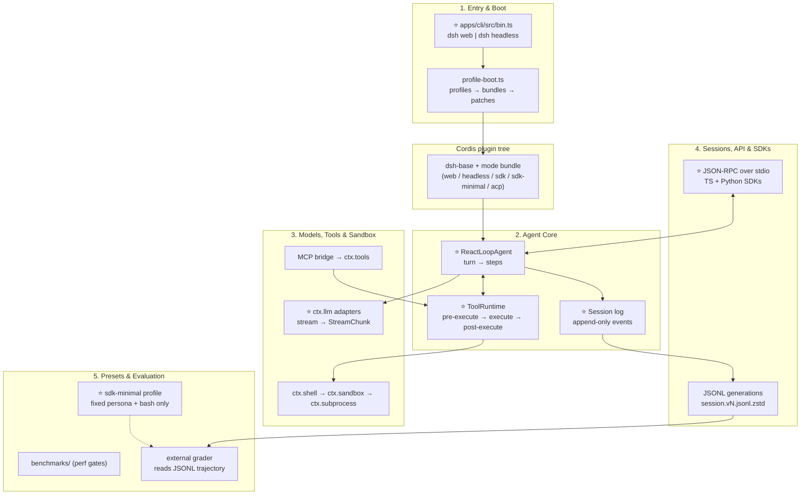
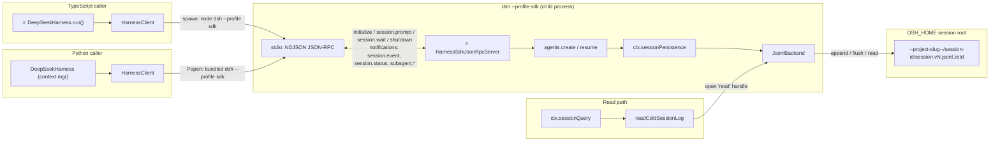
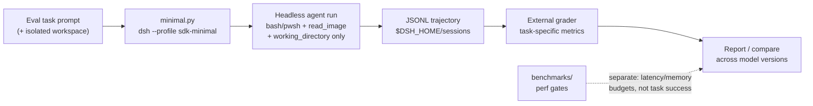

# DeepSeek Harness — Step-by-Step Study Guide

> **Repo:** [deepseek-ai/deepseek-harness](https://github.com/deepseek-ai/deepseek-harness) (`master` branch)
> **What it is:** An open-source agent harness ("everything is a plugin") built on [Cordis](https://github.com/cordiverse/cordis). It is also the evaluation rig DeepSeek uses internally for its own models.
> **Stack:** TypeScript monorepo (pnpm workspaces), Cordis plugin framework, with a Python SDK.
> **License:** MIT

## How to use this guide

Read top to bottom: it follows the real execution path — from the `dsh` command you type, through boot and plugin composition, into the agent loop, out to models and tools, down to the session log on disk, and finally to the SDK and evaluation pipeline. Each section is self-contained enough to study alone, but the order is deliberate.

- ⭐ marks **critical entry points** — start reading code here.
- Every code snippet has inline comments explaining each important line.
- Every file reference links directly to the upstream repo.
- Tick the `- [ ]` boxes as you complete each milestone.

**Suggested path:** skim all five overviews first (30 min), then go deep in order, running the milestone exercises as you go.

## The big picture



**The one-sentence mental model:** `dsh` composes a Cordis plugin tree from YAML layers → the agent loop turns inbox messages into model requests → tools execute through guarded, sandboxable providers → every model-visible fact lands in an append-only session log → SDKs drive the whole thing over JSON-RPC, and the minimal profile doubles as a reproducible eval rig.

---
## 1. Entry Points, Boot & Plugin Composition

This subsystem turns a shell command (`dsh web`, `dsh --profile headless "task"`) into a running Cordis application. The design principle is **composition as data**: a profile is not code but an ordered stack of YAML patch layers — bundle patches (from npm packages declaring `dsh.bundle.patch`), the profile's own `cordis.patch.yml`, the machine-wide `$DSH_HOME/cordis.patch.yml`, and `--patch` CLI overlays — flattened over an empty `cordis.yml` root and mounted by the Cordis Loader. The launcher (`apps/cli`) owns almost nothing: it resolves the profile name, assembles the patch stack, and hands everything else to the booted tree. Understanding this layering is what lets you add a new surface (e.g. a new profile), change what a profile mounts, or debug why a plugin row is missing at runtime.

### Key files

- ⭐ `apps/cli/src/bin.ts` — https://github.com/deepseek-ai/deepseek-harness/blob/master/apps/cli/src/bin.ts — the `dsh` process entry; dispatches to profile/plugin/dump modes.
- `apps/cli/src/args.ts` — https://github.com/deepseek-ai/deepseek-harness/blob/master/apps/cli/src/args.ts — commander adapter; launcher parses only its own flags.
- ⭐ `apps/cli/src/profile-boot.ts` — https://github.com/deepseek-ai/deepseek-harness/blob/master/apps/cli/src/profile-boot.ts — profile resolution, patch-stack composition, shutdown wiring.
- ⭐ `packages/boot/app-boot/src/index.ts` — https://github.com/deepseek-ai/deepseek-harness/blob/master/packages/boot/app-boot/src/index.ts — `boot()`, `mountRootInclude()`, patch loading, fail-loud guards, hot recomposition.
- `packages/boot/app-boot/src/profile.ts` — https://github.com/deepseek-ai/deepseek-harness/blob/master/packages/boot/app-boot/src/profile.ts — `PROFILE_TEMPLATES`, `loadProfile`, `initProfile`, profile-dir layout.
- `packages/boot/app-boot/src/profile-context.ts` — https://github.com/deepseek-ai/deepseek-harness/blob/master/packages/boot/app-boot/src/profile-context.ts — `readProfilePatches()`: the exact layer-application order.
- `packages/boot/cmdline/src/index.ts` — https://github.com/deepseek-ai/deepseek-harness/blob/master/packages/boot/cmdline/src/index.ts — `cmdlineArgs`/`appExit` services; how apps own their flags.
- `packages/boot/plugin-manager/src/index.ts` — https://github.com/deepseek-ai/deepseek-harness/blob/master/packages/boot/plugin-manager/src/index.ts — (auxiliary) `dsh plugin` operations on the current profile.
- `packages/boot/hmr/src/index.ts` — https://github.com/deepseek-ai/deepseek-harness/blob/master/packages/boot/hmr/src/index.ts — (auxiliary) coordinates config/module reloads.
- ⭐ `packages/bundle/base/cordis.patch.yml` — https://github.com/deepseek-ai/deepseek-harness/blob/master/packages/bundle/base/cordis.patch.yml — the shared core layer every base-backed profile patches over.
- `packages/bundle/headless/cordis.patch.yml` — https://github.com/deepseek-ai/deepseek-harness/blob/master/packages/bundle/headless/cordis.patch.yml — one-shot task layer over base.
- `packages/bundle/web-app/cordis.patch.yml` — https://github.com/deepseek-ai/deepseek-harness/blob/master/packages/bundle/web-app/cordis.patch.yml — browser-app layer over base.
- `packages/bundle/sdk-app/cordis.patch.yml` — https://github.com/deepseek-ai/deepseek-harness/blob/master/packages/bundle/sdk-app/cordis.patch.yml — SDK JSON-RPC stdio layer over base.
- `packages/bundle/sdk-minimal/cordis.patch.yml` — https://github.com/deepseek-ai/deepseek-harness/blob/master/packages/bundle/sdk-minimal/cordis.patch.yml — standalone tree (the only profile not built on base).
- `packages/bundle/acp-app/cordis.patch.yml` — https://github.com/deepseek-ai/deepseek-harness/blob/master/packages/bundle/acp-app/cordis.patch.yml — automation-only ACP stdio layer over base.
- `apps/cli/composition.md` — https://github.com/deepseek-ai/deepseek-harness/blob/master/apps/cli/composition.md — generated graph of the exact composition each shipped profile uses.

### `apps/cli/src/bin.ts` — process entry and mode dispatch (CORE ⭐)

```ts
export async function runCli(options: RunCliOptions = {}): Promise<void> {
  const version = getDshRuntimeVersion()                       // version string for --version
  const { manageDesktopProfile, ...profileOptions } = options  // split launcher-owned option out
  const invocation = parseDshArgs(process.argv.slice(2), version, manageDesktopProfile)
  // parseDshArgs returns a discriminated union: mode is 'profile' | 'plugin' | 'dump-config' | 'dump-config-schema'

  switch (invocation.mode) {
    case 'profile': {
      const { runProfile } = await import('./profile-boot.ts') // lazy: only loaded for the hot path
      try {
        await runProfile({
          environment: loadLayeredEnv('dsh'),                  // frozen .env snapshot (project layer, then home layer)
          profile: invocation.profile,                        // e.g. "web"
          fromDefaultProfile: invocation.fromDefaultProfile,   // optional template reset
          patchFiles: invocation.patches,                      // --patch overlays, argv order
          args: invocation.args,                               // inner app args, verbatim
          ...profileOptions,
        })
      } catch (error) {
        if (!(error instanceof StartupError)) throw error      // only StartupError gets the friendly report
        await reportStartupFailure(error, { home: resolveDshHome(), version, profile: invocation.profile })
        process.exit(1)
      }
      break
    }
    // 'plugin' forwards to pnpm; 'dump-config*' print the composed tree without booting
```

### `apps/cli/src/profile-boot.ts` — patch-stack composition (CORE ⭐)

The empty root every profile tree patches over — the whole composition is layers; there is no base config content:

```ts
/** The empty root entry list every profile tree patches over. */
const PROFILE_ROOT_CONFIG = `# dsh profile root — an empty entry list. The tree is composed as patches:
# each bundle in package.json's dsh.profile.bundles, then cordis.patch.yml, then any
# --patch overlays. Edit cordis.patch.yml, not this file.
[]
`
```

`prepareProfile` rewrites that root on **every** boot — deliberately, because the Loader's tree write-back can bake composed rows into the file and duplicate every bundle insert on the next boot:

```ts
export function prepareProfile(name: string, userLayer = true, fromDefaultProfile?: string): Profile {
  if (fromDefaultProfile !== undefined) initializeProfileFromDefault(name, fromDefaultProfile)
  const profile = loadProfile(NAME, name, INSTALL_ANCHOR, undefined, { userLayer })
  reportSkippedBundles(NAME, profile)                       // warn about bundles the install no longer ships
  writeFileSync(join(profile.dir, PROFILE_ROOT_FILENAME), PROFILE_ROOT_CONFIG) // always reset to []
  return profile
}
```

### `packages/boot/app-boot/src/profile-context.ts` — the layer order (CORE)

The single source of truth for "what wins over what". Later layers win per row:

```ts
export function readProfilePatches(binName: string, context: ProfileContext, initialProfile?: Profile): PatchOptions[] {
  const patches = structuredClone([
    ...readBundlePatches(binName, context, initialProfile),   // 1. bundles in dsh.profile.bundles order
    ...(initialProfile?.patches ?? loadOptionalPatches(binName, context.patchPath) ?? []), // 2. profile's cordis.patch.yml
    ...(loadOptionalPatches(binName, join(context.home, PROFILE_PATCH_FILENAME)) ?? []),   // 3. $DSH_HOME/cordis.patch.yml (all profiles)
    ...context.overlays,                                     // 4. --patch overlays, argv order
  ])
  const telemetryPatch = resolveTelemetryPatch(context.telemetryDisabledEnv, /* ... */)
  if (telemetryPatch !== undefined) patches.push(telemetryPatch) // 5. telemetry switch, always last
  return patches
}
```

A patch **replaces** the targeted row's whole `config` instead of merging — so a row that differs by mode does not live in base; each mode bundle restates its complete configuration.

### `packages/boot/app-boot/src/profile.ts` — shipped templates (CORE)

```ts
export const PROFILE_TEMPLATES: Record<string, ProfileTemplate> = {
  acp:    { bundles: ['@deepseek-ai/dsh-base', '@deepseek-ai/dsh-acp-app'] },
  web:    { bundles: ['@deepseek-ai/dsh-base', '@deepseek-ai/dsh-web-app'] },
  headless:{ bundles: ['@deepseek-ai/dsh-base', '@deepseek-ai/dsh-headless'] },
  sdk:    { bundles: ['@deepseek-ai/dsh-base', '@deepseek-ai/dsh-sdk-app'] },
  'sdk-minimal': { bundles: ['@deepseek-ai/dsh-sdk-minimal'] }, // standalone: no base layer
}
```

### Boot sequence

```mermaid
flowchart TD
    A["`dsh web` / `dsh --profile headless 'task'`"] --> B["bin.ts runCli()\nloadLayeredEnv → parseDshArgs\n'web' expands to --profile web"]
    B --> C{"invocation.mode"}
    C -->|profile| D["profile-boot.ts runProfile()\nproxy env, fail-loud guards,\nSIGTERM/SIGINT handlers"]
    C -->|plugin| P["plugin.ts → pnpm in profile dir"]
    C -->|dump-config| Q["print composed tree, no boot"]
    D --> E["prepareProfile()\nloadProfile / initProfile\nfrom PROFILE_TEMPLATES\nrewrite cordis.yml root to []"]
    E --> F["readProfilePatches()\nlayer order: bundles → profile\ncordis.patch.yml → $DSH_HOME/cordis.patch.yml\n→ --patch overlays → telemetry"]
    F --> G["boot(): new Cordis Context\nmountRootInclude pinned id='include'\nprovide profileContext, launch env"]
    G --> H["Loader mounts tree\nservice-driven activation\njudged by requiredStartupEntryIds"]
    H -->|all required ACTIVE| I["appReady.commit()\nheadless-runner adopts Agent,\nprints result, bounded shutdown"]
    H -->|failure| J["StartupError →\nreportStartupFailure → exit 1"]
```

### Presets vs profiles (read this once)

`packages/preset/` is an **orthogonal axis**: profiles decide *which plugins mount* (composition), presets declare *what an Agent can do* (tools, prompts, skills per Agent revision). You add a surface by editing bundles/profiles; you change agent behavior by editing presets. Don't mix the two.

### Learning milestones

- [ ] Run `dsh --profile web --dump-config` and `dsh --profile headless --dump-config`; diff the outputs and identify which rows come from `dsh-base` vs the mode bundle
- [ ] Trace `dsh headless "hi"` end to end: confirm the task text flows from inner argv into the headless runner
- [ ] Create a custom profile and add one row override in its `cordis.patch.yml`
- [ ] Add a `--patch` overlay that disables one base row and verify with `--dump-config` before booting
- [ ] Read `mountRootInclude` and explain why the root Include id is pinned to `'include'`
- [ ] Trigger a `StartupError` (e.g. point a row at a nonexistent module) and read the per-entry diagnostics

### Pitfalls and design decisions

1. **A patch replaces the whole row `config`; it never deep-merges.** Override a row and you must restate every key you still want.
2. **The root `cordis.yml` is rewritten to `[]` on every boot.** Never hand-edit it; edit `cordis.patch.yml` layers instead.
3. **Launcher flags must come first.** `dsh web --resume abc` works; `dsh --resume abc --profile web` fails — the first unrecognized token ends launcher parsing.
4. **Activation is service-driven, not order-driven.** A missing provider surfaces as a `pending` entry with named missing services — read those names first when debugging a hung boot.
5. **Core vs auxiliary:** core = `bin.ts`, `args.ts`, `profile-boot.ts`, `app-boot` (boot, patches, profiles), `dsh-cmdline`. Auxiliary = `plugin-manager`, `hmr`, `config-editor`, `dump-config`. Touch core to change *what boots*; auxiliary to change *how it's managed*.

---
## 2. Agent Core: Loop, Tools & Session Log

This subsystem is the beating heart of the harness: `dsh-agent` defines the public `Agent` handle and `agent/*` event vocabulary, `dsh-agent-loop` provides the one concrete driver (`ReactLoopAgent`) that turns inbox input into model requests → streamed responses → tool calls → logged results, `dsh-system-prompt` assembles what the model is told, `dsh-tools` runs the guarded tool pipeline, `dsh-session` records every model-visible fact in an append-only event log, and `dsh-scope` gives each agent an isolated registration world. The governing invariant: **model-visible ⟺ logged** — anything reaching a model request must be reconstructable from the session log. To modify loop behavior, you almost never edit `agent-loop`; you attach to its documented waterfall extension points (`agent/pre-step`, `agent/request`, `tools/pre-execute`, …).

### Key files

- ⭐ `packages/core/agent-loop/src/agent.ts` — https://github.com/deepseek-ai/deepseek-harness/blob/master/packages/core/agent-loop/src/agent.ts — the `ReactLoopAgent` driver: turn/step machine, prompt admission, request dispatch, cancellation
- `packages/core/agent-loop/src/tool-calls.ts` — https://github.com/deepseek-ai/deepseek-harness/blob/master/packages/core/agent-loop/src/tool-calls.ts — per-step tool scheduling: exclusive barriers + bounded parallel pool
- `packages/core/agent-loop/src/inbox.ts` — https://github.com/deepseek-ai/deepseek-harness/blob/master/packages/core/agent-loop/src/inbox.ts — durable inbox (`next-turn` / `next-step` pending lists, claim semantics)
- `packages/core/agent/src/runtime-types.ts` — https://github.com/deepseek-ai/deepseek-harness/blob/master/packages/core/agent/src/runtime-types.ts — the public `Agent` interface + full `agent/*` event declarations
- `packages/core/agent/src/index.ts` — https://github.com/deepseek-ai/deepseek-harness/blob/master/packages/core/agent/src/index.ts — `AgentRegistry`, factory slot, initiator scope
- `packages/core/system-prompt/src/index.ts` — https://github.com/deepseek-ai/deepseek-harness/blob/master/packages/core/system-prompt/src/index.ts — `SystemPrompt.assemble()`: sections, variables, tool schemas, waterfall
- ⭐ `packages/core/tools/src/index.ts` — https://github.com/deepseek-ai/deepseek-harness/blob/master/packages/core/tools/src/index.ts — `ToolRuntime`: registry + the `tools/pre-execute → execute → post-execute → result` pipeline
- `packages/core/tools/src/types.ts` — https://github.com/deepseek-ai/deepseek-harness/blob/master/packages/core/tools/src/types.ts — `ToolDefinition`, execution/result/guard types
- ⭐ `packages/core/session/src/index.ts` — https://github.com/deepseek-ai/deepseek-harness/blob/master/packages/core/session/src/index.ts — `Session.append()`: validation, freezing, commit, fan-out
- `packages/core/session/src/types.ts` — https://github.com/deepseek-ai/deepseek-harness/blob/master/packages/core/session/src/types.ts — `SessionEventMap` (turn/step/tool/assistant events), `TurnEndReason`
- `packages/core/scope/src/index.ts` — https://github.com/deepseek-ai/deepseek-harness/blob/master/packages/core/scope/src/index.ts — `createScope`, scope-targeted event routing
- `docs/subsystems/core.md` — https://github.com/deepseek-ai/deepseek-harness/blob/master/docs/subsystems/core.md — generated loop map + service API reference

### 2.1 The `Agent` contract — `packages/core/agent/src/runtime-types.ts` (core)

The public surface. Note the driver lives elsewhere (`dsh-agent-loop` registers as the factory); consumers depend on this package only.

```ts
// Four ways to feed one agent. The target selects the inbox boundary;
// wakeup decides whether the driver starts. ⭐ entry points for all input.
send(message: UserMessage, target: InboxTarget, wakeup: boolean): void
followup(message: UserMessage): void  // next-turn prompt + wake driver (ordinary user turn)
steer(message: UserMessage): void     // next-step input; consumed at nearest step boundary
inject(message: UserMessage): void    // model-facing context, does NOT wake the driver

// Cooperative cancellation: aborts the active turn; keepInbox preserves queued work.
cancel(cause: AgentCancelCause, options?: CancelOptions): void
// Resolves when the whole agent reaches quiescence (no driver/maintenance left).
whenIdle(): Promise<void>
```

`agent/*` events (scope-filtered per agent): `agent/pre-step` (waterfall — reject a step or replace its messages), `agent/request` (waterfall — replace frozen call config), `agent/request-error` (waterfall — return `{kind:'retry'}` to retry), `agent/turn-stopping` (serial — steer to keep the turn open), `agent/assistant-stream` (emit — transient UI frames), `agent/status|created|disposed`, `agent/inbox/*`.

### 2.2 The loop driver — `packages/core/agent-loop/src/agent.ts` (core ⭐)

`ReactLoopAgent` owns one session for its lifetime. `wakeDriver()` latches a `running` phase and runs `kick()` → `turn()` until the inbox drains. Each turn: `turn/start` → steps → `turn/end`.

```ts
private async turn(): Promise<boolean> {
  // ... every turn opens a durable boundary FIRST, before any model work
  this.session.append('turn/start', { turn })
  let target: InboxTarget = 'next-turn'   // first step consumes one queued turn + next-step input
  try {
    while (true) {
      signal.throwIfAborted()             // cancellation is cooperative: checked at boundaries
      const decision = await this.preStep(target, { turn, step })  // claim inbox + assemble prompt + agent/pre-step waterfall
      if (decision.kind === 'reject') { turnEnds = { kind: 'blocked' }; return false }
      // ...
      this.session.append('step/start', { turn, step })  // durable step boundary
      const stepEnd = await this.step(decision)          // ⭐ one model request + tool execution
      // ... on step failure: ToolCallRecovery appends recovery results for
      //     unanswered calls so later requests replay paired history
      this.session.append('step/end', { turn, step })
      signal.throwIfAborted()
      if (turnEnds && this.inbox.nextStep.length === 0) break  // turn ends only when model stops AND inbox drains
      target = 'next-step'                // later steps in the same turn take step-scoped input only
    }
  } finally {
    this.session.append('turn/end', { turn, reason: turnEnds! })  // completed | max-tokens | blocked | aborted | error
  }
}
```

Inside `step()`: prompt admission commits `system/message` + `user/message` events, `buildRequest()` logs `request/header` and freezes `deriveMessages()`, then the stream runs — and a **cancelled stream commits the delivered prefix** so replay matches what the user saw:

```ts
const stream = preparedCall?.stream(request) ?? this.loopCtx.llm.stream(request)
live.start()                              // process-local frames only; durable commit happens at settle
for await (const chunk of stream) {
  signal.throwIfAborted()                 // abort mid-stream → catch below commits delivered text
  live.push(chunk)
}
// No tool calls in the message → step returns { kind: 'completed' }; otherwise:
const { concluded } = await executeToolCalls(this.loopCtx, turn, step, toolCalls, signal,
  context => this.inbox.splice('next-step', this.inbox.nextStep.length, 0, [context]))
```

Tool scheduling (`tool-calls.ts`) — exclusive calls are ordering barriers; parallel-safe calls share a bounded rolling pool; **results commit in model order** even though dispatch overlaps:

```ts
while (next < planned.length) {
  const first = planned[next]!
  const mode = ctx.tools.executionMode(first.exec).kind  // re-read per group: registry changes can create barriers
  const group = mode === 'parallel' ? planned.slice(next) : [first]  // exclusive ⇒ barrier of one
  const outcome = await runGroup(ctx, turn, step, group, mode, signal, acceptContext)
  next += outcome.consumed
  if (outcome.aborted) {
    // every skipped call gets a synthetic ABORTED_BEFORE_DISPATCH error result: replay stays valid
    for (const call of planned.slice(next)) appendSkippedToolCall(session, turn, step, call.block)
    return { concluded }
  }
}
```

Auxiliary in this package: `assistant-stream.ts` (transient UI frames — never the replay source), `inbox.ts` (durable claim semantics), `runtime-context.ts` (runtime-fact projection).

### 2.3 Prompt assembly — `packages/core/system-prompt/src/index.ts` (core)

One `assemble()` merges the global layer with the agent's scope layer (scoped contributions shadow globals), canonicalizes tool order, then runs the scope-filtered `system-prompt/assemble` waterfall:

```ts
async assemble(context: AssembleContext = {}): Promise<PromptAssembly> {
  const scopeLayers = this.layers.chainLayers(scope)       // nearest scope wins
  const sectionByName = this.layers.merge(scope, layer => layer.sections)  // scoped shadows global, by name
  // ... tool schemas collected per assembly from registered providers (ToolRuntime self-registers)
  const assembly: PromptAssembly = {
    sections,                                              // ordered prompt sections; ONE complete:true section ⇒ exact prompt
    contexts: [...],                                       // dynamic runtime facts → user-role snapshots in history
    tools: orderTools(collected, this.toolOrder, knownNames),  // model-facing tool order is deterministic
    variables,                                             // {{name}} interpolation at renderPrompt()
  }
  // ⭐ the extension point: listeners may transform the final assembly (prompt + tools as one unit)
  const transformed = await this.ctx.waterfall(
    scopeTarget(this, scope), 'system-prompt/assemble', assembly, context,
    () => Promise.resolve(assembly),
  )
}
```

### 2.4 Tool execution pipeline — `packages/core/tools/src/index.ts` (core ⭐)

Every call runs one fixed pipeline. Waterfall stages delegate via `next()`; the monotonic guard stage after `tools/pre-execute` can only deny, never re-allow:

```ts
// Stage 1 — policy: extensible allow/deny/ask, then registered monotonic guards
const gate = await this.ctx.waterfall(
  carrier, 'tools/pre-execute', exec,
  () => Promise.resolve<PreToolDecision>({ kind: 'allow' }),  // default allow; a listener that skips next() short-circuits
)
const askResolution = gate.kind === 'ask' ? await this.serviceAsk(exec, gate) : { decision: gate, ... }
const denialReason = decision.kind === 'allow' ? this.guardReason(exec) : decision.reason
// → denial becomes a normal isError result; the turn does NOT end

// Stage 2 — around-dispatch wrappers (timeouts, retries live here)
const result = await this.ctx.waterfall(
  carrier, 'tools/execute', mutableExec,
  () => this.dispatchToolBody(mutableExec),  // resolves tool, validates args, runs body with fused abort signal
)

// Stage 3 — post-execute: inspect/replace result; block turns it into an isError with corrective feedback
// Stage 4 — finalizeContent (tool-owned last transform), materialize, then observe-only tools/result
```

Cancellation semantics (memorize these): abort **before** body invocation → `ABORTED_BEFORE_DISPATCH`; abort **after** → only a successful outcome is replaced with `ABORTED` (a failure stays the more specific error). Unknown tools and throwing bodies become structured error results — the turn continues; only loop-machinery failures close the turn.

### 2.5 Session: the append-only log — `packages/core/session/src/index.ts` (core ⭐)

`Session.append()` is the single commit point for every durable fact:

```ts
append<T extends SessionEventType>(type: T, data: SessionEventMap[T], ...opts): SessionEvent<T> {
  const dataSnapshot = snapshotJsonValue(data)   // ONE iterative pass: validate + copy (defeats stateful getters)
  if (dataSnapshot === undefined) throw new Error(...)  // bad event fails HERE, never later at backend flush
  const event = deepFreeze({                       // frozen: the log is immutable history
    type,
    seq: SessionSeq(this.log.length),              // sequence number assigned at commit
    time: Date.now(),
    data: dataSnapshot,
    ...surfaceMetadata,                            // surfaceOp / sourceEventSeqs for surface events
  })
  validateSessionEventData(event, ...)             // typed payload validation
  this.commit(event, entry)                        // surface-manager validation + session/event fan-out
  return event
}
```

`deriveMessages()` projects the log into the `Message[]` the model sees (cached, deep-frozen); `request/header` snapshots the non-history envelope so **every request is a pure function of the log** — resume, fork, and replay all work from events alone.

### 2.6 Scopes: per-agent isolation — `packages/core/scope/src/index.ts` (auxiliary, load-bearing)

```ts
export function createScope(ctx: Context, key: ScopeKey, options?: CreateScopeOptions): Scope {
  if (options?.parent !== undefined) bindScopeParent(key, options.parent)  // one parent link, cycle-rejected
  const fiber = ctx.plugin(scope)                                          // registrations live AND die with this fiber
  const scoped: Context = fiber.ctx.extend({ [kScope]: key })              // visibility tag on the context
  return { ctx: scoped, rawDispose: fiber.dispose, dispose: () => ... }    // dispose unwinds everything registered
}
```

Registration views inherit **down** the chain (child sees ancestors); event admission extends **up**. The loop mints one scope per agent: tools, prompt sections, and listeners registered there are agent-local and unwind on disposal. **Not a sandbox or authority boundary** — it routes trusted same-process plugins.

### Full-turn flow

```mermaid
sequenceDiagram
    participant U as User / Plugin
    participant A as ReactLoopAgent
    participant S as Session log
    participant P as system-prompt
    participant M as LLM adapter
    participant T as tools pipeline
    U->>A: followup() / steer() / inject()
    A->>S: append agent/inbox/spliced (durable)
    A->>A: wakeDriver → kick → turn()
    A->>S: append turn/start
    A->>A: preStep: inbox.claim + P.assemble
    A->>A: agent/pre-step waterfall (reject?)
    A->>S: append step/start
    A->>A: agent/request waterfall → prepareCall()
    A->>S: append system/message + user/message (admission)
    A->>S: append request/header (+ request/context on change)
    A->>M: stream(request) — derived messages + tool schemas
    M-->>A: chunks (agent/assistant-stream: transient UI frames)
    A->>S: append assistant/message (or assistant/attempt on failure/cancel)
    alt tool calls present
        A->>T: executeToolCalls (exclusive barriers / parallel pool)
        T->>T: tools/pre-execute → guards → tools/execute → tools/post-execute
        T->>A: tools/result (observe-only)
        A->>S: append tool/call + tool/result per call (model order)
    end
    A->>A: agent/turn-stopping (serial; steer to continue)
    A->>S: append step/end … loop or append turn/end
```

### Pitfalls & design decisions

1. **Cooperative cancellation, durable replay.** Abort is a signal checked at boundaries, never a thread kill. A cancelled stream commits the *delivered* text with `interrupted: true`; undispatched calls get synthetic results. The log always contains exactly what the user saw.
2. **Waterfalls short-circuit.** A listener that returns without calling `next()` ends the chain — this is how `agent/pre-step` rejects and `agent/request-error` retries. `tools/pre-execute` guards are *monotonic*: a denial can never be re-allowed downstream.
3. **Tool errors ≠ turn errors.** A throwing tool body becomes a structured error *result* and the turn continues (the model sees it and can recover). Only loop-machinery failures close the turn. Design tools to fail as results.
4. **KV-cache awareness is first-class.** Prompt consolidation at node 0 vs `in-history` append is chosen per step based on route capability — gratuitous prompt edits silently multiply token cost. Keep dynamic facts in runtime *context*, not rewritten system sections.
5. **Scope ≠ sandbox.** `dsh-scope` isolates visibility/lifetime for trusted plugins; it confers no authority boundary. Never rely on it for security isolation.

### Learning milestones

- [ ] Trace one `followup()` call end-to-end: inbox splice → `turn/start` → `step/start` → `assistant/message` → `turn/end` in a real session log
- [ ] Explain the difference between `steer()` and `inject()` — when does each one's message reach the model?
- [ ] Write an `agent/pre-step` waterfall listener that rejects a step under a custom condition; observe the `blocked` turn ending
- [ ] Register a tool with `defineTool`, call it from a step, and follow its `tool/call` → `tool/result` pair in the log
- [ ] Add a `tools/pre-execute` listener that denies a call; verify the denial surfaces as an `isError` result and the turn continues
- [ ] Cancel a mid-stream turn and confirm the committed `assistant/message` carries `interrupted: true` with the delivered prefix
- [ ] Assemble a prompt with an agent-scoped section shadowing a global one; verify via the logged `system/message`

---
## 3. Models, Tools, Sandbox & Execution

This subsystem is the harness's "voice and hands." `ctx.llm` streams model calls through provider-neutral **adapters** (`LlmAdapter`); the loop assembles `GenerateOptions` (messages + `ToolSchema`s) and consumes a `StreamChunk` protocol both adapters and the session log share. Model-facing **tools** (`bash`, MCP-bridged tools, the `skill` loader) register on `ctx.tools` via `defineTool` + `ctx.tools.register`. Execution flows down a guarded pipeline — `ctx.shell.resolve()` (request→spec) → `ctx.shell.execute()` → `ctx.sandbox.confine()` (argv wrapping) → `ctx.subprocess` spawn — and because every stage is a Cordis **capability seam** (Service Definition / Provider / Consumer), pointing the sandbox or subprocess provider at SSH transparently moves execution to a remote host with zero consumer changes.

### Key files

- ⭐ `packages/llm/llm/src/types.ts` — https://github.com/deepseek-ai/deepseek-harness/blob/master/packages/llm/llm/src/types.ts — the canonical message/block/chunk vocabulary every adapter, the loop, and the session log share
- ⭐ `packages/llm/llm/src/index.ts` — https://github.com/deepseek-ai/deepseek-harness/blob/master/packages/llm/llm/src/index.ts — `LlmRuntime` (`ctx.llm`): the adapter registry plus the interceptable streaming API
- `packages/llm/llm-deepseek/src/adapter.ts` — https://github.com/deepseek-ai/deepseek-harness/blob/master/packages/llm/llm-deepseek/src/adapter.ts — concrete adapter: the template to copy for a new provider
- ⭐ `packages/shell/shell/src/index.ts` — https://github.com/deepseek-ai/deepseek-harness/blob/master/packages/shell/shell/src/index.ts — `ShellExecutor` (`ctx.shell`): the Service Definition half of the execution seam
- `packages/shell/shell/src/types.ts` — https://github.com/deepseek-ai/deepseek-harness/blob/master/packages/shell/shell/src/types.ts — request/spec/result vocabulary
- ⭐ `packages/shell/tool-bash/src/index.ts` — https://github.com/deepseek-ai/deepseek-harness/blob/master/packages/shell/tool-bash/src/index.ts — the model-facing `bash` tool: the guarded execution pipeline every tool should imitate
- ⭐ `packages/sandbox/sandbox/src/index.ts` — https://github.com/deepseek-ai/deepseek-harness/blob/master/packages/sandbox/sandbox/src/index.ts — `SandboxProvider` (`ctx.sandbox`): the confinement seam (modes: `read-only` | `workspace-write` | `danger-full-access`)
- `packages/subprocess/subprocess/src/types.ts` — https://github.com/deepseek-ai/deepseek-harness/blob/master/packages/subprocess/subprocess/src/types.ts — the lowest spawn vocabulary; every bash command goes through `ctx.subprocess`
- `packages/mcp/mcp-client/src/tools.ts` — https://github.com/deepseek-ai/deepseek-harness/blob/master/packages/mcp/mcp-client/src/tools.ts — bridges external MCP servers into `ctx.tools`
- `packages/skill/skill/src/index.ts` — https://github.com/deepseek-ai/deepseek-harness/blob/master/packages/skill/skill/src/index.ts — `SkillRegistry` (`ctx.skills`)
- `packages/skill/tool-skill/src/index.ts` — https://github.com/deepseek-ai/deepseek-harness/blob/master/packages/skill/tool-skill/src/index.ts — the model-facing `skill` loader tool
- ⭐ `packages/ssh/sandbox-ssh/src/index.ts` — https://github.com/deepseek-ai/deepseek-harness/blob/master/packages/ssh/sandbox-ssh/src/index.ts — the remote-execution proof: same `SandboxProvider` seam, confinement resolved on the remote host

### `packages/llm/llm/src/types.ts` — the streaming vocabulary (core)

```ts
// ⭐ The raw streaming protocol every adapter MUST emit. Block indexes
// correlate interleaved deltas; 'block-end' carries the assembled block.
export type StreamChunk =
  | { type: 'block-start'; index: number; blockType: ContentBlockType }
  | { type: 'text-delta'; index: number; text: string }        // visible text pieces
  | { type: 'reasoning-delta'; index: number; text: string }   // thinking, kept separate
  | { type: 'tool-call-delta'; index: number; id: ToolCallId; name?: string; argumentsDelta: string }
  | { type: 'block-end'; index: number; block: ContentBlock }  // one finished ContentBlock
  | { type: 'usage'; usage: TokenUsage }                       // must come BEFORE finish
  | { type: 'finish'; reason: FinishReason; replayState?: ReplayEnvelope }
  // NOTE: tool arguments stay RAW JSON strings here; parsing is the consumer's job.
```

```ts
// Tool schemas live HERE, not in dsh-tools: they are part of GenerateOptions,
// so the llm package (not the tools package) owns them for prompt assembly.
export interface ToolSchema {
  deferLoading?: true           // Anthropic-style: load definition into context lazily
  name: string
  description: string
  parameters: Record<string, unknown>  // JSON Schema for the arguments
}
```

### `packages/llm/llm/src/index.ts` — the adapter seam (core ⭐)

```ts
// ⭐ THE provider seam. To add a model provider, subclass this and implement
// ONLY stream() — every other method has a working default.
export abstract class LlmAdapter {
  providerInfo(provider: string): LlmProviderInfo { /* display metadata */ }
  providerRetryPolicy(_provider: string) { return undefined }  // or your own policy
  async prepareCall(provider, model, signal): Promise<PreparedAdapterCall> {
    // Binds ONE adapter generation (endpoint + capabilities) to the dispatch,
    // so a settings change mid-flight can't mix generations. Override for
    // dynamic adapters; default just calls resolveModel + stream.
    return { model: await this.resolveModel(provider, model, signal),
             stream: options => this.stream(options) }
  }
  abstract stream(options: GenerateOptions): AsyncIterable<StreamChunk> // the only required method
}
```

```ts
// Registration: one adapter serves N provider routes; duplicates throw loudly.
// Returns a disposer tied to the plugin fiber's lifecycle.
registerAdapter(providers: string[], adapter: LlmAdapter): AdapterRegistrationHandle
// Every call runs through the 'llm/stream' waterfall FIRST, so plugins can
// observe/rewrite chunks; adapter failures normalize into a terminal
// 'error'|'aborted' finish chunk (never thrown).
```

### `packages/shell/tool-bash/src/index.ts` — the model-facing `bash` tool (core ⭐)

The guarded execution pipeline every tool should imitate:

```ts
return defineTool({
  name: 'bash',                       // model-visible name
  description: bashDescription(),      // written from the MODEL's perspective
  parameters: {                       // JSON schema -> joins prompt assembly
    description: { type: 'string', required: true, /* 5-10 word UI label */ },
    command: { type: 'string', required: true, description: 'The bash command to execute.' },
    timeoutMs: { type: 'number', /* executor defaults+caps it */ },
  },
  async execute(args: BashToolArgs, exec) {
    validateBashArgs(args, standingPolicy?.mode)          // 1. schema-level guard
    const approvedMode = /* 2. user-approved one-time escalation, or undefined */
    const spec = ctx.shell.resolve({ ...request, signal: exec.signal }) // 3. request -> spec
    const foreground = await ctx.shell.execute(spec)      // 4. spawn via mounted executor
    const result = await foreground.result()              // 5. await outcome
    if (result.aborted) throw toolAborted()
    return { kind: 'foreground', ...canonicalBashResult(result, spec.workdir) }
  },
})
ctx.tools.register(bashTool(jobCtx.jobs)) // registration is an effect; disposer unregisters
```

### `packages/sandbox/sandbox/src/index.ts` — the confinement seam (core ⭐)

```ts
export abstract class SandboxProvider extends Service {
  // Wrap argv so it runs confined under `policy`. The caller spawns the
  // RETURNED argv instead of its own. FAIL-CLOSED: return enforcing argv or
  // throw — silent unconfined passthrough is forbidden.
  abstract confine(
    argv: readonly string[],   // exact argv about to spawn, NOT a shell string
    policy: SandboxPolicy,     // per-call file-effect policy (mode + roots)
    signal?: AbortSignal,
  ): Promise<ConfinedArgv>     // wrapped argv + enforcement completeness
}
```

### `packages/ssh/sandbox-ssh/src/index.ts` — remote execution via seam swap (core ⭐)

The design payoff of capability seams, in one file:

```ts
export class SshSandboxProvider extends SandboxProvider {
  static inject = ['ssh']  // declares its dependency on the ssh service
  override async confine(argv, policy, signal?): Promise<ConfinedArgv> {
    // Instead of wrapping argv locally (bwrap/Landlock/Seatbelt), ask the
    // REMOTE host to confine it: execution moves with the provider swap.
    const confined = await this.ctx.ssh.request('sandbox', { argv, policy }, factsSchema, signal)
    return { ...confined, runnerFailureRules: confined.runnerFailureRules.map(...) }
  }
}
// Design payoff: tool-bash -> ctx.shell -> ctx.sandbox -> ctx.subprocess is
// unchanged; mounting sandbox-ssh (+ subprocess-ssh) instead of sandbox-local
// reroutes the whole pipeline to the SSH host. Consumers never branch.
```

### Execution data flow

```mermaid
flowchart LR
    A["Agent loop builds GenerateOptions<br/>(messages, tools, toolHistory)"] --> B["ctx.llm.stream()<br/>llm/stream waterfall"]
    B --> C["LlmAdapter.stream()<br/>provider wire: SSE/JSON"]
    C --> D["StreamChunk deltas<br/>text / reasoning / tool-call"]
    D --> E["Assistant message assembled<br/>tool-call blocks"]
    E --> F["ctx.tools dispatch<br/>bash / mcp-* / skill"]
    F --> G["ctx.shell.resolve()<br/>request to spec"]
    G --> H["ctx.sandbox.confine()<br/>argv wrapped"]
    H --> I["ctx.subprocess spawn<br/>local or SSH remote"]
    I --> J["ShellRunResult<br/>stdout/stderr/exit/sandbox facts"]
    J --> K["Tool result feeds next<br/>GenerateOptions"]
```



### Pitfalls & design decisions

1. **Capability seam = Definition + Provider + Consumer, never one role alone.** `ShellExecutor` (definition), `bash-local`/`bash-sandbox` (providers), `tool-bash` (consumer). To change *where* execution happens you swap the provider — if you find yourself branching on "local vs remote" in a consumer, the seam is wrong.
2. **Fail-closed sandboxing.** `confine()` must return enforcing argv or throw; a provider that silently passes argv through unconfined is a contract violation. Weaker enforcement is allowed only when *disclosed*.
3. **Prepared calls bind one adapter generation.** `prepareCall()` captures endpoint + model metadata + dispatch together, and dispatch is single-use — a settings change between preparation and streaming can't mix generations.
4. **Explicit > implicit at package boundaries.** `ShellExecRequest` → `resolve()` → `ShellExecSpec`: defaults and caps are materialized in `resolve()`, never hidden inside `run()`. Copy this request/spec split for any new executor.
5. **Model-visible ⟺ logged.** `ToolSchema` lives in `dsh-llm` (part of `GenerateOptions`) rather than the tools package, and tool additions/removals are explicit blocks — never silent schema edits.

### Learning milestones

- [ ] Trace one model call end-to-end: `GenerateOptions` → `adapter.stream()` → `StreamChunk`s → assembled assistant message → `tool-call` block
- [ ] Implement a stub `LlmAdapter` (only `stream()`, yielding canned chunks) and register it with `ctx.llm.registerAdapter(['my-provider'], adapter)`
- [ ] Register a custom tool with `defineTool` + `ctx.tools.register`; confirm its schema appears in the assembled prompt
- [ ] Execute a command via `ctx.shell.resolve()` → `ctx.shell.execute()` → `result()`; interpret `timedOut` vs `aborted`
- [ ] Run a command under sandbox `read-only` mode and observe a denial surface as facts, not a crash
- [ ] Swap `sandbox-local` for `sandbox-ssh` and verify execution moves to the remote host with no consumer changes
- [ ] Configure an MCP server; watch its tools appear as `server__tool` entries and call one through the bridge
- [ ] Write a `SKILL.md`, expose it via a skill provider, and load it through the `skill` tool

---
## 4. Sessions, Persistence, API & SDKs

**Overview.** This subsystem is the durable backbone of the harness: every agent turn is an append-only event log persisted as versioned, immutable JSONL generations (`session.jsonl.zstd` → `session.v1.jsonl.zstd` …), and out-of-process callers drive a full runtime through a newline-delimited JSON-RPC protocol over stdio (`dsh --profile sdk`). The TypeScript SDK (`@deepseek-ai/dsh-sdk-client`) and the Python SDK (`deepseek-harness-sdk`) speak the same wire protocol; the in-process server plugin (`@deepseek-ai/dsh-sdk-jsonrpc-server`) owns sessions, queues prompts, and streams events back. `session-query` provides backend-neutral reads/search over live and persisted logs. Note: `packages/api/` is a *different* surface (Typert Remote layer for GUI client↔host, see `docs/api-gateway.md`) — do not confuse it with the SDK JSON-RPC path covered here.

**Key files** (core logic vs auxiliary marked; ⭐ = critical entry point):

- ⭐ https://github.com/deepseek-ai/deepseek-harness/blob/master/packages/sdk/client/src/launch.ts — resolves the `dsh` executable + argv (`--profile sdk --patch …`). Core.
- ⭐ https://github.com/deepseek-ai/deepseek-harness/blob/master/packages/sdk/client/src/client.ts — `HarnessClient`: spawns the child, handshake, requests, subscriptions, teardown ladder. Core.
- https://github.com/deepseek-ai/deepseek-harness/blob/master/packages/sdk/client/src/api.ts — `DeepSeekHarness`/`HarnessSession`: receipt-to-idle `run()` flow, `finalResponse` derivation. Core.
- ⭐ https://github.com/deepseek-ai/deepseek-harness/blob/master/packages/sdk/protocol/src/transport.ts — newline-delimited JSON-RPC 2.0 framing over stdio. Core.
- https://github.com/deepseek-ai/deepseek-harness/blob/master/packages/sdk/protocol/src/types.ts — typed request/notification maps shared by both SDKs. Core.
- ⭐ https://github.com/deepseek-ai/deepseek-harness/blob/master/packages/sdk/server/src/server.ts — server plugin: method dispatch, session ownership, event fan-out. Core.
- https://github.com/deepseek-ai/deepseek-harness/blob/master/packages/session/session-persistence-jsonl/src/format.ts — on-disk layout, generation filenames, header line. Core.
- https://github.com/deepseek-ai/deepseek-harness/blob/master/packages/session/session-persistence-jsonl/src/generation.ts — immutable generation publication + migration. Core.
- https://github.com/deepseek-ai/deepseek-harness/blob/master/packages/session/session-persistence-jsonl/src/storage.ts — `JsonlSessionHandle`: read/append/flush/close. Core.
- https://github.com/deepseek-ai/deepseek-harness/blob/master/packages/session/session-persistence/src/storage-contract.ts — backend-neutral validation (version gate, contiguity). Core.
- https://github.com/deepseek-ai/deepseek-harness/blob/master/packages/session-query/session-query/src/cold-read.ts — one-shot cold log read with interrupted-turn repair. Auxiliary (read path).
- https://github.com/deepseek-ai/deepseek-harness/blob/master/python/sdk/src/deepseek_harness/client.py — Python SDK: bundled-runtime launch, explicit `dsh_home`. Core.

### SDK launch: resolving the `dsh` subprocess

`packages/sdk/client/src/launch.ts` — `resolveDshLaunch` turns public options into one subprocess spec. The client spawns the *same-version* `dsh` package (version equality enforced) with the `sdk` profile:

```ts
export function resolveDshLaunch(
  options: HarnessClientOptions = {},   // public opts: profile, patches, dshBin, dshHome, timeouts…
  callerCwd: string = process.cwd(),    // caller-relative paths resolve against this
): RuntimeProcessOptions {
  const profile = options.profile ?? 'sdk'              // default profile boots the JSON-RPC server
  const dshLaunch = options.dshBin === undefined
    ? installedDshNodeLaunch()                          // same-version @deepseek-ai/dsh, built bin or tsx source
    : { nodeArgs: [resolve(callerCwd, options.dshBin)], patches: [], environment: {} }
  const patches = [
    ...dshLaunch.patches,                              // internal patches go *below* caller patches
    ...(options.patches ?? []).map(path => resolve(callerCwd, path)),
  ]
  return {
    command: process.execPath,                          // the child is always Node; dsh entry rides in argv
    args: [...dshLaunch.nodeArgs, '--profile', profile, ...patches.flatMap(path => ['--patch', path])],
    environment: () => ({ ...(options.env ?? process.env), ...dshLaunch.environment,
      ...dshHome === undefined ? {} : { DSH_HOME: dshHome } }),  // DSH_HOME selects the session root
    description: `dsh profile ${JSON.stringify(profile)}`,
    initializeTimeoutMs: options.initializeTimeoutMs ?? DEFAULT_INITIALIZE_TIMEOUT_MS, // 10 s handshake bound
  }
}
```

### Spawning the runtime (HarnessClient.start)

`packages/sdk/client/src/client.ts` — the client spawns directly (documented exception: *not* via the `dsh-subprocess` service, because it *is* the SDK-managed transport):

```ts
start(): void {
  if (this.closeTask !== undefined) throw new TransportClosedError('…client is closed') // closed ⇒ never reuse
  if (this.child !== undefined) return                    // idempotent while live
  const child = spawn(this.runtime.command, this.runtime.args, {
    cwd: this.runtime.cwd,
    env: this.runtime.environment(),                     // materialized lazily at spawn, not at resolve
    stdio: ['pipe', 'pipe', 'pipe'],                     // stdin/stdout = JSON-RPC, stderr = diagnostics
  })
  child.once('error', (error) => {
    this.spawnError = error
    this.transport?.close()                              // spawn failure kills pipes with no 'end' edge…
    this.failSubscriptions(this.closedError('…failed to start')) // …so pending requests must fail here
  })
  child.stdin.on('error', () => {})                       // EPIPE racing runtime death is non-fatal; exit edge is truth
```

### The run loop: prompt → receipt → idle

`packages/sdk/client/src/api.ts` — `HarnessSession.run()` owns one activity interval; note `finalResponse` semantics (pitfall #3 below):

```ts
async run(input: string | SdkPromptContentBlock[], options?): Promise<RunResult> {
  await this.harness.start()                              // lazy: subprocess starts on first use
  const subscription = client.subscribeSessionTree(this.id) // session-tree scoping is client-side filtering
  try {
    const messageId = await client.prompt(this.id, contentBlocks) // returns as soon as runtime *accepts* the prompt
    let received = false
    while (true) {
      const notification = await subscription.next()
      if (!received) {                                    // first: wait for the durable inbox receipt…
        if (notification.method !== 'session.event' || !isInboxReceipt(notification.params.event, messageId)) continue
        received = true                                   // …proving the prompt is committed, not just sent
      }
      collect(notification)                               // then gather events…
      if (notification.method === 'session.status'        // …until the whole agent reports idle
        && notification.params.status === 'idle') break
    }
  } finally { subscription.close() }
  return { sessionId: this.id, finalResponse: finalResponse(events), events, notifications }
}
```

### Wire framing: one JSON object per line

⭐ `packages/sdk/protocol/src/transport.ts` — `JsonRpcLineTransport` classifies each line by shape; malformed lines are ignored, never fatal:

```ts
private async handleLine(line: string): Promise<void> {
  let message: unknown
  try { message = JSON.parse(line) } catch { return }     // JSON syntax error ⇒ drop the line silently
  const frame = message as Record<string, unknown>
  const id = frame.id, method = frame.method
  if ((typeof id === 'string' || typeof id === 'number') && typeof method === 'string') {
    await this.handleIncomingRequest(id, method, objectParams(frame.params)); return  // id+method = request
  }
  if (typeof id === 'string' || typeof id === 'number') {
    this.handleIncomingResponse(id, frame); return         // id alone = response → resolve/reject pending
  }
  if (typeof method === 'string') {
    this.notificationHandler?.(method, objectParams(frame.params)) // method alone = notification (fire-and-forget)
  }
}
```

### Protocol surface (shared by TS + Python)

`packages/sdk/protocol/src/types.ts` — the complete method inventory; both SDKs implement exactly this:

```ts
export interface HarnessSdkRequestMap {                    // client → server requests
  'initialize': { params: InitializeParams; result: InitializeResult }       // handshake: cwd, provider/model route
  'session/prompt': { params: SessionPromptParams; result: SessionPromptResult } // queue prompt → messageId receipt
  'session/resume': { params: SessionResumeParams; result: Record<string, never> } // restore persisted, no new input
  'session/wait': { params: SessionWaitParams; result: Record<string, never> }     // wait for idle incl. descendants
  'session/working-directory/get': { params: SessionWorkingDirectoryParams; result: SessionWorkingDirectoryResult }
  // …plus 'session/working-directory/set' and 'shutdown'
}
export interface HarnessSdkNotificationMap {               // server → client stream
  'session.event': SessionEventNotification                // every committed session-log event, as recorded
  'session.status': SessionStatusNotification              // whole-agent 'idle' | 'running' transitions
  'subagent.started': SubagentStartedNotification          // child session lineage edges (client filters by these)
  'subagent.finished': SubagentFinishedNotification
}
```

### Server dispatch and session ownership

⭐ `packages/sdk/server/src/server.ts` — `HarnessSdkJsonRpcServer.handleRequest` routes wire methods to typed handlers; the constructor subscribes to Cordis events and re-emits them as notifications:

```ts
async handleRequest(method: string, params: Record<string, unknown> | undefined): Promise<unknown> {
  switch (method) {
    case 'initialize':      return this.initialize(params as unknown as InitializeParams)   // validates route, mounts fallback adapter
    case 'session/prompt':  return this.prompt(params as unknown as SessionPromptParams)     // getOrCreateSession + agent.followup()
    case 'session/resume':  return this.resume({ sessionId })                               // open persisted; rejects if missing/occupied
    case 'session/wait':    return this.wait({ sessionId })                                 // idle loop incl. waitForChildren
    case 'shutdown':        return this.shutdown()                                          // memoized, drains descendants first
    default: throw new Error(`unknown DeepSeek Harness SDK runtime method: ${method}`)       // → JSON-RPC error frame
  }
}
```

```ts
// session creation is deduplicated: concurrent opens for one id share a single promise
private openSession(sessionId: string, resume: boolean): Promise<SessionRecord> {
  const creation = this.createSession(sessionId, resume)  // resume ⇒ ctx.agents.resume, else ctx.agents.create
  this.sessionCreations.set(sessionId, creation)          // in-flight map prevents double-create races
  void creation.then(() => { this.sessionCreations.delete(sessionId) },
                     () => { this.sessionCreations.delete(sessionId) })
  return creation
}
```

### On-disk layout: generations, not files

`packages/session/session-persistence-jsonl/src/format.ts` — sessions live under a human-navigable project directory; each format version is an **immutable** generation file:

```ts
export function generationLogFilename(version: number, compression: JsonlCompression): string {
  return `${sessionFormatLogFilename(version)}${compressionSuffix(compression)}`
  // v0 → "session.jsonl.zstd" (original suffix-only name, never renamed)
  // vN → "session.vN.jsonl.zstd"  (lowercase numeric component, canonical only)
}
export function sessionDir(root: string, cwd: string | undefined, id: SessionId): string {
  return join(projectDir(root, cwd), encodeSegment(id))   // SessionId is an *unvalidated* branded string:
}                                                         // MUST be path-encoded — no traversal, no collision
// Full layout: <root>/--<project-slug>--/<encoded-id>/session.v<N>.jsonl.zstd
// First line of every file is a {"type":"session", version, id, …} header record.
```

`packages/session/session-persistence-jsonl/src/generation.ts` — migration publishes a **new** generation file and flips the "current" pointer atomically; committed generations are never moved, overwritten, or deleted (see pitfall #1).

### Append path: validate → queue → persist

⭐ `packages/session/session-persistence-jsonl/src/storage.ts` — `JsonlSessionHandle.append` serializes all mutations through a promise chain; `flush` is the durability barrier:

```ts
async append(events: readonly SessionEvent[], options?: SessionHandleAppendOptions): Promise<void> {
  this.assertOpen('append')
  const batch = materializeAppendBatch(events)  // deep-snapshot + JSON-serializability check HERE, before queueing,
  return this.run('append', async () => {       // so the checked value is exactly the persisted value
    options?.signal?.throwIfAborted()
    await this.persistContiguous(batch)         // contiguity enforced against the stored next-seq
  })
}
flush(options?: SessionHandleFlushOptions): Promise<void> {
  return this.run('flush', async () => {
    if (this.access !== 'write') throw new SessionReadOnlyError(this.id, 'flush')
    if (this.state.materialized) return          // appends are durable on resolution; flush only matters pre-first-write
    await this.ensureLease()                     // cross-process write lock (see lease.ts)
    await this.storage.persistHeader(this.header, this.state.inheritedEventCount)
    this.state.materialized = true               // an explicitly flushed *empty* session still survives restart
  })
}
```

`packages/session/session-persistence/src/storage-contract.ts` — every backend refuses the same bad inputs identically:

```ts
export function assertContiguous(id: SessionId, events: readonly SessionEvent[], cursor: number): void {
  for (const [index, event] of events.entries()) {
    if (event.seq !== cursor + index)            // seq must continue the stored log with no gaps or overlaps
      throw new Error(`append seq mismatch for "${id}": expected ${cursor + index}…, got ${event.seq}`)
  }
}
export function assertVersion(meta, location?): void {
  if (meta.version !== SESSION_FORMAT_VERSION)   // fail-closed: a newer writer's log refuses to open here…
    throw unsupported(sessionFormatVersionRefusal(meta.id, meta.version), location) // …never silently reinterpret
}
```

### Cold reads and query

`packages/session-query/session-query/src/cold-read.ts` — read a stored log without taking ownership; repairs a crashed final turn in memory:

```ts
export async function readColdSessionLog(persistence, sessionId, signal?): Promise<ColdSessionLog> {
  const handle = await persistence.open(sessionId, 'read', options)  // read handle: no lock, no mutation
  let read: SessionHandleReadResult
  try { read = await handle.read(0, undefined, options) }
  catch (error: unknown) { try { await handle.close() } catch { /* read failure is the actionable cause */ } throw error }
  await handle.close()
  return { eventState: read.eventState, header: handle.header,
    inheritedEventCount: handle.inheritedEventCount,
    events: [...events, ...interruptedTurnClosers(events)] }  // synthetic closers balance the transcript; nothing written back
}
```

### Python SDK launch path

`python/sdk/src/deepseek_harness/client.py` — mirrors the TS client; the bundled `dsh` binary comes from the `deepseek-harness-runtime-bin` wheel, and `dsh_home` is **mandatory** (pitfall #2):

```python
def _default_launch_args(self, env):
    if self.config.dsh_bin is None:
        from deepseek_harness_runtime import resolve_bundled_launch_args  # exact same-version runtime wheel
        base = resolve_bundled_launch_args()
    else:
        base = (str(Path(self.config.dsh_bin).expanduser().resolve()),)
    if self.config.dsh_home is not None:
        env["DSH_HOME"] = str(Path(self.config.dsh_home).expanduser().resolve())
    elif not env.get("DSH_HOME", "").strip():
        raise ValueError(                      # deliberate: never implicitly use ~/.dsh — isolation by default
            "HarnessConfig requires an explicit dsh_home or non-empty DSH_HOME; "
            "the Python SDK never uses ~/.dsh implicitly")
    patches = tuple(arg for patch in self.config.patches for arg in ("--patch", str(Path(patch).expanduser().resolve())))
    return (*base, "--profile", self.config.profile, *patches)   # same argv shape as the TS client
```

```python
with DeepSeekHarness(                       # usage: lazy start, owned subprocess, reaped on exit
    dsh_home="/absolute/path/to/isolated-dsh-home",  # REQUIRED — session root lives here
    cwd="/absolute/path/to/workspace",
    provider="deepseek-official", model="deepseek-v4-flash",
) as harness:
    result = harness.run("Say hi.", session_id="example-001")
print(result.final_response)
```

### Architecture



### Pitfalls & design decisions

1. **Generations are append-only history — never rename, move, or delete a committed file.** Migration decodes an old generation and publishes a *new* `session.vN.jsonl.zstd` as the successor; predecessors imply neither fallback nor downgrade. Tooling that "cleans up" old generations corrupts the migration chain.
2. **The Python SDK never discovers `~/.dsh`.** `dsh_home` (or `DSH_HOME`) is mandatory and must be absolute — an explicit isolation decision so SDK runs can't accidentally share or clobber the user's interactive home.
3. **`finalResponse` is not causally attributed.** It is the last committed root-session assistant text in the run interval; steering, injected context, or other queued work may have contributed. Never present it as "the answer to that prompt" without qualification.
4. **Session ids are untrusted path input.** `SessionId` is a branded but *unvalidated* string; `encodeSegment` must encode it before any filesystem use. Any new code that builds session paths by hand instead of via `sessionDir()` is a traversal bug.
5. **Don't confuse the two API surfaces.** `packages/api/` (Typert `@Remote` methods over the app Connection for GUI clients) and `packages/sdk/` (newline JSON-RPC over stdio for out-of-process SDKs) are independent stacks with different trust models.

### Learning milestones

- [ ] Trace one `DeepSeekHarness.run("hi")` call end-to-end: `launch.ts` argv → `client.ts` spawn → `initialize` handshake → `session/prompt` → receipt → `idle` → `finalResponse`
- [ ] Explain the three JSON-RPC frame shapes in `transport.ts` (`id`+`method` / `id` / `method`) and what happens to a malformed line
- [ ] Draw the on-disk layout for a session with cwd `/home/u/proj` and id `abc`: project dir, session dir, generation filenames for v0 and v2 (zstd)
- [ ] Describe what happens on `open()` when the stored generation is v1 and the build is v4: which packages run, what file is written, what is never touched
- [ ] Implement a minimal raw client: spawn `dsh --profile sdk`, send `initialize`, `session/prompt`, print `session.event` notifications until `session.status: idle`
- [ ] Use `readColdSessionLog` (or `ctx.sessionQuery.readSession`) to dump a real session log and identify the header line, an inbox receipt, and a turn boundary
- [ ] Extend the protocol with a new `session/*` method: add it to `HarnessSdkRequestMap`, handle it in `server.ts` `handleRequest`, and call it from the TS client
---

## 5. Presets, Subagents & Evaluation Pipeline

This subsystem answers: *what* runs (composable agent runtimes), *who* can delegate (subagents), and *how* DeepSeek measures it. Two distinctions matter. First, **presets ≠ profiles**: the preset registry manages per-agent plugin compositions selectable in the UI (tools + persona for one session), while **profiles** (`web`, `headless`, `sdk`, `sdk-minimal`, `acp`) are launch-level Cordis trees. Second, `benchmarks/` measures **performance** (latency/memory gates), not task success — the agent-eval rig is the **`sdk-minimal` profile**: a deliberately tiny, fully explicit composition (persistent shell + `read_image` + `working_directory`, JSONL sessions, fixed persona, no subagents/skills/telemetry) driven headlessly via `python/sdk/examples/minimal.py`. That minimal surface is the stable observation/action space DeepSeek's own evals run against: fixed tools ⇒ comparable trajectories across model versions.

### Key files

- ⭐ `packages/bundle/sdk-minimal/cordis.patch.yml` — https://github.com/deepseek-ai/deepseek-harness/blob/master/packages/bundle/sdk-minimal/cordis.patch.yml — the complete minimal composition (eval rig)
- `packages/bundle/sdk-minimal/README.md` — https://github.com/deepseek-ai/deepseek-harness/blob/master/packages/bundle/sdk-minimal/README.md — profile contract and guarantees
- ⭐ `python/sdk/examples/minimal.py` — https://github.com/deepseek-ai/deepseek-harness/blob/master/python/sdk/examples/minimal.py — headless eval entry point
- `BENCHMARK.md` — https://github.com/deepseek-ai/deepseek-harness/blob/master/BENCHMARK.md — how to run benchmark tasks (separate workspace + session ID per task)
- `packages/preset/agent-preset-registry/src/definition.ts` — https://github.com/deepseek-ai/deepseek-harness/blob/master/packages/preset/agent-preset-registry/src/definition.ts — `PresetDefinition` + YAML validation
- `packages/preset/agent-preset-registry/src/mount.ts` — https://github.com/deepseek-ai/deepseek-harness/blob/master/packages/preset/agent-preset-registry/src/mount.ts — live `PresetMount` (fiber tree per revision)
- ⭐ `packages/subagent/tool-subagent/src/index.ts` — https://github.com/deepseek-ai/deepseek-harness/blob/master/packages/subagent/tool-subagent/src/index.ts — model-facing `subagent` tool; preset-based child config
- `packages/subagent/subagent/src/child-agent.ts` — https://github.com/deepseek-ai/deepseek-harness/blob/master/packages/subagent/subagent/src/child-agent.ts — depth budget + child `AgentOptions` resolution
- `benchmarks/AGENTS.md` — https://github.com/deepseek-ai/deepseek-harness/blob/master/benchmarks/AGENTS.md — perf-benchmark rules (gates, workers, budgets)
- `benchmarks/terminal-io/terminal-io.bench.ts` — https://github.com/deepseek-ai/deepseek-harness/blob/master/benchmarks/terminal-io/terminal-io.bench.ts — example benchmark: task def + scoring
- `docs/tool-catalog.md` — https://github.com/deepseek-ai/deepseek-harness/blob/master/docs/tool-catalog.md — full tool catalog (superset of the minimal surface)

### The minimal composition (core — the eval rig)

`packages/bundle/sdk-minimal/cordis.patch.yml` is the **entire** Cordis tree — unlike every other profile it does *not* layer on `dsh-base`, so each row is explicit and auditable:

```yaml
    # Platform-selected shell: exactly ONE of these rows is ever enabled.
    # !!js evaluates at mount time — the disabled row never loads its plugin.
    - id: terminal-bash
      name: '@deepseek-ai/dsh-terminal-bash'
      disabled: !!js process.platform === 'win32'   # off on Windows…
      config:
        timeoutMs: 300000                            # 5-min cap per command
    - id: terminal-pwsh
      name: '@deepseek-ai/dsh-terminal-bash'
      disabled: !!js process.platform !== 'win32'   # …on everywhere else
      config:
        shellDialect: pwsh
        timeoutMs: 300000
```

```yaml
    # Fixed, deterministic persona: no harness identity, no runtime-context
    # snapshots — evals need the system prompt to be byte-stable.
    - id: system-prompt
      name: '@deepseek-ai/dsh-system-prompt'
      config:
        includeHarnessIdentity: false
        includeRuntimeContext: false
        personaPrefix: !!js process.env.DSH_SYSTEM_PROMPT ?? 'You are a helpful software engineer assistant.'
    # Uncompressed JSONL sessions: the trajectory artifact your grader reads.
    - id: sessions
      name: '@deepseek-ai/dsh-session-persistence-jsonl'
      config:
        root: !!js dshHomePath('sessions')
        compression: none
```

Note what is **absent** vs `dsh-base`: text file tools, skills, jobs, subagents, telemetry, managed credentials. The agent's whole world is: shell, `read_image`, `working_directory`.

### Headless eval entry (core)

`python/sdk/examples/minimal.py` — one task in, final response out; the trajectory persists as JSONL:

```python
with DeepSeekHarness(          # launches `dsh --profile sdk-minimal` as a child
    provider=args.provider,    # model routing (default deepseek-official)
    model=args.model,          # SDK init request is the SOLE model selector
    cwd=str(workspace),        # ISOLATED workspace per task (see BENCHMARK.md)
    dsh_home=str(dsh_home),    # explicit home: sessions land in $DSH_HOME/sessions
    profile=args.profile,      # "sdk-minimal"
) as harness:
    result = harness.run(args.prompt, session_id=args.session_id)
print(result.final_response)   # trajectory (tool calls + turns) is in the JSONL
```

### Preset = declarative plugin composition (core)

`packages/preset/agent-preset-registry/src/definition.ts` — a preset is just an id plus an ordered list of Cordis plugin rows:

```typescript
export interface PresetDefinition {
  readonly id: string                    // stable id, e.g. selected via agentPreset
  readonly name?: string                 // display name
  readonly description?: string
  readonly order?: number                 // UI ordering
  readonly plugins: readonly (           // the composition: module + config + on/off
    Omit<EntryOptions, 'id' | 'disabled'> & { id?: string; disabled?: EntryOptions['disabled'] | JsExpr }
  )[]
}
// entryListProblem() validates parsed YAML: top-level list, every row names a plugin.
```

### Subagent spawning (core)

`packages/subagent/tool-subagent/src/index.ts` — the model-facing `subagent` tool. Key design: child configuration comes from an **Agent Preset** selected by `agentPreset`, not ad-hoc fields:

```typescript
for (const field of ['persona', 'toolFilter']) {
  if (Object.hasOwn(config, field)) {
    throw new Error(`tool-subagent: ${field} is no longer supported; configure persona and tool plugins in an Agent Preset and select it with agentPreset (spawn only)`)
  }
}
```

`packages/subagent/subagent/src/child-agent.ts` — recursion is budgeted, and the budget survives session resume:

```typescript
export function resolveChildDepth(parent: Agent, maxDepth: number | undefined): number {
  const childDepth = delegationDepthOf(parent) + 1   // depth is inherited, never reset
  if (maxDepth !== undefined && childDepth > maxDepth) {
    throw new SubagentDepthError(childDepth, maxDepth)  // hard stop, no silent fork
  }
  return childDepth
}
```

Providers: `subagent-spawn-in-process`, `subagent-fork-in-process` (inherits completed turns), `subagent-acp`, `subagent-claude-code`, `subagent-codex`, `subagent-dsh-sdk`. The minimal profile ships **none** of them — eval agents can't delegate.

### Evaluation pipeline



### Learning milestones

- [ ] Run `python/sdk/examples/minimal.py "list files"` with a disposable `DSH_HOME` and inspect the resulting JSONL trajectory in `$DSH_HOME/sessions`
- [ ] Enumerate the exact tool surface of `sdk-minimal` from `cordis.patch.yml` and explain why each omitted `dsh-base` plugin matters for eval comparability
- [ ] Override the fixed persona via `DSH_SYSTEM_PROMPT` and confirm the system prompt changes in a fresh run
- [ ] Author a custom Agent Preset (YAML rows + persona) and select it for a subagent via `agentPreset`
- [ ] Trigger `SubagentDepthError` deliberately with `maxDepth` and verify a resumed parent can't reset the budget
- [ ] Write a 5-line external grader that scores a minimal-profile trajectory (e.g. "did the shell produce file X?")

### Pitfalls & design decisions

1. **The minimal surface is fixed by design (RL-oriented).** Changing tools/persona between runs invalidates comparisons — treat `cordis.patch.yml` as a frozen experimental condition. Patch via `--patch` files, never by editing the shipped bundle.
2. **`danger-full-access` sandbox policy.** The minimal shell can modify any path the process can see — only ever run it against a disposable workspace (BENCHMARK.md's "separate workspaces and session IDs" is a safety rule, not hygiene).
3. **`benchmarks/` ≠ agent evals.** Don't look for task-success metrics there; it's wall-clock/RSS gates with reviewed constants. Agent quality is measured *outside* the repo against JSONL trajectories.
4. **Preset composition is validated, not trusted.** Malformed YAML is rejected before mount, and the registry tracks leaked services per revision.

---

## Capstone: put it all together

- [ ] Fork → clone → `study/*` branch workflow (you already did this once — repeat it solo)
- [ ] Write a 20-line plugin that registers one tool; mount it via a `--patch` overlay on the `headless` profile
- [ ] Run a headless task with your plugin; find its `tool/call` + `tool/result` in the JSONL session log
- [ ] Build a minimal eval: 3 tasks × `sdk-minimal` + a Python grader script that scores trajectories
- [ ] Implement a stub `LlmAdapter` returning canned responses; run the loop against it and watch a full turn without spending a cent
- [ ] Break something on purpose (e.g. a tool that always throws); observe structured error results and model recovery in the log

## Quick reference

| I want to… | Touch this |
|---|---|
| Add a CLI surface / profile | `apps/cli`, `packages/boot/app-boot`, `packages/bundle/*` |
| Change agent behavior per session | `packages/preset/*` (not profiles) |
| Intercept or extend the loop | `agent/*` waterfall events (never edit `agent-loop` directly) |
| Add a model provider | Subclass `LlmAdapter`, `ctx.llm.registerAdapter()` |
| Add a model-facing tool | `defineTool` + `ctx.tools.register` |
| Change where commands execute | Swap the `ctx.sandbox` / `ctx.subprocess` provider |
| Read/persist sessions | `packages/session/*`, `packages/session-query/*` |
| Drive dsh programmatically | TS SDK (`packages/sdk`) or Python SDK (`python/sdk`) |
| Run an eval | `sdk-minimal` profile + `python/sdk/examples/minimal.py` + external grader |

*Guide generated 2026-10-16 from `deepseek-ai/deepseek-harness@master` (commit `86a4022`). Code excerpts are from the MIT-licensed upstream repo; links point at the upstream `master` branch.*
